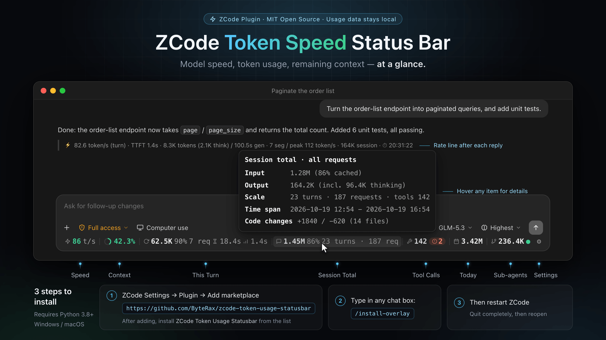

<div align="center">

# ZCodeBox Desktop Enhancement Toolkit

**Model speed, token usage, context and plan quota — at a glance.**

[](LICENSE)
[](https://github.com/ByteRax/zcode-token-usage-statusbar) [](https://github.com/ByteRax/zcode-token-usage-statusbar) [](https://github.com/ByteRax/zcode-token-usage-statusbar)
[](https://qm.qq.com/q/l43Xj8P7mE) [](#-community)

A third-party toolkit for the [ZCode](https://zcode.z.ai) desktop app, with a speed status bar, usage queries and UI enhancements. Its marketplace name remains **ZCode Token Usage Statusbar**; repository URLs and commands are unchanged.

English · [简体中文](README.md)



Promotional image with staged UI and demonstration data; the actual interface varies by version and configuration.

</div>

## Quick start

### What you need

- The **ZCode desktop app**: Windows and macOS are the primary targets. Linux has path and permission adaptations, but not every distribution has been tested on-device.
- **Python 3.8+** with the standard-library `sqlite3` module. No third-party Python packages are required.
- No separate Node.js or npm installation is needed; the desktop bar uses ZCode's bundled Node runtime.

### Installation

Send this to ZCode to install or update the plugin:

```text
Please install or update and enable this ZCode plugin: https://github.com/ByteRax/zcode-token-usage-statusbar#plugin-releases
Then run /install-overlay in the ZCode chat. Once you confirm the status bar installation succeeded, remind me to quit ZCode completely and reopen it (closing the window is not enough); do not restart it automatically.
If installation fails, explain why. If you cannot run the command in the current session, ask me to run it manually; do not skip this step or claim installation succeeded.
```

If GitHub is unreachable, use this instead (keep `.git` in the URL; this route requires local [Git](https://git-scm.com/downloads)):

```text
Please install or update and enable this ZCode plugin: https://gitcode.com/tanranran/zcode-token-usage-statusbar.git#plugin-releases-gitcode
Then run /install-overlay in the ZCode chat. Once you confirm the status bar installation succeeded, remind me to quit ZCode completely and reopen it (closing the window is not enough); do not restart it automatically.
If installation fails, explain why. If you cannot run the command in the current session, ask me to run it manually; do not skip this step or claim installation succeeded.
```

Keep `#plugin-releases` / `#plugin-releases-gitcode` in the URLs: they select the project's stable release channels.

> **Important:** installing the bar modifies ZCode's program files (`app.asar`), so proceed only if you trust the project. **After the first successful injection, quit ZCode completely and reopen it** (closing the window or reopening a session is not enough), then check that the bar appears. If installation fails or permissions are insufficient, diagnose that first; restarting does not replace installation.

If the bar is still missing after a successful installation and full restart, send this to ZCode:

```text
Please investigate why the status bar or toolbar chips from https://github.com/ByteRax/zcode-token-usage-statusbar are missing. Check whether the plugin is enabled, installation succeeded, the actual loaded path is correct, and the relevant switches are on. Ask for my confirmation before modifying client files. If a report is needed, prepare redacted reproduction steps and a diagnostic summary, then wait for my approval before submitting to https://github.com/ByteRax/zcode-token-usage-statusbar/issues. Do not upload credentials or complete local logs.
```

### Troubleshooting, automatic repair and uninstall

Client upgrades can overwrite injection patches. Keep the plugin enabled and **start or resume a session** to trigger automatic installation/repair; sending another message in an already-open session does not guarantee a trigger. Confirm repair succeeded, then fully quit and reopen ZCode if a restart is required. Insufficient permissions or changes to the host's structure can still prevent repair.

- **Plugin install/update**: `/install-overlay`: open ZCode, start a new session, type `/install-overlay` and press Enter to re-trigger the repair injection; after confirming success, fully restart as instructed.
- **Plugin uninstall**: ① turn off auto-update in ⚙ → ② run `/uninstall-overlay` in chat and confirm success → ③ open **Settings → Plugins → Installed → ZCode Token Usage Statusbar → ⋯ → Uninstall** → ④ fully quit and reopen ZCode. Never uninstall only the plugin and leave the bar injected; for configuration and cache cleanup, see the [full uninstall guide](docs/user-guide.md#彻底卸载) (Chinese).

- [Installation guide](docs/user-guide.md#插件安装) (Chinese)
- [Update and client-upgrade details →](docs/user-guide.md#更新与客户端升级) (Chinese)
- [Feature illustrations](docs/features.md) (Chinese)
- [Quota support matrix](docs/quota-support-audit.md) (Chinese)
- [Architecture and data semantics](docs/design-notes.md) (Chinese)
- [Development and releases](docs/maintaining.md) (Chinese)
- [Tests](tests/README.md) (Chinese)

---

## Feature overview

| Feature | What it does |
|---|---|
| **Status bar statistics** | Follows the session in the current window or pane, showing turn, session, project and daily usage. Hover for input/output, cache hit rate, requests, turns, sessions and timing details. Speed during generation is estimated; stored usage refreshes after completed requests reach the database |
| **Per-answer rate line** | When turn statistics are available, shows output speed, time to first token, output tokens (including reasoning), generation duration and a timestamp, with session average speed and cumulative output when available. Multi-request turns also show segment count and peak speed. Requires the overlay and renderer bridge; not every historical reply has a rate line |
| **Git status** | Shows the branch, upstream status, staged/unstaged/untracked file counts and changed lines. If the working directory is not a repository, summarizes repositories in its direct subdirectories. Reads local Git only, with no network access or repository changes |
| **Plan quota** | Shows account-level plan-window usage, reset times or balance to the left of the context button, with an option to display remaining percentages. Supports sources such as GLM Coding Plan and DeepSeek, plus relays with compatible protocols. See the [quota support matrix](docs/quota-support-audit.md) (Chinese); team plans are not supported yet |
| **Reset-card badge** | Shows available quota reset cards and expiry times for the signed-in account, with countdowns and color warnings near expiry. Requires a ZCode sign-in; unavailable to API-key-only users and team plans |
| **Estimated cost** | Hover turn/session/project/today totals to estimate API cost using official-channel public list prices collected by [models.dev](https://models.dev/). Unmatched models use a fallback average. For reference only, not a bill |
| **One-click context compaction** | After confirmation in the context-button panel, sends `/compact` to the current session without changing the composer draft. Sending a new message during compaction interrupts it |
| **Adjustable auto-compaction threshold** | Set the trigger percentage (30–99%) in ⚙ → General; once the patch is active, the context panel's adjustment link also opens this setting. Leave empty to follow the engine default, which varies by model window. Applies only to supported desktop bundled engines; loading the patch for the first time requires a new session or restart |
| **Enhanced context button** | Adds ring fill, color bands and a percentage to the native context button. Prefers the host's current usage and falls back to database values when parsing is unavailable. Context usage does not occupy a status bar cell |
| **Full project paths** | Shows full paths below folder names in the project-edit dialog. Long paths wrap, multiple folders get separate rows, and clicking a folder row opens it in the system file manager |
| **Wider search dialogs** | Raises the width and height limits of cmdk search dialogs such as the command center, making long entries easier to read. Does not affect every type of dialog |
| **Status phrase rotation** | Off by default. When enabled, rotates customizable phrases in the message-stream loading row during thinking, generation and long-running stages |
| **SSH / WSL remote sessions** | Discovers remotes with trusted identity bindings, queries each server independently and retries failed queries. The query script must be deployed manually on the remote; the plugin does not reconnect the host's SSH session. Cross-machine queries are limited to the desktop snapshot path. See the [remote sessions guide](docs/user-guide.md#远程会话) (Chinese) |
| **Subagent details** | Shows subtask usage, models, running state, speed and estimated cost. Running speed is estimated from text changes and replaced with measured statistics after completion when data is available |
| **Usage queries** | Use `/usage today` in chat, run `python3 zusage.py days 7` from the repository directory, or call the MCP tool `token_usage(scope="today")`. The `current` query selects the most recently active database session, which is not necessarily the focused session |

In ⚙, choose a [Default / Pill / Compact status bar style](docs/user-guide.md#状态条样式) (Chinese), select displayed items, switch between Chinese and English, and set token units. MCP is optional and is not required for the bar. Replace `python3` with `python` if that is your installed interpreter command. Per-answer rate-line labels are currently in Chinese.

## Where these numbers come from

Local usage statistics primarily query ZCode's SQLite database, not billing records. Queries try a read-only connection first and fall back to a regular connection if that fails. Stored usage refreshes when completed requests reach the database, not character by character.

With the renderer bridge, speed during generation is estimated from text changes, then the bar shows the latest turn's measured speed after completion. Without the bridge, it falls back to the latest valid database segment. Session and historical weighted averages are available in the speed popup; the per-answer rate line weights valid request segments from the current turn and excludes tool waits between segments.

The context percentage prefers the host's native button. Its database fallback uses the latest completed request's input divided by the context window, not cumulative session usage. Plan quota and balance are generally queried independently from providers rather than inferred from local token totals. SCNet's credential-free estimate uses a separate ledger and conversion-rate path. See the [data semantics guide](docs/user-guide.md#数据如何计算) (Chinese) for full definitions.

## WorkBuddy support (optional)

The same query library can also read **WorkBuddy**'s local usage: context and window come from `session_usage` in `~/.workbuddy/workbuddy.db`, while per-request **tokens / cache / thinking / credits / tool calls / turns** come from `providerData.rawUsage` in each session transcript (`projects/*/*.jsonl`). Speed is approximated from response windows; **estimated cost** is priced per model at models.dev list rates (¥ when an FX rate is available, otherwise $), and models missing from the price table are reported as unavailable — never as fallback averages or fake zeros.

The overlay is picked per client at startup: ZCode keeps the original asar injection; WorkBuddy has no such chain, so it gets a **CDP-injected status row inside the input card**; every segment shows a **hover card** (speed has a last-8-segment bar chart with the same colour bands and basis text; turn / session / tools / today / context / project each get their own breakdown), with a gear for the full details including estimated cost. It only uses the client's own debug port and never modifies program files. ZCode behaviour is unchanged.

```bash
python zusage.py host                 # self-check: active host, both DB paths, available metrics
python zusage.py --host workbuddy now # query WorkBuddy for one run, no config change
```

To make it permanent, set `"host": "workbuddy"` in `config.json` (or `"auto"` to pick by DB presence); if the DB lives elsewhere use `hosts.workbuddy.db_path` or `ZUSAGE_WORKBUDDY_DB`. The MCP tool gained an optional `host` argument. **The default stays `zcode`** — installing WorkBuddy never changes existing ZCode behaviour.

**To use `/usage` inside the WorkBuddy client itself**, the repo ships a WorkBuddy-only build at `plugins/workbuddy-token-usage/` (MCP + command, no asar injection); install steps are in the [host adapter docs](docs/hosts.md#7-在-workbuddy-客户端里安装可选) (Chinese).

## Privacy and security

- **This is not an official ZCode feature.** It is a community plugin that modifies ZCode's program files (`app.asar`); uninstall removes only the project's own injection.
- **Data and network access:** local usage queries use SQLite and do not upload usage. Quota and reset-card queries contact the relevant services. Estimated cost downloads prices from models.dev and exchange rates from er-api (with exchangerate.fun as a fallback) every 12 hours by default; `pricing.fetch: false` disables these downloads, while hiding cost in the UI does not stop the sync. Plugin updates and release notes also use the network; auto-update can be disabled in ⚙. Remote sessions use configured SSH / WSL channels. These switches are independent: turning quota queries off does not disable all networking.
- **Debug port:** for on-device debugging and automated QA, the plugin attempts to add a Chromium debug port on `9229` by default and preserves any explicitly specified debug port. Other processes on the same machine can read or control ZCode windows through it; do not proxy or forward it to the public internet. Set `ZCODE_DISABLE_FIXED_REMOTE_DEBUGGING_PORT=1` before launching and fully restart to prevent the plugin from adding a port. This does not remove ports enabled through other means. If you do not accept this capability, disable port addition or uninstall the plugin, then restart and verify the result.
- **Credential boundaries:** SSH passwords and private-key passphrases stored in ZCode are not decrypted or reused by the plugin. Quota credentials are not written to logs or diagnostics. Credentials saved through ⚙ persist in the runtime directory's `quota-secrets.json` (with 0600 permissions where supported), and requests go only to the relevant allowed official domains or the configured relay's own domain. The Anthropic source is off by default and may read `~/.claude/.credentials.json` after explicit opt-in. Quota and reset-card queries have separate switches; turn each off to stop both kinds of queries.
- **Token usage is not a bill:** the quota chip may show plan usage or an account balance, depending on the source, but does not provide a cash-spending bill or billing details.

## FAQ

**Why did the bar disappear after a ZCode update?**

- A ZCode update can overwrite the modified program files. Keep the plugin enabled, start or resume a session to trigger repair, confirm it succeeds, then **fully quit and reopen once more** — even if the client upgrade already restarted the app. [Detailed steps →](docs/user-guide.md#zcode-升级后状态条消失) (Chinese)

**Why don't the numbers change continuously?**

- Stored usage refreshes when a completed request reaches the database, not per character. With the renderer bridge, speed can be estimated from text changes during a reply; otherwise it waits for a valid completed database sample. New sessions may not yet have usable statistics.

**Can it show how much money I spent?**

- Not an actual cash bill: no billing details are available here. Hover turn/session/project/today totals for estimated API cost at public list prices (for reference only, not actual charges). Supported quota sources can also show plan usage or account balance through the **quota chip**.

[More troubleshooting →](docs/user-guide.md#排查) (Chinese)

## 💬 Community

- QQ group: **129554306** ([join link](https://qm.qq.com/q/WXuISJK3ug))
- WeChat: add **ByteRax** and ask for an invite

<p>
  
  &nbsp;&nbsp;
  
</p>

## Help improve ZCodeBox

Contributions are welcome: fix bugs, improve documentation, develop extensions or share suggestions. Thanks to everyone contributing code, diagnosing problems, testing versions and supporting the project.

<p align="center">
  <a href="https://github.com/ByteRax/zcode-token-usage-statusbar">
    
  </a>
</p>

## Star History

If ZCodeBox is useful to you, consider [starring the repository](https://github.com/ByteRax/zcode-token-usage-statusbar).

[](https://www.star-history.com/#ByteRax/zcode-token-usage-statusbar&Date)

## License and disclaimer

### Open-source license

This project is released under the [MIT License](LICENSE).

Some interface icons are adapted from [Lucide](https://lucide.dev) (ISC License).

### Disclaimer

- This is a **community-maintained, unofficial enhancement plugin**, not authorized or endorsed by ZCode. ZCode's name, trademarks and official resources belong to their respective rights holders.
- The project modifies `app.asar` to load enhancement code and relies on client internals, page DOM structure and selected engine patches. **Compatibility with every future ZCode version is not guaranteed.** Client updates may break features or require adaptation; assess the risks before production use.
- The software is provided "as is", without express or implied warranties. See the [MIT License](LICENSE) for the full terms and limitations of liability.
