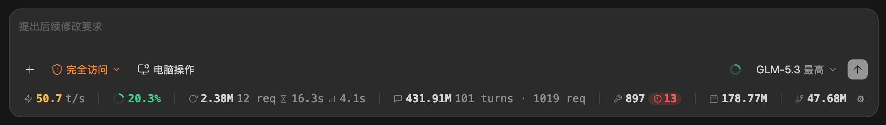

<div align="center">

# ZCode Token Usage Status Bar

**See token usage, model speed and remaining context at a glance.**

A real-time usage bar for your [ZCode](https://zcode.z.ai) conversation window.

English · [简体中文](README.md)

Windows / macOS · Python 3.8+ · [MIT](LICENSE)



</div>

## What it does

- **Track usage**: see the current turn, session and today's totals without opening Settings.
- **Check speed**: see generation speed and the wait for the first token.
- **Watch context**: a color-coded indicator warns as the context window fills up.
- **Inspect details**: hover for cache and thinking tokens, click for subagent usage, and spot tool errors.
- **Make it yours**: use ⚙ to choose visible items, switch languages and manage plugin updates.
- **Query in chat**: use `/usage` for reports; the plugin also adds a rate line to eligible replies.

[Feature screenshots and details →](docs/features.md)

## Quick start

**Using the desktop app?** Choose either installation method below, not both.
**Self-hosting the web UI?** Follow the [Web edition guide](web/README.md) instead.

### One-command installer

Install [Python](https://www.python.org/downloads/) and [Git](https://git-scm.com/downloads), then run in a terminal:

```bash
git clone https://github.com/ByteRax/zcode-token-usage-statusbar.git
cd zcode-token-usage-statusbar
python install.py --lang en
```

On macOS, use `python3 install.py --lang en` if `python` is unavailable.

**After installation succeeds, quit ZCode completely and reopen it.** The bar appears at the bottom of a conversation window.

### Install through ZCode plugins (local directory)

Choose this method to manage installation, enablement and updates inside ZCode. The plugin provides **usage queries, reply rates and plugin updates**. To add the floating bar, use its built-in installer; there is no need to run `python install.py` separately.

Prepare this project's source with a root-level `marketplace.json`, then:

1. Open **Settings → Plugin → Add marketplace**.
2. Click **Choose directory**, select the repository root (not the `plugins/` subdirectory), and add it.
3. Find **ZCode Token Usage Statusbar**, install it and leave it enabled.
4. Start or reopen a session and enter:

   ```text
   /zcode-token-usage-statusbar:install-overlay
   ```

5. After installation succeeds, **quit ZCode completely and reopen it**.

<details>
<summary>Installation screenshot and command alternative</summary>


Alternatively, enter these commands in **ZCode's chat input**, replacing the path with your repository directory:

```text
/plugin marketplace add /absolute/path/to/zcode-token-usage-statusbar
/plugin install zcode-token-usage-statusbar@zusage-marketplace
```

`marketplace add` only adds the marketplace; the second command installs the plugin. Follow steps 4 and 5 to install the bar afterward.

</details>

**Installing the plugin alone does not install the bar.** For query tools and reply rates only, skip steps 4 and 5. The bar installer modifies client files; only run it if you trust this project.

**How do I update it later?**

1. Update your local source, then enter `/plugin marketplace update zusage-marketplace` in ZCode to refresh the marketplace.
2. Update this plugin in **Settings → Plugin → Installed**. With the bar installed, you can also check and update through **⚙ → Plugin updates**.
3. Start or reopen a session afterward. If prompted about changed main-process files, quit ZCode completely and reopen it.

ZCode runs an installed copy: **editing the repository does not update the plugin**, and a local-directory marketplace never runs `git pull` for you.
Make sure the selected source directory contains `marketplace.json`; do not select only the `plugins/` subdirectory.
[More installation, updates and troubleshooting →](docs/user-guide.md#插件安装) (Chinese)

## Everyday use

- **Hover** an item for its detailed figures.
- **Click Sub-agents** for per-task usage.
- **Click ⚙** to hide items, switch language or check for plugin updates.
- **Run `/usage today`** for today's usage, or `/usage week` for the past week.

The plugin command's full name is `/zcode-token-usage-statusbar:usage`.

## Safety and caveats

- **Usage data is not uploaded**: local queries do not use the network. Configured remote sessions read the remote database over your chosen transport. Plugin updates download code over the network.
- **The bar modifies client files**: it is not a native ZCode feature. Removal strips only this project's injection, without reverting the client version.
- **ZCode upgrades may remove the bar**: rerun the installer. The plugin can optionally repair the injection, but a restart is still required.
- **Uninstalling the plugin may leave the bar behind**: follow the removal steps below.

## FAQ

**I installed the plugin. Where is the bar?**

The plugin does not install it automatically by default. Run `install-overlay`, wait for success, then quit and reopen ZCode.

**Why don't the numbers change continuously?**

They mainly refresh when a model request completes, not with each streamed token. A new session with no requests can show zeros.

**Why do some replies have no rate line?**

Pure Q&A and questions with no stored request data omit it rather than reuse the previous turn. Disable it with the per-answer rate toggle in ⚙.

**Does this show my bill or plan balance?**

It shows token usage, not billing. Use ZCode's official pages for pricing and plan limits.

[More troubleshooting, automatic updates and remote setup →](docs/user-guide.md) (Chinese)

## Uninstall

**One-command installation**: run this from the repository, then quit and reopen ZCode:

```bash
python install.py --remove
```

**Plugin installation**: follow this order so the bar is removed along with the plugin:

1. Turn off automatic updates in ⚙ and let any update already running finish.
2. Run `/zcode-token-usage-statusbar:uninstall-overlay` and confirm success.
3. Open **Settings → Plugin → Installed → ZCode Token Usage Statusbar → ⋯ → Uninstall**.
4. Quit ZCode completely, reopen it and confirm the bar is gone.

<details>
<summary>Uninstall screenshot (Chinese UI)</summary>


</details>

To remove settings, caches and the marketplace too, follow the [full cleanup guide](docs/user-guide.md#彻底卸载) (Chinese).

## More documentation

Detailed desktop guides are currently in Chinese.

- [Feature screenshots](docs/features.md) · [Installation, configuration and troubleshooting](docs/user-guide.md)
- [Web edition](web/README.md) · [Architecture and data semantics](docs/design-notes.md)
- [Development and releases](docs/maintaining.md) · [Tests](tests/README.md)

[MIT License](LICENSE)
