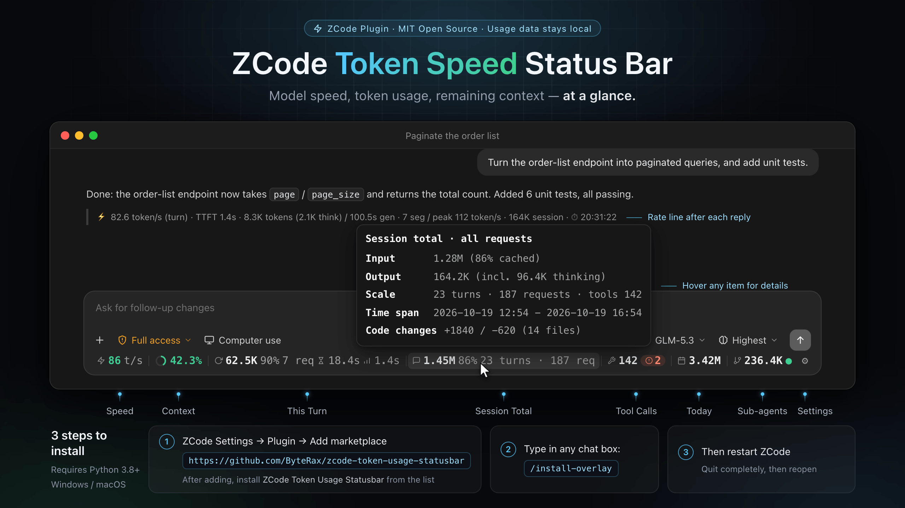

<div align="center">

# ZCode Token Speed Status Bar

**See model speed, token usage and remaining context at a glance.**

A real-time speed bar for your [ZCode](https://zcode.z.ai) conversation window.

English · [简体中文](README.md)

Windows / macOS / Linux · Python 3.8+ · [MIT](LICENSE)



</div>

## What it does

- **Check speed**: see generation speed and the wait for the first token.
- **Track usage**: see the current turn, session and today's totals without opening Settings.
- **Watch context**: a color-coded indicator warns as the context window fills up.
- **Inspect details**: hover for cache and thinking tokens, click for subagent usage, and spot tool errors.
- **Make it yours**: use ⚙ to choose visible items, switch languages and manage plugin updates.
- **Query in chat**: use `/usage` for reports; the plugin also adds a rate line to eligible replies.
- **Follow remote sessions**: adapt to connected SSH workspaces and route by `workspaceIdentity` across servers, with separate daily totals and errors. Failed or not-yet-found sessions keep retrying; resumed sessions and reconnects continue querying. See the remote section below.

[Feature screenshots and details →](docs/features.md)

## Quick start

> ⚠️ **The floating bar does not appear immediately after its first installation. Quit ZCode completely and restart it to load the bar. Closing the window alone is not enough.**

**Using the desktop app?** Plugin installation is recommended; the one-command installer below is an alternative. Do not install both.
**Self-hosting the web UI?** Follow the [Web edition guide](web/README.md) instead.

### Install through ZCode plugins

The plugin provides **usage queries, reply rates and plugin updates**. Install [Python 3.8+](https://www.python.org/downloads/), then choose either method below.

#### Method 1: remote installation (no source download needed)

Enter these commands in **ZCode's chat input**, in order:

```text
/plugin marketplace add ByteRax/zcode-token-usage-statusbar#plugin-releases
/plugin install zcode-token-usage-statusbar@zusage-marketplace
```

Alternatively, open **Settings → Plugin → Add marketplace**, enter `https://github.com/ByteRax/zcode-token-usage-statusbar#plugin-releases`, then find and install **ZCode Token Usage Statusbar**. This channel installs verified stable Release assets, not development branch code.

#### Method 2: local-directory installation

Download or clone this repository, then:

1. Open **Settings → Plugin → Add marketplace** and click **Choose directory**.
2. Select the repository root containing `marketplace.json` (not the `plugins/` subdirectory) and add it.
3. Find **ZCode Token Usage Statusbar** and install it.

Or enter these commands in ZCode, replacing the path with your repository directory:

```text
/plugin marketplace add /absolute/path/to/zcode-token-usage-statusbar
/plugin install zcode-token-usage-statusbar@zusage-marketplace
```

<details>
<summary>Add marketplace screenshot</summary>


</details>

#### Add the floating bar

> **Scope:** References to automatic bar installation/repair being enabled by default apply only to the current `main` / newer local source, not yet published to the stable channel. Stable `v1.4.1` from `#plugin-releases` still defaults to disabled; run `/install-overlay`, or merge `"plugin_auto_install_overlay": true` into the config file below and start or resume a session.

After installing the newer local source plugin from the current `main`, leave the plugin enabled and start or reopen a session. The plugin automatically installs/repairs the bar by default. **This modifies the client's `app.asar`; only enable it if you trust this project. After installation succeeds, quit ZCode completely and reopen it.** Closing the window alone is not enough.

If automatic installation fails, use this manual fallback and follow the actual output to troubleshoot. A full restart is still required after success:

```text
/install-overlay
```

**Only want queries and reply rates?** Merge `"plugin_auto_install_overlay": false` into `~/.zcode/zcode-token-usage-statusbar/config.json` without replacing other settings, or run `/uninstall-overlay` to remove the bar and keep an uninstall opt-out that blocks automatic reinjection and installation reminders.

A missing config file or key defaults to enabled; an existing explicit `false` is preserved. `ZUSAGE_PLUGIN_AUTO_INSTALL=1` / `0` takes precedence over config, but never bypasses the uninstall opt-out. Without an environment override, corrupt config or a non-boolean value does not enable automatic installation.

**How do I update it later?**

- **Remote installation**: enter `/plugin marketplace update zusage-marketplace` in ZCode, then update this plugin in **Settings → Plugin → Installed**.
- **Local installation**: update your source first, then follow the same refresh and update steps. The local marketplace never runs `git pull` for you.
- Start or reopen a session afterward. If prompted about changed main-process files, quit ZCode completely and reopen it.

Use the `#plugin-releases` stable channel for remote installs; its catalog matches the asset URL, version and SHA256. Existing default-branch or local-directory registrations do not switch automatically; see the [migration guide](docs/user-guide.md#切换已有市场到正式渠道) (Chinese).
[More installation, updates and troubleshooting →](docs/user-guide.md#插件安装) (Chinese)

### One-command installer (without plugins)

Install [Python](https://www.python.org/downloads/) and [Git](https://git-scm.com/downloads), then run in a terminal:

```bash
git clone https://github.com/ByteRax/zcode-token-usage-statusbar.git
cd zcode-token-usage-statusbar
python install.py --lang en
```

On macOS, use `python3 install.py --lang en` if `python` is unavailable.

**After installation succeeds, quit ZCode completely and reopen it.** The bar appears at the bottom of a conversation window.

## Everyday use

- **Hover** an item for its detailed figures.
- **Click Sub-agents** for per-task usage.
- **Click ⚙** to hide items, switch language, switch token counts to 万/亿 units (Chinese UI only, on by default) or check for plugin updates.
- **Run `/usage today`** for today's usage, or `/usage week` for the past week.

The plugin command's full name is `/zcode-token-usage-statusbar:usage`.

## SSH remote support (current main)

> These features are in the current `main` / newer local source and **have not been published as a stable Release**. Editing the repository does not update a running plugin or injection. Update the local installed plugin copy/runtime files, complete installation or repair, then **quit ZCode completely and restart it**. An existing stable-channel installation does not imply these features are present.

### Features and data sources

- **Automatic connection adaptation**: derive query transports from saved SSH workspace connection settings, and identify remote sessions using the current workspace identity supplied by the host. Automatic mode queries only confirmed remote scopes; it does not probe historical servers with unknown local session IDs.
- **Precise multi-server routing**: use the session ID together with `workspaceIdentity` to select its server. Manual targets need the matching `identity`, not just a host label. Matching IDs alone do not merge data across workspaces, windows or servers.
- **Separate daily totals and errors**: each target keeps its own `today` and error state. A remote total is not substituted for local or another server's daily total, and a failing target should not block other sources.
- **Continued recovery**: failed or not-yet-found sessions keep retrying with backoff rather than being permanently abandoned. After resuming a historical session, switching workspaces or reconnecting SSH, remote queries continue only when a reliable identity is available. An unconfirmed identity is not guessed.

**Main-pane ownership**: the main tab (`workspace-main`) reads the current "session → workspace identity" pairing from the primary binding the host persists for each workbench group. When the current main session is bound as the primary session of exactly one group and that workspace is remote, it routes automatically. Any second distinct ownership for the same SID (including a local main-leaf group: windows share one localStorage and cannot be told apart), an untrusted identity, or a contradiction with the task list is treated as ambiguity and keeps the pane local-only. Partial remote IPC, historical candidates and legacy manual single-channel queries still do not constitute main-pane ownership evidence; when ownership is unknown only local `sids` are reported, remote data of another pane with the same SID is not shared, and an unknown main pane shows a local match or 0. The right pane explicitly bound to a remote workspace still routes automatically and can be used for remote statistics.

### Prerequisites and limits

1. **Manually deploy the matching `zusage.py` on each SSH server**, by default at `~/.zcode/zcode-token-usage-statusbar/zusage.py`. The server needs Python 3.8+ and permission to read that user's ZCode database. Adapting a connection does not install the remote script; this is not a completely zero-configuration setup.
2. The local query transport must work non-interactively. The plugin **cannot decrypt and reuse** passwords, encrypted private keys or passphrases saved by the client. Configure SSH keys/agent authentication yourself. The plugin does not automatically log in or handle authentication prompts.
3. Remote queries include a recursion guard. Run only the query script remotely; no desktop bar installation or further remote forwarding is required there.
4. This support covers only the **desktop bar's JSON query chain**. MCP, `/usage` and reply rate lines do not automatically fetch data across machines. Pure CLI use has no bar UI; self-hosted Web follows its separate deployment guide.
5. Automated fixtures verify routing and recovery logic, not live acceptance on every desktop version, SSH authentication method or multi-server environment.

### Switches and manual targets

`remote.auto` defaults to `true` independently of the legacy single-channel switch. `remote.enabled: false` preserves manual opt-out from legacy `ssh`/unscoped fallback; it does not disable automatic identity routing. Manual `targets` with `identity`/`identities` override automatic targets for the same identity. With discovery off, explicitly set `enabled: true` to use manual targets. Merge only the needed fields and replace the sample identity with the client's actual `workspaceIdentity`:

```json
{
  "remote": {
    "auto": true,
    "enabled": false,
    "targets": [
      {
        "identity": "remote:ssh:build.example.com:22:alice:/srv/build",
        "ssh": "ssh alice@build.example.com",
        "host_label": "build"
      }
    ]
  }
}
```

Unset target `script`, `python` and `timeout_s` inherit from the top-level `remote` section (per-target timeout is bounded to 1–6 seconds). To stop all remote queries, set both `auto: false` and `enabled: false`; keep `targets` configured without executing them. `enabled: true` allows the legacy CLI `python3 zusage.py json <SID>` (SID/comma-list protocol) to use a default single-channel fallback. The desktop always sends JSON requests; `scopes: []` forbids this fallback. An unknown main pane does not borrow that channel to query remotely or guess historical identity.

Failures retain the last successful workspace snapshot with stale/error feedback; a first failure without cache shows zeros, never local daily totals. Null/error responses do not clear the last successful display. Remote polling defaults to 3 seconds (minimum 1 second), with continued backoff for failed/unknown sessions. Re-enabling queries and changes to config/connection settings are detected by the heartbeat (default 30 seconds, minimum 10 seconds).

**Recovery boundary**: the plugin does not reconnect the host's SSH connection. Recovery means continued statistics-query retries and resuming after the host reconnects. Missing trusted identity is not guessed; reopening the workspace or completely restarting does not guarantee identification of the main pane.

See the [remote session guide](docs/user-guide.md#远程会话) (Chinese) for switches, identity-bearing multi-server examples and recovery troubleshooting. Merge only the needed fields and preserve your settings.

## Safety and caveats

- **Usage data is not uploaded**: local queries do not use the network. Enabled remote queries read remote databases through the chosen transport; see [SSH remote support](#ssh-remote-support-current-main) for prerequisites and limits. Plugin updates download code over the network.
- **The bar modifies client files**: it is not a native ZCode feature. Removal strips only this project's injection, without reverting the client version.
- **ZCode upgrades may remove the bar**: the plugin repairs the injection by default; quit completely and reopen after success. Use the installer as a fallback if automatic repair fails.
- **Uninstalling the plugin may leave the bar behind**: follow the removal steps below.

## FAQ

**I installed the plugin. Where is the bar?**

Leave the plugin enabled and start or reopen a session to trigger automatic installation/repair, then quit ZCode completely and reopen after success. If automatic installation fails, use `install-overlay` as a fallback and check permissions, config and the uninstall opt-out. Restarting alone cannot repair a bar that was not successfully installed.

**Why don't the numbers change continuously?**

They mainly refresh when a model request completes, not with each streamed token. A new session with no requests can show zeros.

**Why do some replies have no rate line?**

Pure Q&A and questions with no stored request data omit it rather than reuse the previous turn. Disable it with the per-answer rate toggle in ⚙. After a full restart, restored historical turns may lack valid output statistics. Without a retained line or full-text cache in the current overlay, those turns get neither fabricated statistics nor a misleading “turn stats unavailable” line. Older statistics stored in the message body are unaffected.

**Does this show my bill or plan balance?**

It shows token usage, not billing. Use ZCode's official pages for pricing and plan limits.

[More troubleshooting, automatic updates and remote setup →](docs/user-guide.md) (Chinese)

## Uninstall

**One-command installation**: run this from the repository, then quit and reopen ZCode:

```bash
python install.py --remove
```

**Plugin installation**: follow this order so the bar is removed along with the plugin:

1. Turn off automatic updates in ⚙ and let any update already running finish.
2. Run `/uninstall-overlay` and confirm success.
3. Open **Settings → Plugin → Installed → ZCode Token Usage Statusbar → ⋯ → Uninstall**.
4. Quit ZCode completely, reopen it and confirm the bar is gone.

<details>
<summary>Uninstall screenshot (Chinese UI)</summary>


</details>

To remove settings, caches and the marketplace too, follow the [full cleanup guide](docs/user-guide.md#彻底卸载) (Chinese).

## More documentation

Detailed desktop guides are currently in Chinese.

- [Feature screenshots](docs/features.md) · [Installation, configuration and troubleshooting](docs/user-guide.md)
- [Web edition](web/README.md) · [Architecture and data semantics](docs/design-notes.md)
- [Development and releases](docs/maintaining.md) · [Tests](tests/README.md)

[MIT License](LICENSE)
