<div align="center">

# ZCodeBox Desktop Enhancement Toolkit

**Model speed, token usage, context and plan quota — at a glance.**

[](LICENSE)
[](https://github.com/ByteRax/zcode-token-usage-statusbar) [](https://github.com/ByteRax/zcode-token-usage-statusbar) [](https://github.com/ByteRax/zcode-token-usage-statusbar)
[](https://qm.qq.com/q/l43Xj8P7mE) [](#-community)

A community toolkit for [ZCode](https://zcode.z.ai) desktop that puts generation speed, token usage, context fill, plan quota and handy helpers right in your interface (marketplace name: **ZCode Token Usage Statusbar**).

English · [简体中文](README.md)

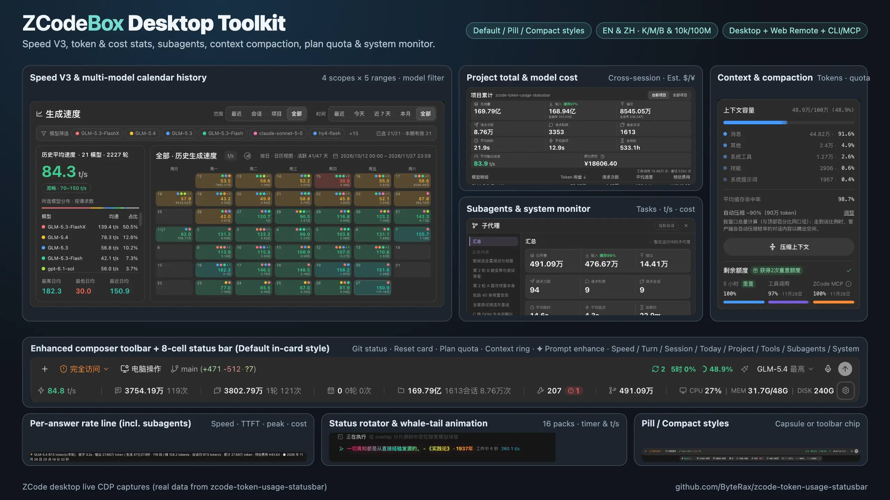

The cover uses cropped screenshots from ZCode desktop. Interface labels in the live captures are in Chinese.

</div>

## Quick start

### What you need

- **ZCode desktop app**: Windows and macOS are supported (Linux has basic path and permission support, not tested on every distro).
- **Python 3.8+**: System Python works out of the box — **no extra Python packages or Node.js required**.
- **Optional MCP queries**: `token_usage` requires **ZCode 3.19.0+**. Older builds still work with the status bar, `/usage` command and CLI.
- **Context Insights panels (ZCode 4.0+)**: "Context Insights" in the left nav shows cross-session usage; the "Context" side tab shows the current session's composition, per-turn messages, errors and retries. Send `/context` in chat for an AI summary. Details in the [user guide](docs/user-guide.md#上下文洞察与上下文组成) (Chinese).

### Installation

Send this message directly to ZCode to install or update the plugin (if GitHub is unreachable, it retries automatically via the mirror):

```text
Please install or update the ZCode plugin zcode-token-usage-statusbar. Follow the three steps below exactly and do not look for another installation method:

1. Add the marketplace and install the plugin with ZCode's own command line. There is no separate zcode command: set the environment variable ELECTRON_RUN_AS_NODE=1, run the ZCode executable, and pass resources/glm/zcode.cjs from the installation directory as its first argument. On macOS the defaults are /Applications/ZCode.app/Contents/MacOS/ZCode and /Applications/ZCode.app/Contents/Resources/glm/zcode.cjs. On Windows ZCode.exe and resources\glm\zcode.cjs sit in the same installation directory; when it is not in the default location, find the running ZCode.exe with (Get-Process ZCode).Path in PowerShell. Run these two commands in that command line, in order:
   plugins marketplace add "https://github.com/ByteRax/zcode-token-usage-statusbar#plugin-releases" --json
   plugins install "zcode-token-usage-statusbar@zusage-marketplace" --scope user --json
   If the first one fails (usually because GitHub is unreachable), retry with the address https://gitcode.com/tanranran/zcode-token-usage-statusbar.git#plugin-releases-gitcode instead; do not ask me again.
2. Run python3 "<installPath from the second command's output in step 1>/overlay_install.py" install (on Windows, if python3 is unavailable, try python and then py -3).
3. Report step 2's output to me: when it asks for a restart, remind me to quit ZCode completely (from the menu or the tray; closing the window is not enough) and reopen it; do not restart it automatically.

If any step fails, relay the error as is; do not skip it and do not claim installation succeeded.
```

> **Note**:
> - The mirror route requires local [Git](https://git-scm.com/downloads), and `#plugin-releases` / `.git#plugin-releases-gitcode` must stay in the URLs.
> - Installing the bar modifies ZCode's `app.asar`, so proceed only if you trust this project. **Quit ZCode completely** (from the menu or tray, not just closing the window) and reopen it after installation.

If the bar is still missing after restarting, run `/zusage-doctor` in a new session for a read-only check-up; to ask ZCode to investigate further, send:

```text
Please investigate why the status bar or toolbar chips from https://github.com/ByteRax/zcode-token-usage-statusbar are missing. Check whether the plugin is enabled, installation succeeded, the actual loaded path is correct, and the relevant switches are on. Ask for my confirmation before modifying client files. If a report is needed, prepare redacted reproduction steps and a diagnostic summary, then wait for my approval before submitting to https://github.com/ByteRax/zcode-token-usage-statusbar/issues. Do not upload credentials or complete local logs.
```

### Mobile remote page (current source feature)

To see the same status bar in your mobile or browser remote page: install the [regular mobile userscript](https://raw.githubusercontent.com/ByteRax/zcode-token-usage-statusbar/main/zusage-mobile.user.js) in Tampermonkey, turn on push in desktop **⚙ → Maintenance → Mobile remote control**, then enable **Web Remote Control** and open `https://zcode.z.ai/remote/` (see the [mobile remote guide](docs/user-guide.md#手机远控页面) (Chinese)).

### Troubleshooting, automatic repair and uninstall

ZCode updates can overwrite the patch. Keep the plugin enabled and **start or resume a session** to trigger auto-repair, then fully quit and reopen ZCode.

- **Manual repair / reinstall**: Run `/install-overlay` in a new session.
- **Read-only check-up**: Run `/zusage-doctor` in a new session to see what is wrong and how to fix it.
- **Clean uninstall**: ① Turn off auto-update in ⚙ → ② Run `/uninstall-overlay` in chat → ③ Uninstall the plugin in **Settings → Plugins → Installed** → ④ Quit ZCode completely and reopen it (see the [full uninstall guide](docs/user-guide.md#彻底卸载) (Chinese)).

More docs: [Installation guide](docs/user-guide.md#插件安装) (Chinese) · [Updates & upgrades](docs/user-guide.md#更新与客户端升级) (Chinese) · [Feature illustrations](docs/features.md) (Chinese) · [Quota support matrix](docs/quota-support-audit.md) (Chinese) · [Architecture & data](docs/design-notes.md) (Chinese) · [Development & releases](docs/maintaining.md) (Chinese) · [Tests](tests/README.md) (Chinese)

---

## Feature overview

Click a preview to open it full size. Live captures show the Chinese UI. Previews marked “Demo” use sample data.

| Feature | What it does | Screenshot |
|---|---|---|
| **Speed V3 & history trends** | Follows the active window/pane with thinking/tool timers and output speed; hover to filter per-model speeds, shares, calendar heatmaps and bar charts across 4 scopes × 5 time ranges | <a href="docs/promo/features/live/status-bar.webp">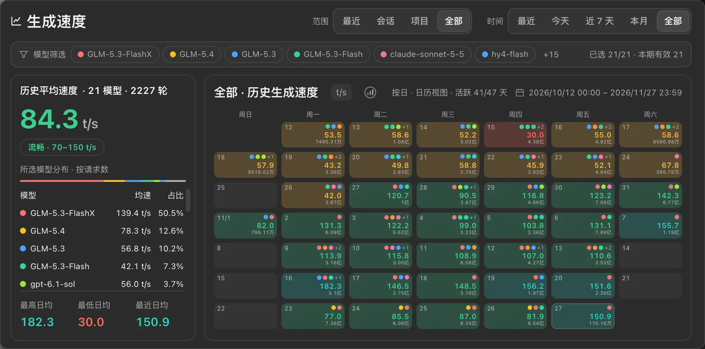</a> |
| **Three bar styles & layout** | Switch between Default (in-card), Pill (floating capsule) and Compact (toolbar speed chip) styles with alignment, drag reordering and priority folding into `···` | <a href="docs/promo/features/live/pill-bar.webp">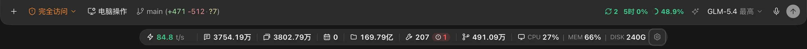</a> |
| **Turn & session breakdowns** | Tracks current-turn and whole-session tokens, cache hit rates, request counts, latency and per-model breakdowns independently across windows, split panes and side chats | <a href="docs/promo/features/live/session.webp">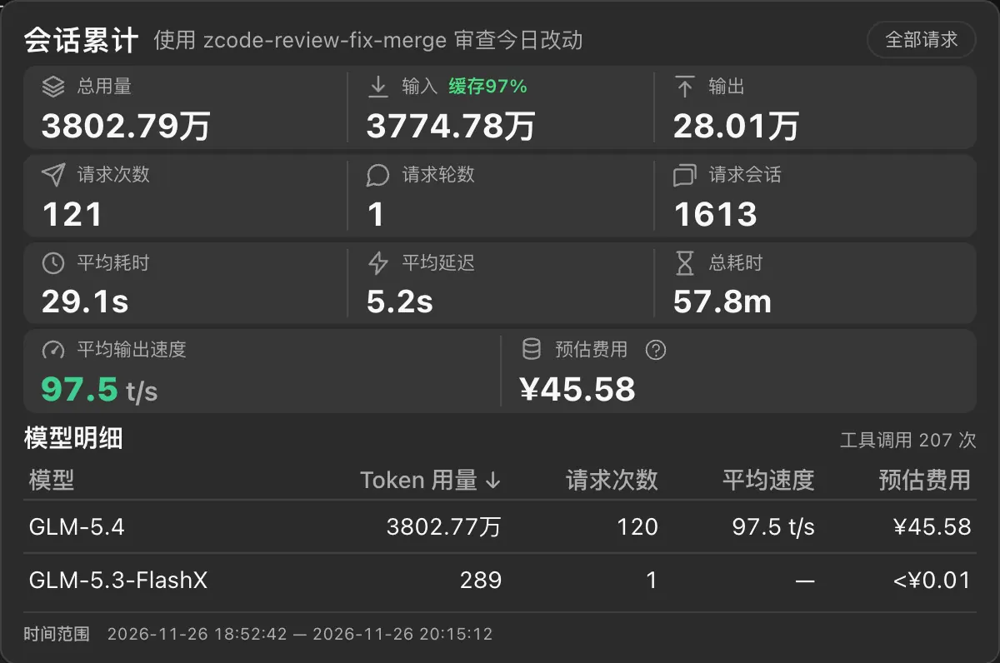</a> |
| **Project total & cross-project view** | Aggregates cross-session tokens, turns, duration, average speed and per-model costs for the current workspace, or switch to All Projects to compare workspaces | <a href="docs/promo/features/live/project.webp">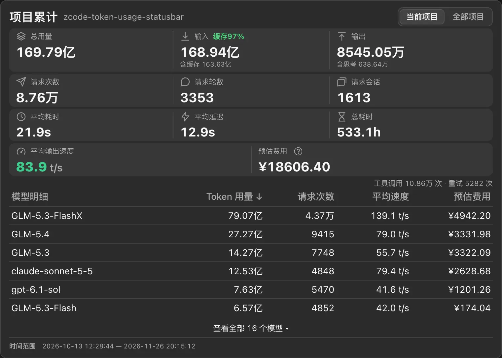</a> |
| **Tool calls & error monitor** | Counts tool invocations in the session and lights up a red error badge on failures; hover for per-tool call counts, cumulative duration and error counts | <a href="docs/promo/features/live/tools.webp">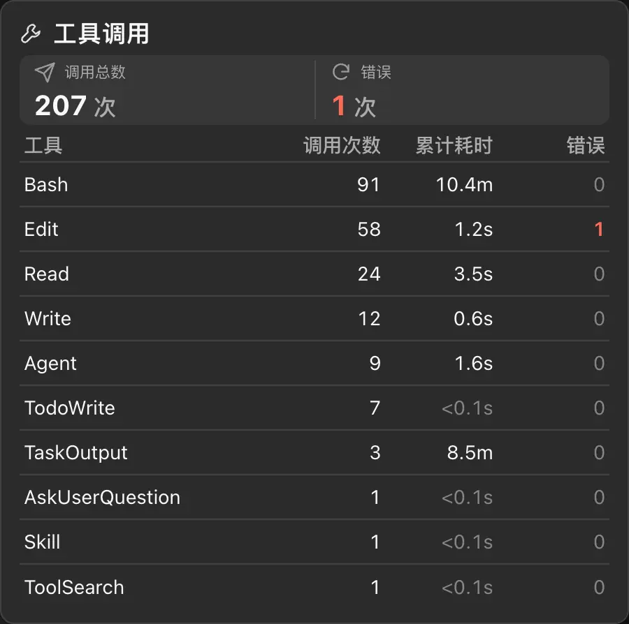</a> |
| **Per-answer rate line** | Appends a compact summary line under each completed reply: model, output speed, time to first token, output tokens, duration, peak speed and est. cost (also in subagent panes) | <a href="docs/promo/features/live/reply-rate.webp">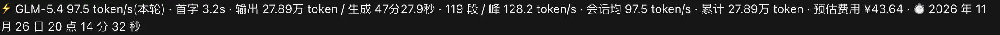</a> |
| **Git status** | Shows current branch, ahead/behind status, changed files and line counts; summarizes subdirectory repos if not in a repo root, and tracks managed worktree sessions automatically. Read-only, never modifies your repo | <a href="docs/promo/features/live/git.webp">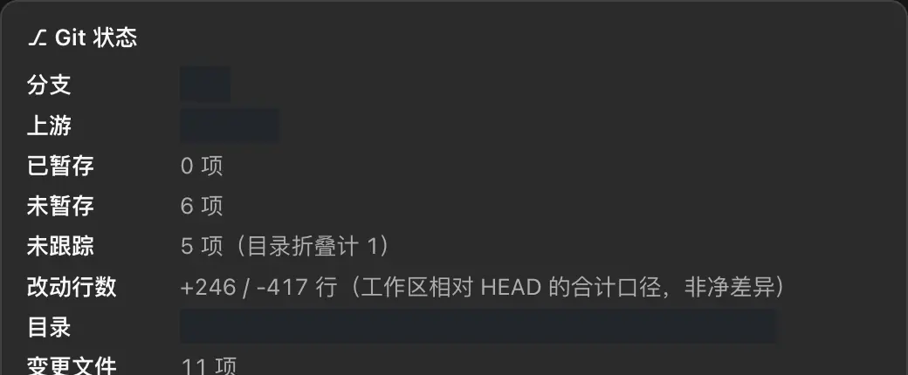</a> |
| **System status** | Optional 8th cell (enable in ⚙): local CPU, memory and free disk space with color warnings when running low; monitors only the machine running ZCode | <a href="docs/promo/features/en/system.webp">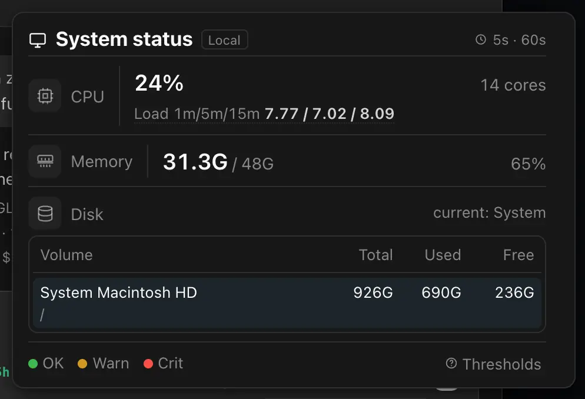</a><br><sub>Demo</sub> |
| **Plan quota & multi-provider sources** | Displays plan usage, reset times or balance next to the context button, with an option to show remaining percentages. Supports GLM, Start Plan, Qianwen, DeepSeek, OpenCode Go, R4 Coder, StepFun and more (see [quota matrix](docs/quota-support-audit.md) (Chinese)) | <a href="docs/promo/features/live/quota.webp">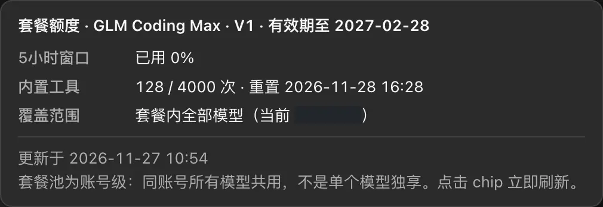</a> |
| **Reset-card badge** | Shows available quota reset cards and expiry countdowns for signed-in ZCode accounts, with per-card expiry and recent reset history on hover | <a href="docs/promo/features/live/reset-card.webp">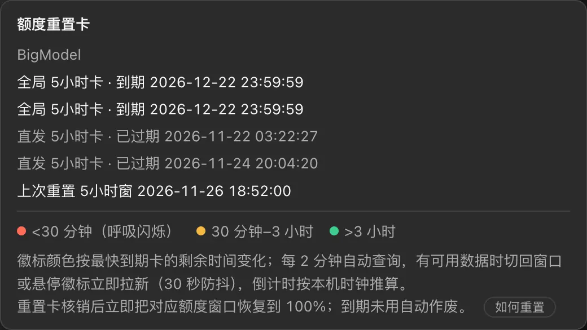</a> |
| **Model picker peak-factor badges** | Shows current-window quota multipliers (e.g., `0.67×` / `2.00×`) on GLM Coding Plan model rows; hover for peak (Mon–Fri 14:00–18:00) and off-peak rates | <a href="docs/promo/features/en/peak-factor.webp">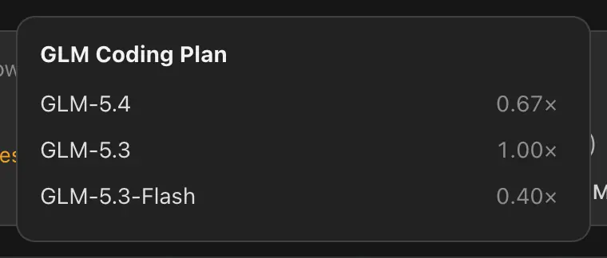</a><br><sub>Demo</sub> |
| **Pull model list & probing** | Pulls model lists for custom providers and plan sources in one click; tests connectivity and reasoning effort and fills missing context/output limits (probing sends minimal requests and may use quota) | <a href="docs/promo/features/en/model-pull.webp">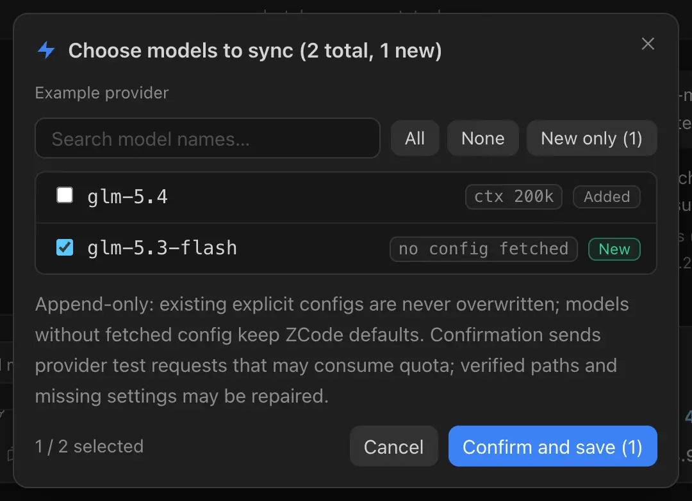</a><br><sub>Demo</sub> |
| **Prompt enhance & history** | ✦ button next to the model picker rewrites your draft; hover to view recent enhancement records (original vs. enhanced text, tokens and duration) or configure a dedicated model | <a href="docs/promo/features/en/prompt-enhance.webp">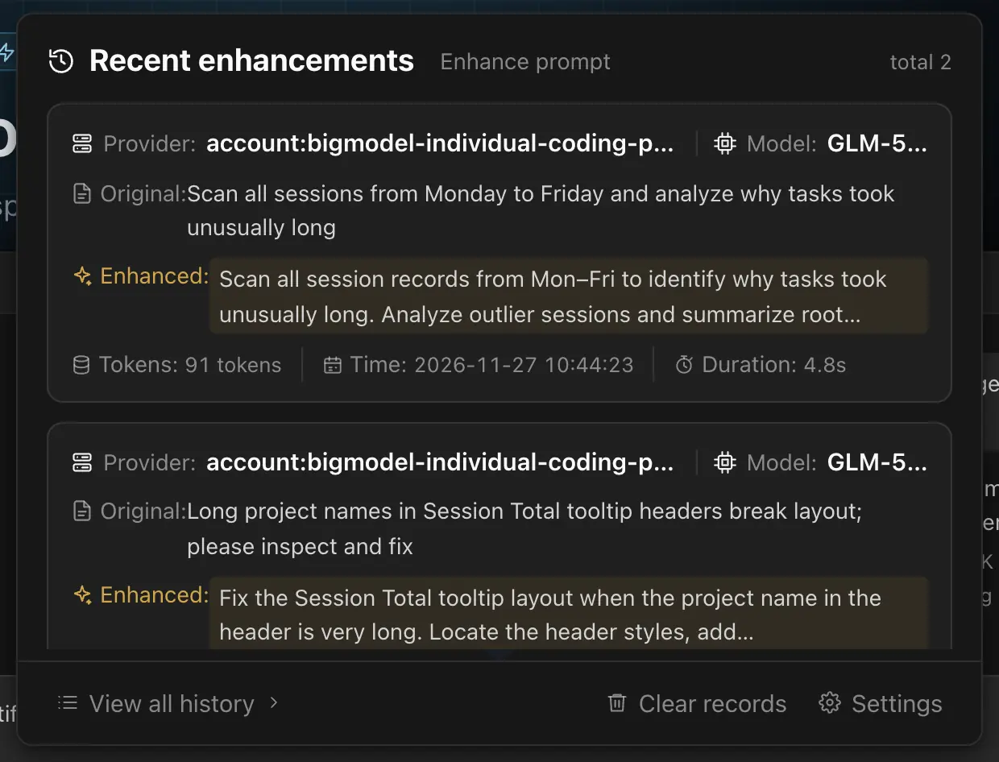</a><br><sub>Demo</sub> |
| **Estimated cost** | Hover turn, session, project, daily or subagent totals to see estimated API cost at public list prices, with USD (`$`) / CNY (`¥`) switching; for reference only, not a bill | <a href="docs/promo/features/en/estimated-cost.webp">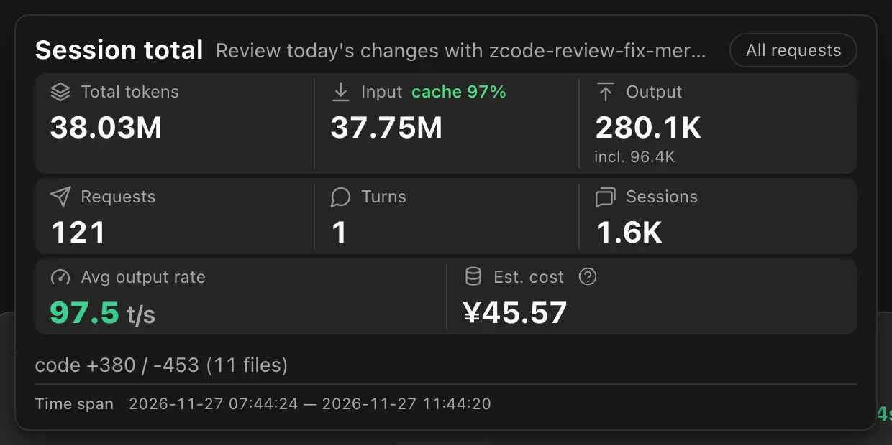</a><br><sub>Demo</sub> |
| **Enhanced context button** | Adds a progress ring, warning colors and percentage directly on the native context button without taking a status-bar slot | <a href="docs/promo/features/live/context-ring.webp">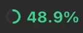</a> |
| **Context breakdown details** | Adds estimated token counts to each category in the Context Capacity popover; hover items for plain-language tips, file paths and cache hit-rate details (toggleable in ⚙) | <a href="docs/promo/features/live/context-breakdown.webp">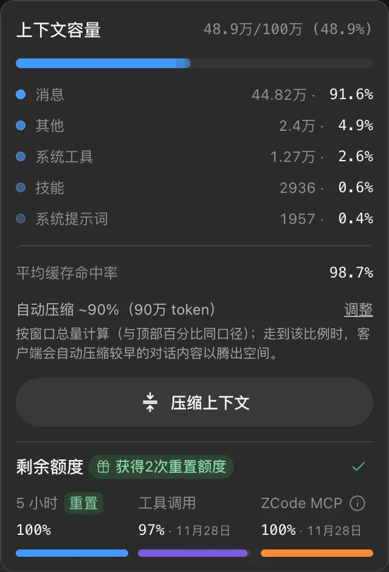</a> |
| **One-click compaction & divider stats** | Sends `/compact` after confirmation in the context panel without touching your composer draft, and annotates timeline compaction dividers with before/after context drop and duration | <a href="docs/promo/features/live/compact.webp">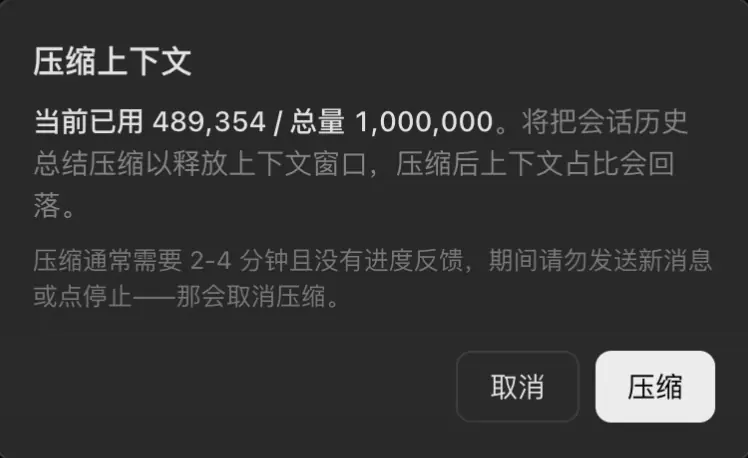</a> |
| **Adjustable auto-compaction threshold** | Set when auto-compaction triggers (30–99% or token count like `100k`) in ⚙ → General; leave blank for engine default. Supports bundled engines only; first activation requires a new session or restart | <a href="docs/promo/features/live/auto-compact.webp">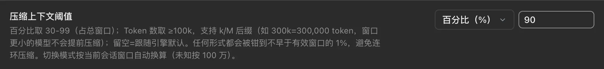</a> |
| **Project quick-open & full paths** | Adds "Open in Finder / File Explorer" to local project context and "⋯" menus; shows clickable full paths in the project-edit dialog | <a href="docs/promo/features/en/project-folder.webp">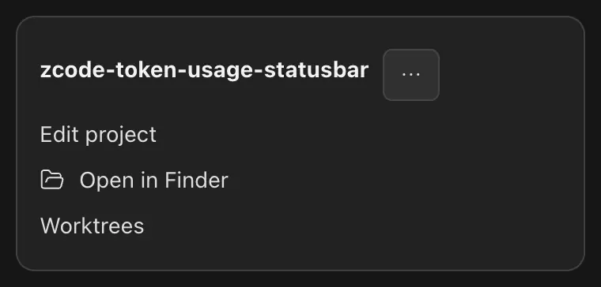</a><br><sub>Demo</sub> |
| **Wider search dialogs** | Expands search dialogs such as the command center so long titles and paths are easy to read | <a href="docs/promo/features/en/search.webp">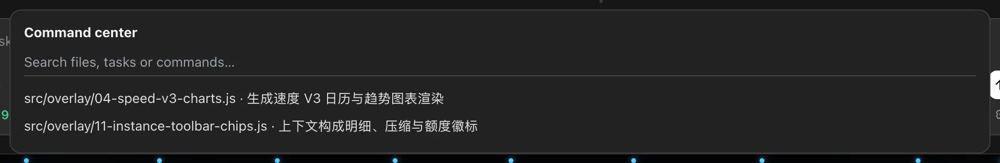</a><br><sub>Demo</sub> |
| **Status phrase rotation** | Off by default; rotates customizable phrases (16 built-in packs and schedule presets) while thinking or generating, with working-time counter and estimated t/s speed | <a href="docs/promo/features/live/rotator.webp"></a> |
| **SSH / WSL remote sessions** | Queries and displays usage independently for remote SSH or WSL sessions (requires deploying the query script on the remote; see [remote guide](docs/user-guide.md#远程会话) (Chinese)) | <a href="docs/promo/features/en/ssh.webp">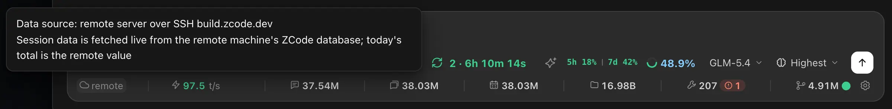</a><br><sub>Demo</sub> |
| **Web remote status bar** | Reuses the desktop status bar, tooltips and settings on the web remote page via userscript (see [mobile remote guide](docs/user-guide.md#手机远控页面) (Chinese)) | <a href="docs/promo/features/live/web-remote.webp">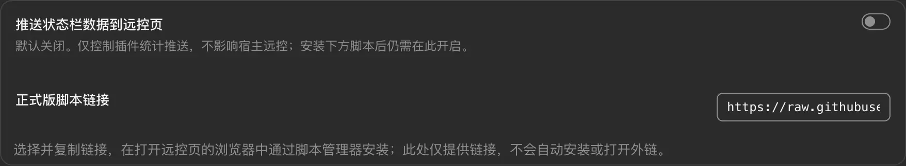</a><br><sub>Desktop settings entry</sub> |
| **Subagent & workflow details** | Tracks background subagents and dynamic workflow cards separately; expands to show per-task model, status, speed and cost, plus inline t/s badges on Agent rows | <a href="docs/promo/features/en/subagents.webp">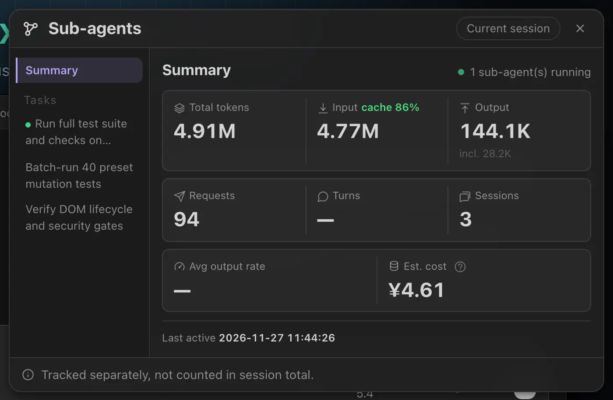</a><br><sub>Demo</sub> |
| **Auto-update, changelog & doctor** | Supports GitHub / GitCode release channels, built-in release notes viewer, local hotfix preservation, restart-needed badge, one-click ZCode restart and `/zusage-doctor` check-up | <a href="docs/promo/features/live/update-notes.webp">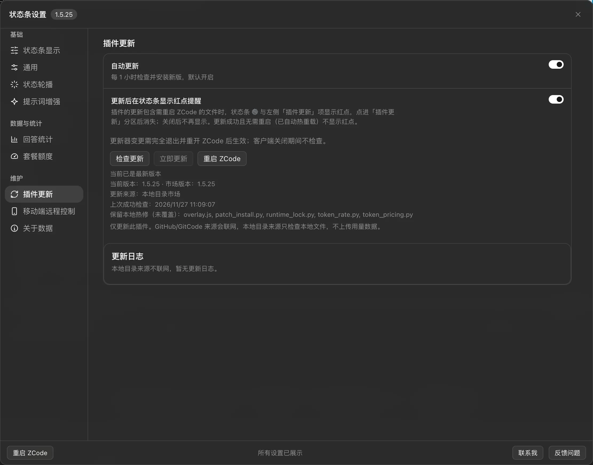</a> |
| **Usage queries** | Run `/usage today` in chat, `python3 zusage.py days 7` in terminal, or call the `token_usage` MCP tool | <a href="docs/promo/features/en/usage-query.webp">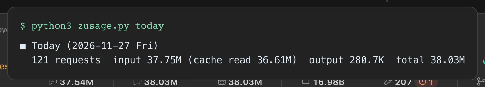</a><br><sub>Demo</sub> |

Click the **⚙ gear icon** on the bar to switch [Default / Pill / Compact styles](docs/user-guide.md#状态条样式) (Chinese), reorder or hide cells, switch English/Chinese, set token units (10k/100M or K/M/B), and choose hover or click to open tooltips.

## Where these numbers come from

- **Usage & cost**: Read locally from ZCode's SQLite database (read-only); updates when each request finishes, not character by character.
- **Generation speed**: Estimated from text changes while generating, then replaced with measured speed after completion. See [data semantics](docs/user-guide.md#数据如何计算) (Chinese).
- **Context & quota**: Context prefers ZCode's native button; plan quotas are queried directly from providers rather than guessed from local tokens.

## WorkBuddy support (optional)

The same library can read **WorkBuddy** local usage and inject a status bar into its input card (via debug port only, without modifying program files or affecting ZCode):

```bash
python zusage.py host                 # check active host and DB paths
python zusage.py --host workbuddy now # query WorkBuddy once
```

See the [host adapter docs](docs/hosts.md#7-在-workbuddy-客户端里安装可选) (Chinese) for permanent setup and the WorkBuddy `/usage` plugin.

## Privacy and security

- **Unofficial plugin**: Modifies ZCode's `app.asar` to load UI enhancements; uninstalling removes only what the plugin added.
- **Network usage**: Local SQLite queries stay offline. Network requests happen only for plan quota/reset cards, 12-hour price/FX table sync, plugin updates, prompt enhance/probing, or opt-in remote/mobile features. Each feature can be turned off independently.
- **Mobile relay**: When enabled in ⚙, pushes numeric stats only (no chat text, file paths or secrets) through ZCode's relay without end-to-end encryption.
- **Debug port**: Opens local Chromium debug port `9229` by default for debugging and QA (never expose to public networks). Set `ZCODE_DISABLE_FIXED_REMOTE_DEBUGGING_PORT=1` before launch and restart completely to disable.
- **Credentials**: Keys saved in ⚙ are stored locally in `quota-secrets.json` (0600 permissions) and never logged; ZCode sign-in tokens are decrypted in memory only; SSH passwords and key passphrases are never read.
- **Not a bill**: Estimated costs and quota chips are for reference only, not billing statements.

## FAQ

**Why did the bar disappear after a ZCode update?**

- Client updates overwrite `app.asar`. Keep the plugin enabled, **start or resume a session** to trigger auto-repair, then **fully quit and reopen ZCode**. [Detailed steps →](docs/user-guide.md#zcode-升级后状态条消失) (Chinese)

**Why don't the numbers change continuously?**

- Stored usage updates after each completed request reaches the database; during generation, only the estimated speed updates.

**Can it show how much money I spent?**

- Not an official bill, but hovering usage totals shows estimated API cost at public list prices; supported plans also show remaining quota or balance directly.

[More troubleshooting →](docs/user-guide.md#排查) (Chinese)

## 💬 Community

- QQ group: **129554306** ([join link](https://qm.qq.com/q/WXuISJK3ug))
- WeChat: add **ByteRax** and ask for an invite

<p>
  
  &nbsp;&nbsp;
  
</p>

## Help improve ZCodeBox

Contributions are welcome: fix bugs, improve documentation, develop extensions or share suggestions. Thanks to everyone contributing code, diagnosing problems, testing versions and supporting the project.

<p align="center">
  <a href="https://github.com/ByteRax/zcode-token-usage-statusbar">
    
  </a>
</p>

## Star History

If ZCodeBox is useful to you, consider [starring the repository](https://github.com/ByteRax/zcode-token-usage-statusbar).

[](https://www.star-history.com/#ByteRax/zcode-token-usage-statusbar&Date)

## License and disclaimer

### Open-source license

This project is released under the [MIT License](LICENSE).

Some interface icons are adapted from [Lucide](https://lucide.dev) (ISC License).

### Disclaimer

- This is a **community-maintained, unofficial enhancement plugin**, not authorized or endorsed by ZCode. ZCode's name, trademarks and official resources belong to their respective rights holders.
- The project modifies `app.asar` to load enhancement code and relies on client internals, page DOM structure and selected engine patches. **Compatibility with every future ZCode version is not guaranteed.** Client updates may break features or require adaptation; assess the risks before production use.
- The software is provided "as is", without express or implied warranties. See the [MIT License](LICENSE) for the full terms and limitations of liability.
