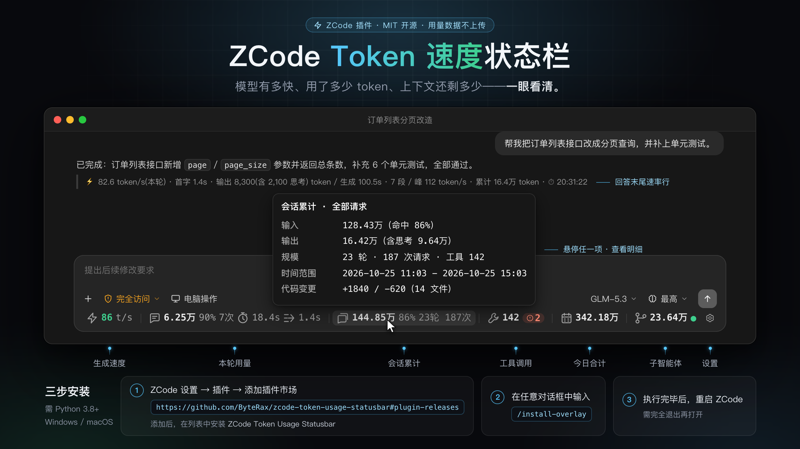

<div align="center">

# ZCode Token 速度状态栏

**让 ZCode 的对话窗口底部多一条小状态栏：模型有多快、token 花了多少、上下文还剩多少，一眼看到。**

给 [ZCode](https://zcode.z.ai) 桌面版用的第三方插件（不是官方功能），市场里的名字叫 **ZCode Token Usage Statusbar**。顺带送你一个命令行和一个 MCP 工具，随时能翻历史用量。

A ZCode plugin for token usage monitoring, generation speed and context window tracking.

简体中文 · [English](README.en.md)

Windows / macOS · Python 3.8+ · [MIT](LICENSE)



</div>

**三步装上：**

把这句话发给 ZCode：

```text
安装或者更新 zcode 插件 https://github.com/ByteRax/zcode-token-usage-statusbar，执行完毕后，运行命令 /install-overlay
```

它会先把插件装好，再执行 `/install-overlay` 装上状态条——要是它没自己跑，你就在对话框里手动敲一次。然后**完全退出 ZCode 再重新打开**（关窗口不算），底部就多出那条小状态栏了。详细说明见[快速开始](#快速开始)。

> 这条捷径装的是仓库默认分支的源码。想跟着正式 Release 走自动更新，用下面「方式 A」里带 `#plugin-releases` 的地址。

国内网络访问 GitHub 受限？上面那句里的地址可能连不上。插件渠道和代码在 GitCode 都有同步镜像：[gitcode.com/tanranran/zcode-token-usage-statusbar](https://gitcode.com/tanranran/zcode-token-usage-statusbar)，插件市场可以直接注册 GitCode 渠道，见下面「四种装法」的说明。

[快速开始](#快速开始) · [这些数字是怎么来的](#这些数字是怎么来的) · [常见问题](#常见问题) · [功能截图](docs/features.md)

---

## 装好之后长什么样

对话窗口底部会多出一条窄窄的横条，大概是这样：

```text
⚡ 86 t/s │ 6.25万 90% 7次 Σ18.4s ⏱1.4s │ 144.85万 86% 23轮 187次 │ 142 🔴2 │ 342.18万 │ 23.64万 🟢 │ ⚙
  生成速度       本轮（这次提问）            会话累计（这次对话）       工具调用     今日合计    子智能体    设置
```

每一格说的是：

| 那一格 | 大白话解释 |
|---|---|
| ⚡ **86 t/s** | 模型刚才写字有多快。完成一轮后按快慢上色：≥70 绿、40–70 黄、<40 红 |
| **42.3%** | 这次对话已经占了模型"一次能看多少"上限的 42.3%。快满了会变色：普通窗口 70% 开始黄、85% 开始红；百万字级的大窗口 60% 就开始黄。万一超限被拒，还会弹处置建议 |
| **6.25万 90% 7次 Σ18.4s ⏱1.4s** | 这一次提问：花了 6.25 万 token、缓存命中 90%、这一轮发了 7 次请求、最近一次请求跑了 18.4 秒、首字等了 1.4 秒 |
| **144.85万 86% 23轮 187次** | 这次对话从头到尾：共 144.85 万 token、命中 86%、聊了 23 轮、发了 187 次请求 |
| **142 🔴2** | 工具被调了 142 次，其中 2 次报错（红色小标记） |
| **342.18万** | 今天所有对话加起来花了 342.18 万 token |
| **23.64万 🟢** | 模型自己派的子任务（子智能体）花了 23.64 万 token，🟢 表示有子任务正在跑 |
| **⚙** | 点这里：想看哪几项、界面语言、token 用万/亿显示、检查更新 |

**鼠标停在任意一格上，会弹出更细的数字。** 想看真实效果可以看[功能截图](docs/features.md)。

## 你想问的，怎么看

| 你想问的 | 去哪儿找 |
|---|---|
| 模型现在快不快？ | 最左边那格 **t/s**，颜色直接告诉你快慢 |
| 我按回车之后等了多久才出字？ | **本轮**里的 ⏱ 那个数（就是常说的 TTFT / 首字延迟） |
| 这次提问 / 这次对话 / 今天一共用了多少 token？ | **本轮** / **会话累计** / **今日合计** 三格 |
| 会不会聊着聊着就写不下了？ | 输入框工具栏的**上下文按钮**（环形图标+百分比），快满了会变色，撑爆了还会弹处置建议 |
| 缓存省了多少？思考花了多少？ | 悬停 **本轮**，能看到输入、输出、缓存读取、思考 token 的明细和命中率 |
| 模型派的子任务烧了多少？ | **子智能体**那格，点开能看到每个子任务分别花了多少 |
| 工具是不是报错了？ | **工具调用**那格，出错会亮红点，悬停能看每个工具的耗时和错误 |
| 翻历史用量 | 对话框敲 `/usage`；或者用终端 `python zusage.py today`；或者用 MCP 工具 `token_usage` |

> 这里显示的是 **token 用量**，不是账单、不是套餐额度、也不是"还剩多少钱"。费用和额度去 ZCode 官方页面看。

## 先看懂这几个词

只要认识这几个，后面全都好懂：

| 词 | 大白话 |
|---|---|
| **token** | 模型眼里的"字"。计费和速度都按它算。英文一个词通常 1–2 个 token，中文一个字通常接近 1 个 token（看分词器，不精确） |
| **tok/s** | tokens per second，模型每秒吐多少 token。数字越大写得越快 |
| **TTFT / 首字延迟** | time to first token。你按下回车，到屏幕上冒出第一个字，等了多久 |
| **上下文窗口** | context window。模型这一次能"看到"的内容上限：你的提问 + 它的回答 + 历史对话。快满了就该压缩或开新会话 |
| **缓存** | 重复出现的内容不用重新算一遍。命中越高越快、越省 |
| **思考 token** | 模型回答前先"想一想"的部分，会被算进输出里 |
| **子智能体** | 模型自己派出去的"分身"，去跑独立的子任务，各自带 token 消耗 |

## 核心功能

### 桌面状态条

贴在对话窗口底部，跟着**你正在看的那个窗口的会话**走。每一格都能单独关掉（⚙ 里设置），嫌挤就关掉不关心的。

### 回答末尾的速率行

插件还会在回答的末尾追加一行小统计：生成速度、首字延迟、输出 token、生成耗时。

它和状态条**不是同一个数**：状态条看的是**最近一段**请求，速率行看的是**这一轮所有已完成请求的加权平均**。这一问还没写完、数据没入库时它就不显示，免得拿上一轮的数字糊弄你。

### 查询：对话框、终端、MCP

三个入口，同一份本地数据：

```text
/usage                    # 对话框里查
/usage today              # 今天的用量
/usage week               # 近一周
```

```bash
python zusage.py today    # 终端里查
python zusage.py days 7
python zusage.py models 7
```

```text
token_usage(scope)        # MCP 工具（stdio）
```

MCP 工具还支持 `days:N`、`sessions:N`、`models:days`、`session:<会话ID前缀>`、`workspace:<目录关键词>`。插件命令的完整名字是 `/zcode-token-usage-statusbar:usage`。

### SSH 远端会话

如果你的 ZCode 跑在 SSH 连过去的服务器上，状态栏也能跟着过去：

- 每台服务器的今日用量和报错**各算各的**，一台挂了不影响别的
- 没查到或者失败了会一直退避重试；恢复会话、换工作区、SSH 重连之后接着查
- 远端脚本要**你自己拷过去**，查询通道必须**免交互**——插件不会去解密复用 ZCode 里存的密码、私钥或口令

远端只覆盖**状态栏的取数**这一条路。MCP、`/usage` 和回答末尾的速率行**不会**自动跨机器取数。详细配置见[远程会话指南](docs/user-guide.md#远程会话)。

## 快速开始

### 你需要准备什么

- **ZCode 桌面客户端**（Electron）。Windows 和 macOS 是主力；Linux 下有些系统路径要管理员权限，界面在不同发行版上的表现得自己验一下。
- **Python 3.8+**（自带标准库 `sqlite3` 就够）。不需要装任何第三方 Python 包。
- **不用装 Node.js 或 npm**——状态栏的代码跑在 ZCode 自带的 Node 环境里。

### 四种装法，按需挑一种

| 装法 | 适合谁 | 怎么做 |
|---|---|---|
| **A. 插件（推荐）** | 绝大多数人 | 在 ZCode 对话框敲两条 `/plugin` 命令，之后能在 ⚙ 里一键更新 |
| **B. 本地源码目录** | 想自己改代码的人 | 克隆仓库后，用「添加插件市场 → 选择目录」指到仓库根目录 |
| **C. 一键安装器** | 不想装插件的人 | 终端里 `git clone` + `python install.py` |
| **D. 自托管 Web** | 自己搭 ZCode 服务器的人 | [单独部署](web/README.zh-CN.md)，和上面三种不是一回事 |

> 前三种都往同一个运行目录里装东西，**选一个就行，别叠着来**；第四种是自托管 Web，和桌面版完全不是一回事。

> **国内访问 GitHub 受限？** 仓库在 GitCode 有一份同步镜像：[`tanranran/zcode-token-usage-statusbar`](https://gitcode.com/tanranran/zcode-token-usage-statusbar)。**A. 插件** 把市场注册地址换成 GitCode 渠道就行（见下面的命令，本机要装有 Git）；**B/C** 把克隆地址换成 GitCode 的。注册或克隆的是哪个地址，之后的检查更新和下载就走哪个，不用再碰 GitHub。

#### A. 插件（推荐）

开头那句自然语言指令，目的就是让 ZCode 替你走完下面两步；想自己手动来也行，在 **ZCode 对话输入框**依次执行：

```text
/plugin marketplace add ByteRax/zcode-token-usage-statusbar#plugin-releases
/plugin install zcode-token-usage-statusbar@zusage-marketplace
```

GitHub 访问受限时，把第一条换成 GitCode 渠道（结尾的 `.git` 不能省；这个走法要求本机装有 [Git](https://git-scm.com/downloads)）：

```text
/plugin marketplace add https://gitcode.com/tanranran/zcode-token-usage-statusbar.git#plugin-releases-gitcode
/plugin install zcode-token-usage-statusbar@zusage-marketplace
```

注册的是哪个地址，之后 ⚙ 里的「检查更新 / 立即更新」和自动更新就从哪里取：两条渠道装的是同一份经过校验的正式 Release 包，不会跟着开发分支乱跑。

也可以走界面：**设置 → 插件 → 添加插件市场**，填上面任意一个渠道地址，添加后找到 **ZCode Token Usage Statusbar** 点安装。

> **版本说明（2026-10-20）：** `#plugin-releases` 当前正式版是 [v1.5.2](https://github.com/ByteRax/zcode-token-usage-statusbar/releases/tag/v1.5.2)，已经包含默认自动安装/修复和下面的 SSH 远端支持。还在用旧版 `v1.4.1` 的请先按下面的更新步骤升级——旧版默认是关闭自动安装的，那种情况要手动敲一次 `/install-overlay`。

#### B. 本地源码目录

下载或克隆本仓库后：

1. **设置 → 插件 → 添加插件市场**，点 **选择目录**。
2. 选**包含 `marketplace.json` 的仓库根目录**（不是 `plugins/` 那个子目录），添加市场。
3. 找到 **ZCode Token Usage Statusbar**，点安装。

也可以在 ZCode 里敲：

```text
/plugin marketplace add /绝对路径/到/zcode-token-usage-statusbar
/plugin install zcode-token-usage-statusbar@zusage-marketplace
```

<details>
<summary>看看添加插件市场的截图</summary>


</details>

#### C. 一键安装器（不装插件）

先装好 [Python](https://www.python.org/downloads/) 和 [Git](https://git-scm.com/downloads)，在终端里：

```bash
git clone https://github.com/ByteRax/zcode-token-usage-statusbar.git
cd zcode-token-usage-statusbar
python install.py
```

macOS 上要是没有 `python`，就写 `python3 install.py`。

安装器会自己找到 ZCode、复制运行文件、装上状态条，顺带把独立 MCP 服务和 `/usage` 也注册好。常用选项：`--lang en` 输出英文、`--no-mcp` 只装状态条不注册查询工具、`--remove` 卸载、`--dry-run` 先看它要干什么。

### 装完之后，别忘了这三步

这三件事是分开的，缺一步你都会以为"装了没反应"：

1. **插件装上并启用了** — 插件页里能看到它。到这一步，ZCode 只是加载了插件的查询、速率行和更新功能。
2. **状态条注入成功** — 插件在你新建或恢复会话时会自动安装/修复状态条，这一步会**改客户端的 `app.asar` 文件**。自动装失败的话，用 `/install-overlay` 手动补一刀。
3. **重启后确实加载了** — 必须**完全退出 ZCode 再重新打开**，状态条才会出现。**关掉窗口不算，重开会话也不算。**

> 状态条要改客户端文件，你得自己确认信得过这个项目。卸载的时候只删自己注入的那部分，不会把你的 ZCode 还原回去。

**以后怎么更新？**

- **插件（正式渠道）**：在 ZCode 里敲 `/plugin marketplace update zusage-marketplace`，再去 **设置 → 插件 → 已安装** 更新这个插件。或者直接点 ⚙ 里的「检查更新 / 立即更新」。自动更新默认是开的。注册的是 GitCode 渠道的话，这套更新从版本检查到下载安装全部走 GitCode，⚙ 的「更新来源」会写明当前渠道。
- **本地目录 / 源码分支**：⚙ 里的自动更新只认正式 Release。源码安装点它会提示"不支持自动更新"，请先 `git pull` 再重新安装，或按[切换到正式渠道](docs/user-guide.md#切换已有市场到正式渠道)迁移。
- **一键安装器**：⚙ 里的「检查更新」只对插件安装有效。一键安装的更新就两步：进克隆目录 `git pull`（从哪个地址克隆的就从哪里拉，GitCode 镜像用户拉的就是 GitCode），再重跑一次 `python install.py`。
- 更新装不上时，也可以把「更新zcode 插件 https://github.com/ByteRax/zcode-token-usage-statusbar」这句话直接发给 ZCode，让它帮你重装。
- 更新完新建或重开会话；如果提示主进程文件变了，就完全退出再重开 ZCode。

[更多安装、更新和排查 →](docs/user-guide.md#插件安装)

### 我只想查用量，不想让它动我的客户端

在 `~/.zcode/zcode-token-usage-statusbar/config.json` 里**只加**这一项（别覆盖你已有的设置）：

```json
{
  "plugin_auto_install_overlay": false
}
```

或者跑 `/uninstall-overlay` 把状态条拆掉，同时留一个"别再自动装"的标记。这样插件照样给你 `/usage`、MCP 工具和回答末尾的速率行，就是不碰客户端文件。

配置文件没有这个字段、或者整个文件都没有时，**默认是开启**的；你已经明确写了 `false` 的话，这个设置会一直保留。环境变量 `ZUSAGE_PLUGIN_AUTO_INSTALL=1` / `0` 比配置优先，但绕不过"别再自动装"这个标记。

## 日常使用

- **鼠标停上去**看那一项的详细数据。
- **点子智能体**展开每个子任务分别花了多少。
- **点 ⚙** 藏掉不关心的项、换语言、把 token 数字换成万/亿（中文界面默认开）、查更新。
- **敲 `/usage today`** 看今天用了多少，`/usage week` 看近一周。

## 这些数字是怎么来的

数据是从 ZCode 本地 SQLite 数据库读的，不是模型自己报的，也不是估算的账单。除生成速度外，其余各项都随"一次请求写进数据库"而更新。

<details>
<summary>展开看每个数的计算方式</summary>

| 显示项 | 怎么算的 |
|---|---|
| 生成速度（tok/s） | 写完一轮后：输出 token（含思考）÷ 模型生成时长 |
| 生成时长 | 普通请求 = 结束时间 − 首 token 到达时间；带思考的请求 = 结束时间 − 请求发出时间 |
| 首字延迟（TTFT） | 首 token 到达时间 − 请求发出时间 |
| 用量合计 | 总用量 = 输入 + 输出。输入里已经含了缓存读取，不会再加一次 |
| 缓存命中率 | 缓存读取 ÷ 输入 token |
| 上下文占比 | 最近一次成功请求的输入 token ÷ 上下文窗口大小 |
| 轮数 | 按去重后的 `turn_id` 算 |

**几个容易搞混的地方：**

- **状态条的速度 ≠ 回答末尾的速率行。** 状态条看最近一段请求；速率行看这一轮已入库请求的**加权**速度，段与段之间等工具的时间不算进生成时长。
- **生成速度 ≠ 端到端吞吐。** 端到端还包含等首字、思考和网络往返；这里量的是模型真正在写的那段时间。
- **带思考的请求会显得慢一点，这是对的。** 思考 token 在第一个字出来之前就流出来了，所以这类请求（含 Claude 系列）从"请求发出"开始算生成时长。Claude 不单独上报思考 token，但思考同样发生在首字之前，所以算法一致。这不是 bug。
- **上下文占比 ≠ 会话累计。** 占比看的是最近一次请求的输入量，压缩对话之后会掉下来；会话累计是整场对话累加。
- **思考 token 已经算在输出里了**，不会再加一次；到底上不报，看供应商。
- **命令行和 MCP 的 `current`** 指的是"最近在动的那个会话"，不保证就是你屏幕上正看着的那个窗口；状态条是跟着各自窗口走的。

**为什么可能和别的插件数字对不上？** 普通请求的生成窗口是"首 token → 请求完成"；上报思考 token 的请求、还有 Claude 请求，用的是"请求开始 → 请求完成"。回答末尾的速率行又是另一套：按这一问已完成的有效段算"总输出 ÷ 总生成耗时"，不含段间等工具的时间，也不含还没写完入库的收尾正文。端到端吞吐又是另一个时间窗口，不能直接横比。

另外，状态条会**往前找**最近一个有效速度样本，不一定就是最新那条请求。逐问统计有"是不是当前这一问"的校验，但短时间内连着问仍有识别边界。

**正在写的时候，那个速度是估算的。** 模型还在输出时，状态栏上的 t/s 是按"已经吐出来的字数"除以一个每 token 字符数的比例**估**出来的（这个比例取自本会话最近一次完成的真实轮次，会自己校准）；这一轮写完，就换成这一轮真实的 tok/s。读不到客户端内部的会话状态时，就退回用数据库里最近一段的值。

</details>

数据缺失、无效样本、历史轮次的边界（不会凭空补造统计）见[数据口径](docs/user-guide.md#数据如何计算)。

## 心里有底的几件事

- **这不是 ZCode 官方功能**，是社区做的插件，和官方团队没有关系。状态条的实现方式是往客户端 `app.asar` 里注入。
- **本地数据库是只读的。** 用量数据不会上传。
- **但插件更新要联网**——从你配置好的来源下载代码。自动更新默认开着，可以在 ⚙ 里关掉。
- **用 SSH 远端查询也会联网**——经由你配好的通道在远端跑只读查询脚本。前提和限制见 [SSH 远端会话](#ssh-远端会话)。
- **不会解密复用你的凭据。** ZCode 里存的密码、加密私钥、口令都不会被插件拿去解密使用，SSH key / agent 请自己配好。
- **token 用量不等于账单。** 这里没有套餐费用、没有剩余额度、没有计费信息。

## 常见问题

**这是 ZCode 插件，还是通用的 LLM Token 监控工具？**

是 ZCode 专用插件。它读的是 ZCode 的会话和用量数据，服务的是 ZCode 用户。CLI 和 MCP 只是**查询入口**，不表示它能去统计别的 AI 编程客户端。

**能直接在浏览器或者 SSH 服务器上装桌面状态条吗？**

不能。桌面状态条只装在本机的 ZCode 客户端上。自托管 Web 要[单独部署](web/README.zh-CN.md)；SSH 远端只部署匹配的查询脚本和 Python，不装桌面浮层。远端自动路由还需要免交互的认证，而且不覆盖 MCP、`/usage` 和回答末尾的速率行。

**我装了插件，状态条呢？**

保持插件是启用的，**新建一个会话或者恢复一个会话**，会自动触发安装/修复；装成功后完全退出并重开 ZCode。自动装失败就用 `/install-overlay` 手动来一次，顺便检查权限、配置和"别再自动装"的标记。**光重启救不了一个还没装成功的状态条。**

**更新 ZCode 之后，状态条怎么没了？**

ZCode 更新可能把你注入的客户端文件覆盖掉。更新后第一次打开 ZCode，是给插件一个重新注入的机会；**注入成功后，你还得再完全退出并重启一次 ZCode**，新的注入才会被加载。哪怕更新时已经自动重启过一次，这一步也不能省。

1. 保持插件启用，新建或恢复会话，触发自动修复。
2. 如果没开自动安装、或者修复失败，在对话框里敲 `/install-overlay`，按提示走完。
3. 确认成功之后，**完全退出 ZCode，再重新打开**。

用一键安装器而不是插件的，直接在仓库目录重跑 `python install.py`（macOS 用 `python3 install.py`），成功后同样要完全退出并重启。

**数字怎么不一直跳？**

大部分数据是"一次请求写完进库"才刷新一次，不是逐字往上滚。刚开的新会话还没发过请求，显示 0 是正常的。（只有正在生成时的那个 t/s 会动，那是估算值，见上面「这些数字是怎么来的」。）

**为什么有时候回答末尾没有速率行？**

纯问答、或者这一问的数据还没入库时，它就不显示，免得把上一轮的数当这一轮。可以在 ⚙ 里把「逐问速率行」关掉。完全重启之后，ZCode 恢复出来的历史轮次有时会缺有效的输出统计，这些轮次不会硬凑一个数出来；写在消息正文里的老统计行不受影响。

**能显示花了多少钱、还剩多少额度吗？**

不能。这里只有 token 用量。套餐费用和额度去 ZCode 官方页面看。

[更多排查、自动更新和远程配置 →](docs/user-guide.md)

## 卸载

**一键安装的**：在仓库目录里执行，然后完全退出并重开 ZCode：

```bash
python install.py --remove
```

**插件装的**：按这个顺序来，别只删插件把状态条留在那儿：

1. 在 ⚙ 里关掉自动更新；正在更新的话等它跑完。
2. 跑 `/uninstall-overlay`，确认成功。
3. **设置 → 插件 → 已安装 → ZCode Token Usage Statusbar → ⋯ → 卸载**。
4. 完全退出并重开 ZCode，确认状态条没了。

<details>
<summary>看看卸载的截图</summary>


</details>

还想把设置、缓存、插件市场一起清掉？见[彻底清理步骤](docs/user-guide.md#彻底卸载)。

## 更多文档

- [功能截图](docs/features.md) · [安装、配置与排查](docs/user-guide.md)
- [Web 版（自托管）](web/README.zh-CN.md) · [实现原理与数据口径](docs/design-notes.md)
- [开发与发布](docs/maintaining.md) · [测试说明](tests/README.md)

[MIT License](LICENSE)
