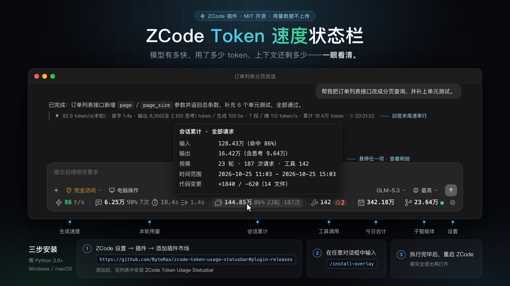

<div align="center">

# ZCodeBox 客户端增强套件

**模型速度、token 用量、上下文与套餐额度，一眼看到。**

[](LICENSE)
[](#你需要准备什么)

给 [ZCode](https://zcode.z.ai) 桌面版用的第三方增强插件，提供速度状态栏、用量查询和界面增强；市场名称仍为 **ZCode Token Usage Statusbar**，仓库地址与命令不变。

A community toolkit for ZCode desktop: generation speed, token usage, context tracking and UI enhancements.

简体中文 · [English](README.en.md)



宣传图采用布景与演示数据，实际界面随版本和配置变化。

</div>

## 快速开始

### 你需要准备什么

- **ZCode 桌面客户端**：主要支持 Windows / macOS；Linux 有路径与权限适配，但未覆盖所有发行版的实机验证。
- **Python 3.8+**，需包含标准库 `sqlite3`，不用安装第三方 Python 包。
- 无需另外安装 Node.js 或 npm，桌面状态栏使用 ZCode 自带的 Node 环境。

### 安装方法

把下面这段话发给 ZCode，安装或更新稳定渠道插件：

```text
请安装或更新并启用 ZCode 插件：https://github.com/ByteRax/zcode-token-usage-statusbar#plugin-releases
完成后，在 ZCode 对话中执行 /install-overlay；确认状态条安装成功后，提醒我完全退出并重新打开 ZCode（仅关闭窗口不算），不要自动重启。
若安装失败，请说明原因；若当前会话无法执行该命令，请提示我手动执行，不要跳过这一步或声称安装成功。
```

国内访问 GitHub 受限时，换成下面这段（地址中的 `.git` 不能省，本机需安装 [Git](https://git-scm.com/downloads)）：

```text
请安装或更新并启用 ZCode 插件：https://gitcode.com/tanranran/zcode-token-usage-statusbar.git#plugin-releases-gitcode
完成后，在 ZCode 对话中执行 /install-overlay；确认状态条安装成功后，提醒我完全退出并重新打开 ZCode（仅关闭窗口不算），不要自动重启。
若安装失败，请说明原因；若当前会话无法执行该命令，请提示我手动执行，不要跳过这一步或声称安装成功。
```

保留地址中的 `#plugin-releases` / `#plugin-releases-gitcode`，它们选择正式发布的稳定渠道。也可在 **设置 → 插件 → 添加插件市场** 中粘贴对应地址，安装并启用 **ZCode Token Usage Statusbar**，再手动执行 `/install-overlay`。源码安装等其它方式见[安装指南](docs/user-guide.md#插件安装)，选择一种即可。

> **注意**：状态条安装会修改 ZCode 的程序文件（`app.asar`），请先确认信任本项目。**首次注入成功后，须完全退出并重开 ZCode**（仅关闭窗口或重开会话不算），再检查状态条是否出现；安装失败或权限不足时，先排查原因，重启不能替代安装。

以后可在 ⚙ 中检查更新（自动更新默认开启）。支持热更新的文件可自动生效；若提示待重启，再完全退出并重开客户端。[更新与升级细节 →](docs/user-guide.md#更新与客户端升级)

如果安装成功并完全重启后仍看不到状态条，可把这句话发给 ZCode：

```text
请排查 https://github.com/ByteRax/zcode-token-usage-statusbar 插件的状态条或工具栏 chip 未显示的原因，先检查插件启用状态、安装结果、实际加载路径及相关开关。修改客户端文件前先征求我确认；需要反馈时，整理脱敏后的复现步骤与诊断摘要，待我确认后再提交到 https://github.com/ByteRax/zcode-token-usage-statusbar/issues，不要上传凭据或完整本地日志。
```

### 故障排查与自动修复

客户端升级可能覆盖注入补丁。保持插件启用，**新建或恢复会话**可触发自动安装/修复；仅在已打开的会话里发消息不保证触发。确认修复成功后，如提示待重启，再完全退出并重开 ZCode。权限不足或宿主结构变化仍可能使修复失败。

- `/install-overlay`：手动安装或修复注入，确认成功后按提示完全重启。
- `/uninstall-overlay`：移除状态条并写入卸载豁免，阻止后续自动重注入；确认成功后完全退出并重开。`/usage` 与 MCP 查询仍可用，回答末尾的速率行依赖浮层及渲染桥。

[安装指南](docs/user-guide.md#插件安装) · [常见问题](#常见问题) · [功能图示](docs/features.md) · [更多排查](docs/user-guide.md#排查)

> 本页以 `main` 分支代码为准，可能包含尚未发布的功能；稳定渠道以 [GitHub Releases](https://github.com/ByteRax/zcode-token-usage-statusbar/releases) 对应版本为准。

---

## 功能一览

| 功能名称 | 核心效果 |
|---|---|
| **状态栏统计** | 跟随当前窗口 / 分栏的会话，显示本轮、会话、项目与今日用量；悬停查看输入 / 输出、缓存命中率、请求数、轮数、会话数及耗时等明细。生成中的速度为估算值，用量在请求完成入库后刷新 |
| **回答末尾的速率行** | 在本轮统计可用时显示输出速度、首字延迟、输出 token（含思考）、生成时长及时间，并按数据情况补充会话均速和累计输出；多段请求另显示段数和峰值。依赖浮层及渲染桥，不保证每条历史回答都有统计行 |
| **Git 状态** | 查看分支、上游状态、暂存 / 未暂存 / 未跟踪文件数及改动行数；工作目录不是仓库时，汇总直接子目录的多个仓库。只读本机 Git，不联网、不改仓库 |
| **套餐额度** | 在上下文按钮左侧显示账号级套餐池各时间窗的已用比例、重置时间或余额，可切换剩余口径。支持 GLM Coding Plan、DeepSeek 等数据源及兼容协议的中转站；支持程度见[额度支持矩阵](docs/quota-support-audit.md)，团队套餐暂不支持 |
| **重置卡徽标** | 显示登录账号可用的额度重置卡张数与到期时间，临近过期时显示倒计时与颜色提醒；需要 ZCode 登录态，仅 API Key 用户与团队套餐不可用 |
| **预估费用** | 悬停本轮 / 会话累计 / 项目累计 / 今日合计，按 [models.dev](https://models.dev/) 收录的官方渠道公开价格估算 API 费用；未匹配模型使用默认均价，仅供参考，不是账单 |
| **一键压缩上下文** | 在上下文按钮面板中确认后，向当前会话发送 `/compact`，不改输入框草稿；压缩期间发送新消息会中断压缩 |
| **调整自动压缩上下文比例** | 在 ⚙ → 通用设置触发比例（30–99%），补丁生效后也可从上下文面板的「调整」链接直达。留空跟随引擎默认，默认比例因模型窗口而异；仅适用于受支持的桌面内置引擎，首次加载补丁需新会话或重启 |
| **上下文按钮增强** | 在原生上下文按钮上显示环形填充、档位颜色与百分比，优先跟随宿主当前用量，解析不可用时回退数据库口径；上下文占比不占状态条格子 |
| **项目完整路径** | 「编辑项目」弹窗在文件夹名称下方显示完整路径；长路径换行，多文件夹逐行显示，点击文件夹行可用系统文件管理器打开目录 |
| **搜索弹框加宽** | 放宽命令中心等 cmdk 搜索弹框的宽高上限，便于查看长条目；不影响所有类型的弹窗 |
| **状态轮播** | 默认关闭；开启后，在思考 / 生成 / 长耗时阶段的消息流 Loading 行轮播状态短语，可自定义词包 |
| **SSH / WSL 远端会话** | 在可信身份绑定下自动发现远端、按服务器独立查询统计，失败后持续重试；需手动在远端部署查询脚本，不替宿主重连 SSH。仅桌面快照链支持跨机，详见[远程会话指南](docs/user-guide.md#远程会话) |
| **子智能体明细** | 查看子任务用量、模型、运行状态、速度和预估费用；运行中速度按字符增量估算，完成后在数据可用时回填统计值 |
| **用量查询** | 对话中用 `/usage today`，终端在仓库目录运行 `python3 zusage.py days 7`，或调用 MCP 工具 `token_usage(scope="today")`；`current` 取数据库最近活跃会话，不保证是屏幕焦点 |

在 ⚙ 中可切换「默认 / 药丸 / 精简」[状态条样式](docs/user-guide.md#状态条样式)、选择显示项、设置中英文与 token 单位。MCP 是可选查询入口，不影响状态条使用；终端的 `python3` 可按本机安装替换为 `python`。回答末尾的速率行标签目前仍为中文。

## 这些数据是怎么来的

本地用量统计主要读取 ZCode 的 SQLite 数据库，不是账单；查询优先以只读模式打开，失败时回退到普通连接。用量随请求完成并入库后刷新，不是逐字流式统计。

有渲染桥时，生成中的 t/s 按字符增量估算，完成后条面显示最近一轮真实速度；无桥时回退数据库最近有效段。会话与历史加权均速见速度悬浮卡，回答末尾的速率行按本轮有效请求段加权计算，不包含段间工具等待。

上下文占比优先跟随宿主原生按钮，数据库兜底取最近完成请求的输入量 / 上下文窗口，不是会话累计。套餐额度与余额通常独立查询供应商接口，不用本地 token 总量反推；SCNet 的无凭据估算另走账本与抵扣表。完整定义见[数据口径](docs/user-guide.md#数据如何计算)。

## 顺带支持 WorkBuddy（可选）

同一套查询库也能读 **WorkBuddy** 的本地用量：上下文与窗口取自 `~/.workbuddy/workbuddy.db` 的 `session_usage`，**逐请求 token / 缓存 / 思考 / credit / 工具调用**取自会话正文 `projects/*/*.jsonl` 里的 `providerData.rawUsage`（每次模型调用都有）。速度是按响应窗口推算的近似值；**预估费用**按 models.dev 官方牌价逐模型计价（有汇率显示 ¥，否则 $），价表未收录的模型如实标「不可得」并在聚合里注明范围，不拿兜底均价或 0 冒充。

浮层按客户端分流：ZCode 仍走原来的 asar 注入；WorkBuddy 没有这条链，改走 CDP 在**输入卡内注入一条状态条**，每个分段**悬停弹信息卡**（速度卡带最近 8 段柱状图、档位配色与统计口径；本轮/会话/工具/今日/上下文/项目各有明细），右侧齿轮看完整详情。只连客户端自带的调试端口，不改程序文件；启动时按 agent 自动选择，ZCode 侧行为一字未变。

三句话用起来：

```bash
python zusage.py host                 # 自检：当前宿主、两个库位置、可用指标
python zusage.py --host workbuddy now # 临时按 WorkBuddy 查，不写配置
```

想固定下来，在 `config.json` 写 `"host": "workbuddy"`（或 `"auto"` 让它按库存在性选）；库不在默认位置时用 `hosts.workbuddy.db_path` 或环境变量 `ZUSAGE_WORKBUDDY_DB`。MCP 工具多了一个可选 `host` 参数。**默认值仍是 `zcode`**——装了 WorkBuddy 不会改变原 ZCode 的任何行为。

**想直接在 WorkBuddy 客户端里用 `/usage`**：仓库另带 WorkBuddy 专用插件 `plugins/workbuddy-token-usage/`（只有 MCP + 命令，不含 asar 注入），装法见[宿主适配文档](docs/hosts.md#7-在-workbuddy-客户端里安装可选)。

## 隐私与安全

- **这不是 ZCode 官方功能**，是社区插件；状态条靠修改 ZCode 的程序文件（`app.asar`）实现，卸载时只删自己加的那部分。
- **数据与联网**：本地用量查询使用 SQLite，不上传用量。额度与重置卡查询会访问对应服务；预估费用默认每 12 小时从 models.dev 下载价表，并从 er-api（失败时回退 exchangerate.fun）获取汇率，可用 `pricing.fetch: false` 关闭下载，仅关闭费用显示不会停止同步。插件更新 / 更新日志也会联网，⚙ 可关自动更新；远程会话使用已配置的 SSH / WSL 通道。各功能开关独立，关闭额度查询不等于停止全部联网。
- **调试端口**：为实机调试与自动化 QA，插件默认尝试补开 Chromium 调试端口 `9229`，并保留用户显式指定的调试端口。同机其它进程可借此读取或操控 ZCode 窗口内容，请勿将端口代理或转发到外网。在启动前设置 `ZCODE_DISABLE_FIXED_REMOTE_DEBUGGING_PORT=1` 并完全重启，可禁止插件补开端口，但不会移除其它途径启用的端口；不接受此调试能力时，请禁用补开或卸载插件，并在重启后核验。
- **凭据边界**：ZCode 里存的 SSH 密码、私钥口令不会被插件解密使用；额度查询凭据不写入日志或诊断。⚙ 面板保存的凭据持久化在运行目录的 `quota-secrets.json`（支持时设置为 0600），请求只发往对应官方域或用户配置的中转站本域。Anthropic 数据源默认关闭，显式启用后可能读取 `~/.claude/.credentials.json`。额度与重置卡查询开关独立，停止这两类查询需分别关闭。
- **token 用量 ≠ 账单**：额度 chip 可显示支持的数据源提供的套餐已用比例或账户余额，但不提供现金扣费账单或计费明细。

## 常见问题

**更新 ZCode 之后，状态条怎么没了？**

- ZCode 更新时会把状态条改过的程序文件覆盖回原样。保持插件启用，新建或恢复会话触发自动修复，确认成功后再**完全退出重开一次**——哪怕更新时已经自动重启过。[详细步骤 →](docs/user-guide.md#zcode-升级后状态条消失)

**数字怎么不一直跳？**

- 用量数据在请求完成并入库后刷新，不是逐字滚动；有渲染桥时生成速度可在回复中按字符增量估算，无桥时按请求完成入库刷新。刚开的新会话可能尚无可用统计。

**能显示花了多少钱吗？**

- 现金账单不能，这里没有计费明细。悬停本轮 / 会话累计 / 项目累计 / 今日合计时，可查看按官方公开目录价估算的 API 费用（仅供参考，非实际账单）；支持的数据源还可通过**套餐额度 chip** 显示套餐已用比例或账户余额。

[更多排查 →](docs/user-guide.md#排查)

## 卸载说明

- **插件方式安装**：① 在 ⚙ 关闭自动更新 → ② 在对话中执行 `/uninstall-overlay` 并确认成功 → ③ 打开 **设置 → 插件 → 已安装 → ZCode Token Usage Statusbar → ⋯ → 卸载** → ④ 完全退出并重开 ZCode。切勿直接卸载插件而把状态条留在客户端中；清理配置与缓存残留见[彻底卸载指南](docs/user-guide.md#彻底卸载)。
- **源码脚本安装**：在仓库目录执行 `python3 install.py --remove`（按本机安装可换成 `python`），确认移除成功后完全退出并重开 ZCode。

## 更多文档

- [功能截图](docs/features.md) · [安装、配置与排查](docs/user-guide.md) · [额度支持矩阵](docs/quota-support-audit.md)
- [实现原理与数据口径](docs/design-notes.md)
- [开发与发布](docs/maintaining.md) · [测试说明](tests/README.md)

## 一起把 ZCodeBox 做得更好

欢迎修复问题、完善文档、开发扩展，或分享使用建议。感谢每一位贡献者，也感谢帮助定位问题、测试版本和支持项目的人。

<p align="center">
  <a href="https://github.com/ByteRax/zcode-token-usage-statusbar">
    
  </a>
</p>

## Star History

如果 ZCodeBox 对你有帮助，欢迎 [点一颗 Star](https://github.com/ByteRax/zcode-token-usage-statusbar)。

[](https://www.star-history.com/#ByteRax/zcode-token-usage-statusbar&Date)

## 许可证与免责声明

### 开源许可

本项目以 [MIT License](LICENSE) 开源。

部分界面图标改编自 [Lucide](https://lucide.dev)（ISC License）。

### 免责声明

- 本项目为**社区维护的非官方增强插件**，未获得 ZCode 官方授权或认可。ZCode 的名称、商标及官方资源归各自权利人所有。
- 本项目通过修改 `app.asar` 加载增强代码，并依赖客户端内部接口、页面 DOM 与部分引擎补丁，**不承诺兼容未来所有 ZCode 版本**；客户端更新可能使功能失效或需要适配，用于生产环境前请评估风险。
- 软件按「现状」提供，不附带明示或默示担保；完整许可与责任限制见 [MIT License](LICENSE)。
