<div align="center">

# ZCodeBox 客户端增强套件

**模型速度、token 用量、上下文与套餐额度，一眼看到。**

[](https://linux.do/)
[](LICENSE)
[](https://github.com/ByteRax/zcode-token-usage-statusbar) [](https://github.com/ByteRax/zcode-token-usage-statusbar) [](https://github.com/ByteRax/zcode-token-usage-statusbar)
[](https://qm.qq.com/q/l43Xj8P7mE) [](#-交流与反馈)

给 [ZCode](https://zcode.z.ai) 桌面版用的第三方增强插件，把模型速度、Token 用量、上下文占用、套餐额度和常用小工具直接放到界面上（市场原名 **ZCode Token Usage Statusbar**）。

A community toolkit for ZCode desktop: generation speed, token usage, context tracking and UI enhancements.

简体中文 · [English](README.en.md)

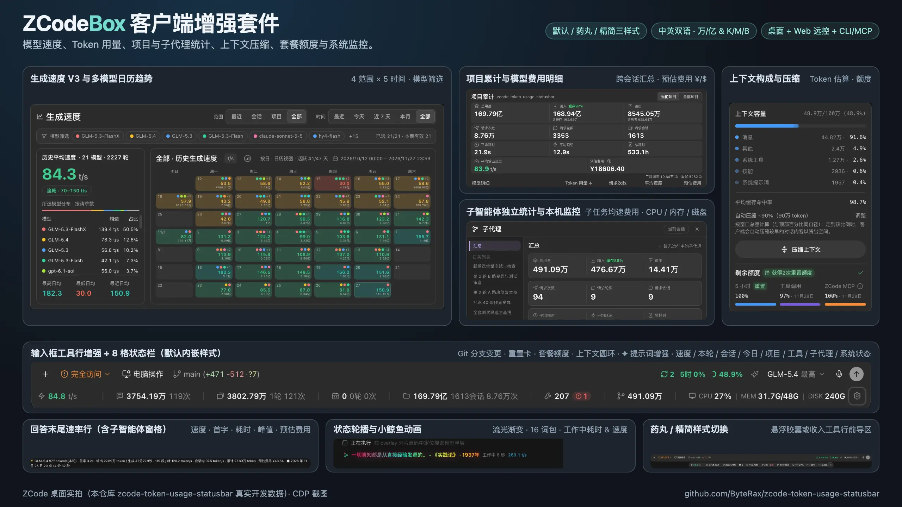

宣传图取自 ZCode 桌面实拍。实际界面随版本和配置变化。

</div>

## 快速开始

### 你需要准备什么

- **ZCode 桌面版**：支持 Windows 和 macOS（Linux 已做基础适配，未逐一测试所有发行版）。
- **Python 3.8+**：系统自带或自行安装即可，**不需要装任何第三方库**，也不用单独装 Node.js。
- **可选 MCP 查询**：`token_usage` 工具需要 **ZCode 3.19.0+**；更老版本依然可以使用状态条、`/usage` 命令和终端查询。
- **上下文洞察面板（ZCode 4.0+）**：左侧导航「上下文洞察」看跨会话总览，右侧「上下文组成」看当前会话的构成、逐轮消息与错误/重试；对话里发 `/context` 可让 AI 汇总当前会话用量。详见[用户指南](docs/user-guide.md#上下文洞察与上下文组成)。

### 安装方法

复制下面这段话，直接发给 ZCode 就能自动完成安装或更新（GitHub 连不上时，它会自动改用国内源重试）：

```text
请安装或更新 ZCode 插件 zcode-token-usage-statusbar，严格按下面三步做，不要另找安装方式：

1. 用 ZCode 自带的命令行添加市场并安装插件。调用方法：先设置环境变量 ELECTRON_RUN_AS_NODE=1，再运行 ZCode 的可执行文件，把安装目录里的 resources/glm/zcode.cjs 作为第一个参数。macOS 默认是 /Applications/ZCode.app/Contents/MacOS/ZCode 和 /Applications/ZCode.app/Contents/Resources/glm/zcode.cjs；Windows 上 ZCode.exe 与 resources\glm\zcode.cjs 在同一个安装目录，位置不固定时用 PowerShell 的 (Get-Process ZCode).Path 查到正在运行的 ZCode.exe。在这个命令行里依次执行：
   plugins marketplace add "https://github.com/ByteRax/zcode-token-usage-statusbar#plugin-releases" --json
   plugins install "zcode-token-usage-statusbar@zusage-marketplace" --scope user --json
   第一条失败时（多半是 GitHub 连不上），把地址换成 https://gitcode.com/tanranran/zcode-token-usage-statusbar.git#plugin-releases-gitcode 重试，不用再问我。
2. 运行 python3 "<第 1 步第二条命令输出里的 installPath>/overlay_install.py" install（Windows 上 python3 不可用就依次换 python、py -3）。
3. 按第 2 步的输出提醒我：出现重启提醒时，提醒我完全退出 ZCode（从菜单或托盘退出，只关窗口不算）再重新打开；不要自动重启。

任何一步失败都原样转述错误，不要跳过，也不要声称安装成功。
```

> **提示**：
> - 国内源需要本机装有 [Git](https://git-scm.com/downloads)，且地址里的 `#plugin-releases` / `.git#plugin-releases-gitcode` 不能删。
> - 安装状态条会修改 ZCode 程序文件（`app.asar`），请确认信任本项目。**首次安装后必须完全退出 ZCode**（从菜单或托盘退出，只关窗口不算）再重开，才能看到状态条。

装完重启后如果没看到状态条，新开一个会话输入 `/zusage-doctor` 做只读体检，按提示修复即可；需要让 ZCode 帮忙排查时，可发送：

```text
请排查 https://github.com/ByteRax/zcode-token-usage-statusbar 插件的状态条或工具栏 chip 未显示的原因，先检查插件启用状态、安装结果、实际加载路径及相关开关。修改客户端文件前先征求我确认；需要反馈时，整理脱敏后的复现步骤与诊断摘要，待我确认后再提交到 https://github.com/ByteRax/zcode-token-usage-statusbar/issues，不要上传凭据或完整本地日志。
```

### 手机远控页面（当前源码功能）

想在手机或浏览器远控页看同样的状态条：在浏览器装好油猴扩展后[点击安装手机脚本](https://raw.githubusercontent.com/ByteRax/zcode-token-usage-statusbar/main/zusage-mobile.user.js)，然后在桌面状态条 **⚙ → 维护 → 移动端远程控制** 开启推送开关，打开宿主「Web 远程控制」并访问 `https://zcode.z.ai/remote/` 即可（详情见[手机远控指南](docs/user-guide.md#手机远控页面)）。

### 故障排查与自动修复以及卸载说明

ZCode 每次官方升级后，状态条可能会暂时消失。保持插件启用，**新开或恢复一个会话**就会自动修复，按提示完全退出重开即可。

- **手动修复 / 重装**：新开会话输入 `/install-overlay`。
- **只读体检**：新开会话输入 `/zusage-doctor`，它会列出问题和修法，不改任何文件。
- **彻底卸载**：① 在 ⚙ 关闭自动更新 → ② 对话中运行 `/uninstall-overlay` → ③ 在 **设置 → 插件 → 已安装** 卸载本插件 → ④ 完全退出并重开 ZCode（清理残留见[彻底卸载指南](docs/user-guide.md#彻底卸载)）。

更多文档：[安装指南](docs/user-guide.md#插件安装) · [更新与升级细节](docs/user-guide.md#更新与客户端升级) · [功能图示](docs/features.md) · [额度支持矩阵](docs/quota-support-audit.md) · [实现原理与数据口径](docs/design-notes.md) · [开发与发布](docs/maintaining.md) · [测试说明](tests/README.md)

---

## 功能一览

点击缩略图可查看原图。标有「演示」的截图使用示例数据。

| 功能名称                   | 核心效果                                                                                                                                      | 截图示意 |
|----------------------------|-----------------------------------------------------------------------------------------------------------------------------------------------|---|
| **生成速度与历史趋势 V3**  | 跟着当前窗口和分栏走，显示思考/工具计时与输出速度；鼠标悬停可按 4 种范围 × 5 种时间筛选多模型均速、占比、日历热力图和柱状趋势（支持月份翻页） | <a href="docs/promo/features/live/status-bar.webp">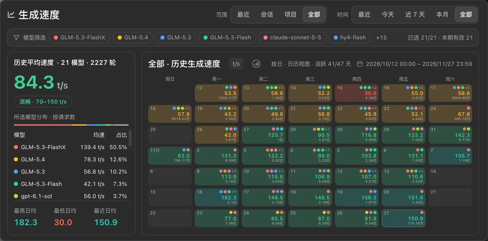</a> |
| **三套状态栏样式与布局**   | 支持「默认（输入框内嵌）/ 药丸（悬浮胶囊）/ 精简（速度移入工具行）」三套样式与均分/居左/居右对齐；支持拖拽排序和低优先级自动折叠进 `···` 菜单 | <a href="docs/promo/features/live/pill-bar.webp"></a> |
| **本轮与会话累计明细**     | 分别统计当前提问和整个对话的 Token 总量、输入/输出、缓存命中率、请求次数、平均延迟与各模型拆分明细；多窗口、多分栏和划词侧栏各自独立不串数据  | <a href="docs/promo/features/live/session.webp">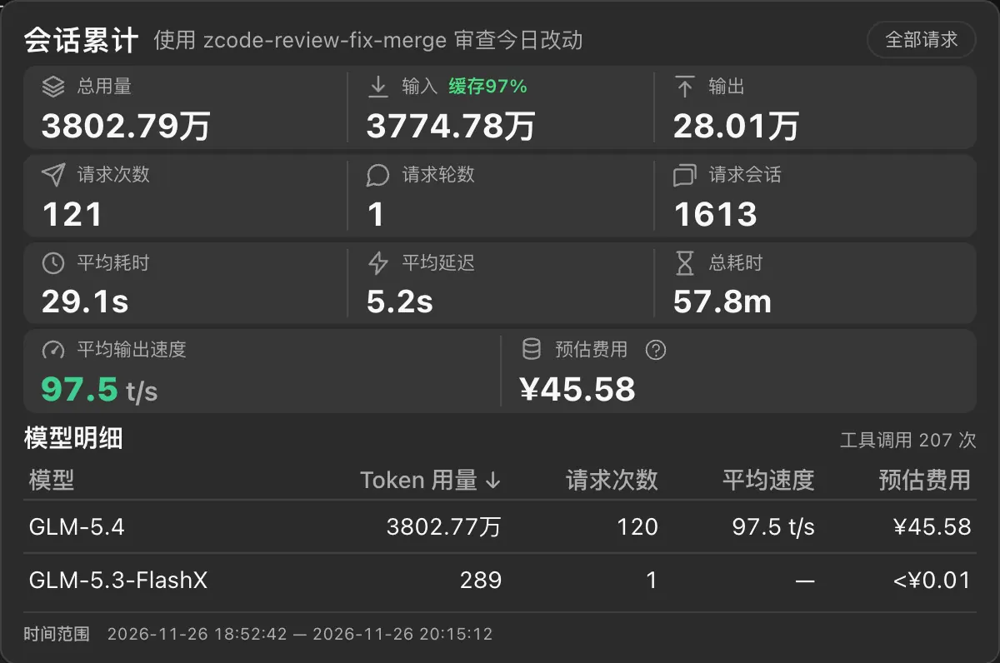</a> |
| **项目累计与跨项目对比**   | 按工作区目录汇总跨会话的 Token 消耗、请求轮数、总耗时、平均速度和各模型费用明细；右上角可一键切到「全部项目」横向对比各项目历史消耗           | <a href="docs/promo/features/live/project.webp">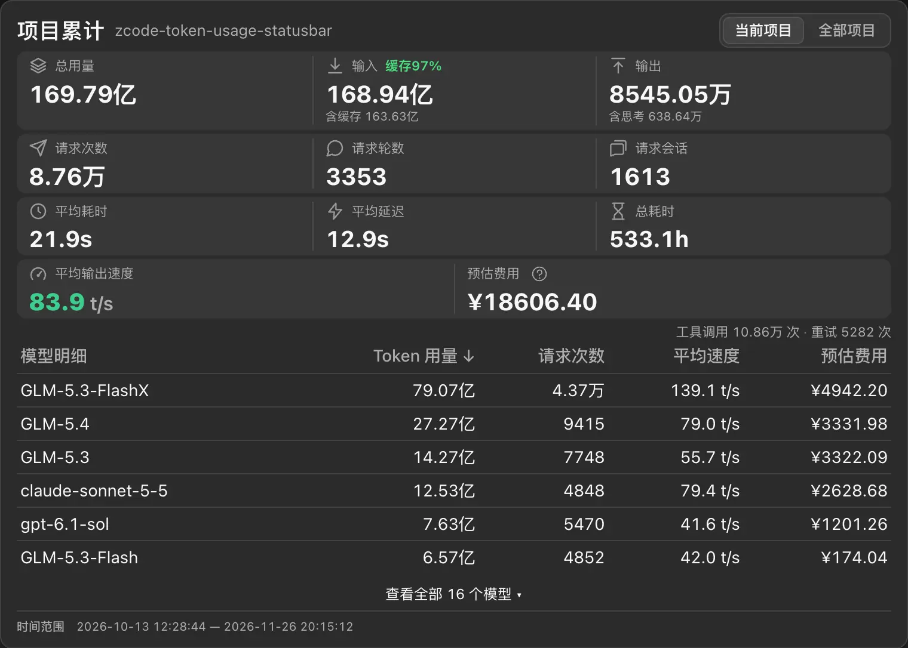</a> |
| **工具调用与错误监控**     | 统计当前会话的工具调用总次数，出错时亮起红色错误徽标；鼠标悬停可看 Bash、Edit、Read、Agent 等每个工具的调用次数、累计耗时和错误数             | <a href="docs/promo/features/live/tools.webp">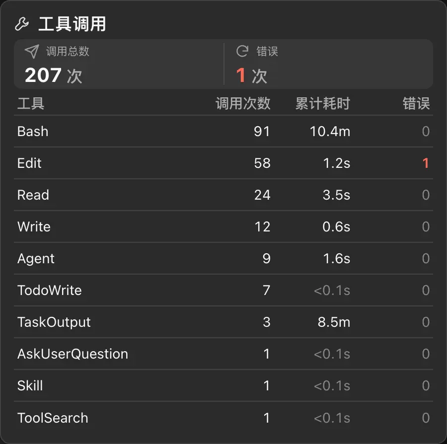</a> |
| **回答末尾的速率行**       | 每轮回答结束后，在末尾附上一行小字：模型名、输出速度、首字等待、输出字数、耗时、峰值速度与预估费用（子智能体窗格也会显示，远端会话除外）       | <a href="docs/promo/features/live/reply-rate.webp"></a> |
| **Git 状态**               | 一眼看当前分支、有没有未推送/未拉取的提交、改了多少文件和行数；支持多仓库子目录汇总，也支持 Worktree 会话。只读本地仓库，不改代码             | <a href="docs/promo/features/live/git.webp">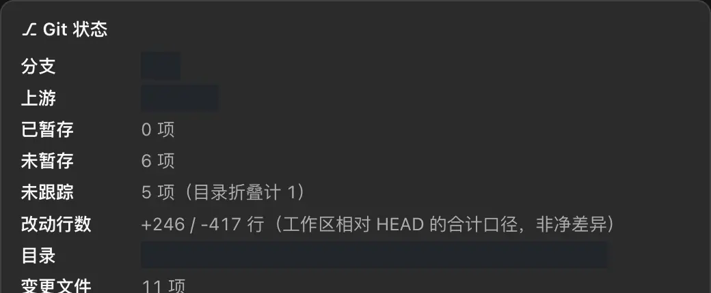</a> |
| **系统状态**               | 状态条第八格（默认关闭，可在 ⚙ 开启）：看本机 CPU、内存和磁盘剩余空间，快满时变色提醒；仅监控运行 ZCode 的本机                                | <a href="docs/promo/features/live/system.webp">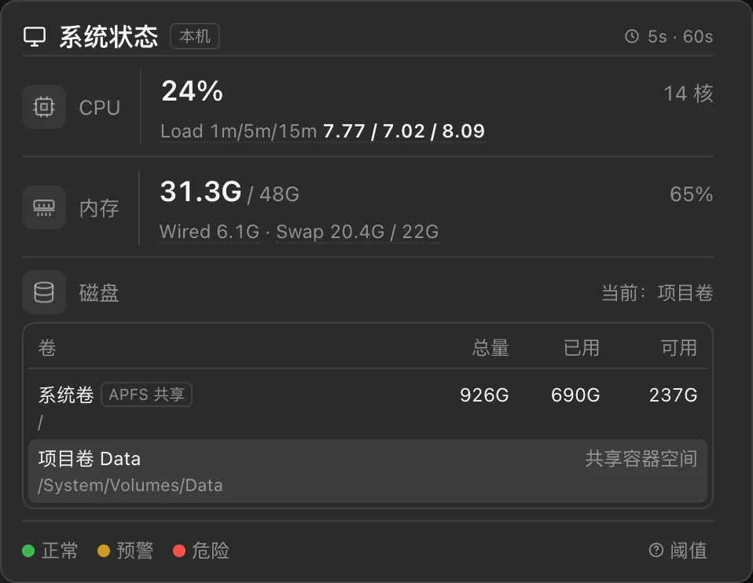</a> |
| **套餐额度与多源凭据**     | 在上下文按钮左边显示账号套餐已用比例、重置时间或余额，可切换看剩余比例。支持 GLM、Start Plan、千问、DeepSeek、OpenCode Go、R4 Coder、StepFun 等 | <a href="docs/promo/features/live/quota.webp"></a> |
| **重置卡徽标**             | 显示登录账号可用的额度重置卡张数和到期倒计时；悬停可看每张卡到期时间、近 7 天过期记录和上次重置时间（纯 API Key 与团队套餐不可用）             | <a href="docs/promo/features/live/reset-card.webp">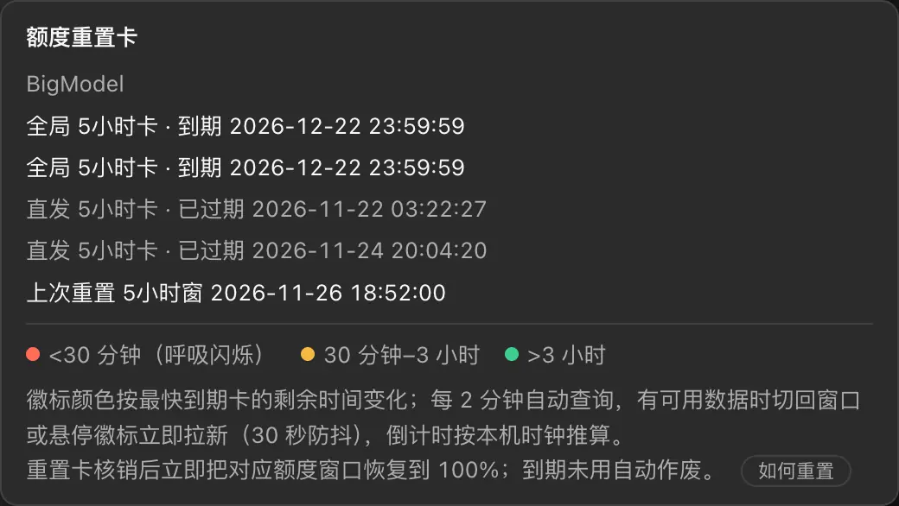</a> |
| **模型选择器峰谷倍率徽标** | 在 GLM Coding Plan 模型列表右侧直接标出当前时段消耗倍率（如 `0.67×` / `2.00×`），悬停可看高峰（工作日 14:00–18:00）与非高峰双档倍率           | <a href="docs/promo/features/peak-factor.webp">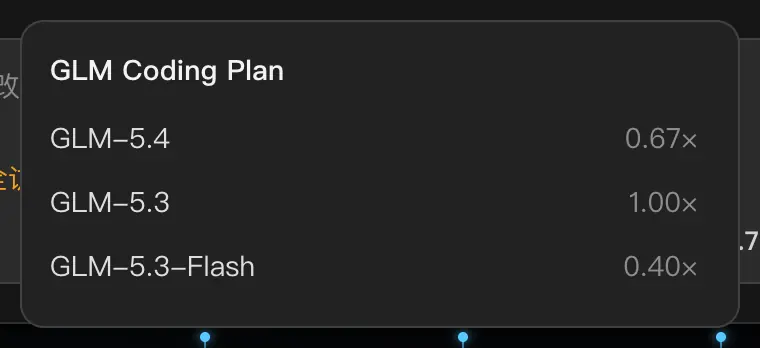</a><br><sub>演示</sub> |
| **拉取模型列表与探测**     | 在自定义供应商和套餐源里一键拉取模型列表；支持自动测试连通性与思考档位，顺手补齐上下文窗口和输出上限（测试会发最小请求，可能消耗少量额度）     | <a href="docs/promo/features/model-pull.webp">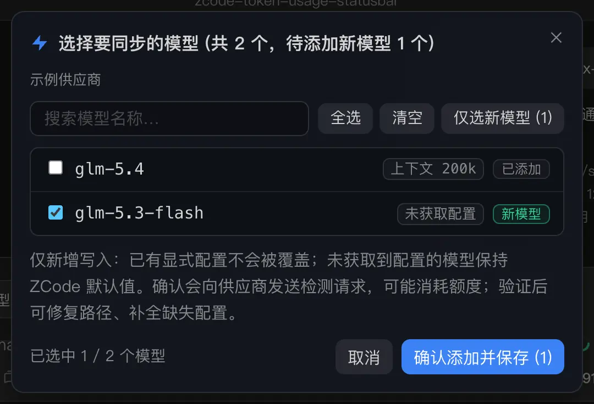</a><br><sub>演示</sub> |
| **增强提示词与历史记录**   | 模型按钮左边的 ✦ 按钮：点一下把草稿润色改写，悬停可查看最近增强历史（含原始/增强文本对照、耗时与 Token 消耗），也可指定专门的润色模型          | <a href="docs/promo/features/live/prompt-enhance.webp">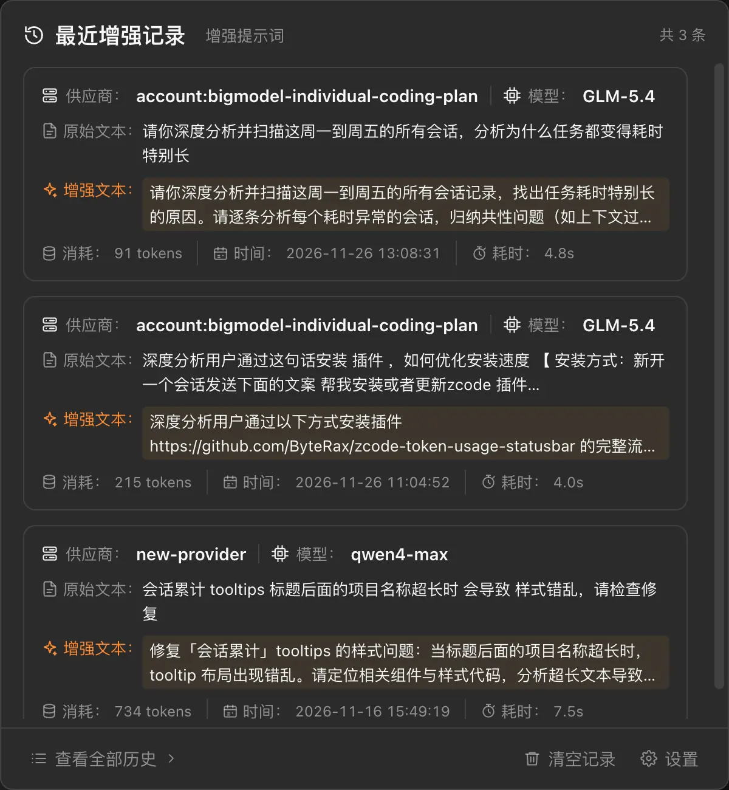</a> |
| **预估费用**               | 鼠标悬停本轮、会话、项目、今日或子代理用量，按公开官方价格估算花了多少钱，支持美元（`$`）和人民币（`¥`）切换；仅供参考，不是真实账单           | <a href="docs/promo/features/estimated-cost.webp">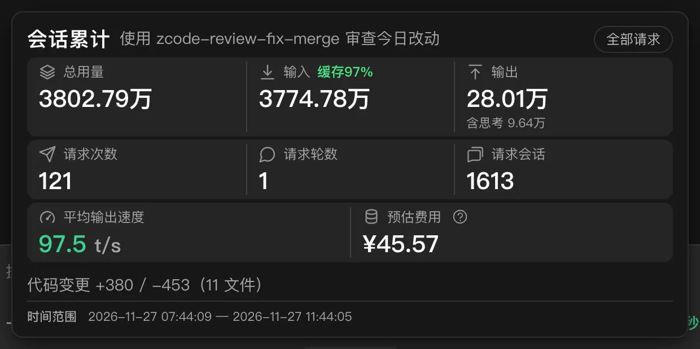</a><br><sub>演示</sub> |
| **上下文按钮增强**         | 给原生上下文按钮加上进度圆环、变色预警和百分比；不占状态条格子                                                                                | <a href="docs/promo/features/live/context-ring.webp"></a> |
| **上下文构成明细**         | 悬停「上下文容量」弹层时，在每一项旁边显示估算 Token 数；鼠标放上去能看大白话解释、对应文件位置和省空间建议（可在 ⚙ 关闭）                     | <a href="docs/promo/features/live/context-breakdown.webp">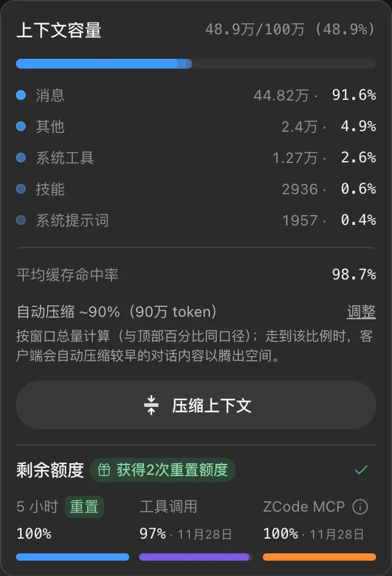</a> |
| **一键压缩与分隔线统计**   | 在上下文面板点确认，直接给当前会话发 `/compact` 压缩记忆且不碰输入框草稿；时间线「上下文已压缩」分隔线下方还会标注压缩前后水位变化与耗时       | <a href="docs/promo/features/live/compact.webp"></a> |
| **调整自动压缩上下文比例** | 在 ⚙ → 通用里自定义什么时候自动压缩（30%–99% 或直接填 Token 数，如 `100k`），留空则按官方默认。仅支持受支持的内置引擎，首次开启需重开或新会话  | <a href="docs/promo/features/live/auto-compact.webp"></a> |
| **项目快捷打开与完整路径** | 在本地项目右键或「…」菜单里加入「在 Finder / 文件资源管理器中打开」；在「编辑项目」弹窗里完整显示文件夹路径，点一下就能打开目录               | <a href="docs/promo/features/project-folder.webp">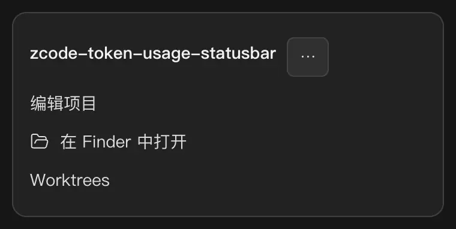</a><br><sub>演示</sub> |
| **搜索弹框加宽**           | 把命令中心等搜索弹窗放宽加高，长文件名和长标题不用左右滚动就能看全                                                                            | <a href="docs/promo/features/search.webp">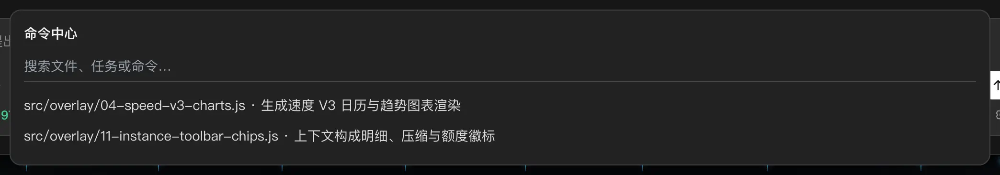</a><br><sub>演示</sub> |
| **状态轮播**               | 默认关闭；开启后，AI 思考和生成时会在加载行轮播有趣短语（内置 16 个词包与日程排程，支持自定义词包），并附上工作耗时和估算速度                  | <a href="docs/promo/features/live/rotator.webp"></a> |
| **SSH / WSL 远端会话**     | 连远程服务器或 WSL 时，也能独立查询和显示远端的用量统计（需先按[远程会话指南](docs/user-guide.md#远程会话)在远端放好查询脚本）               | <a href="docs/promo/features/ssh.webp">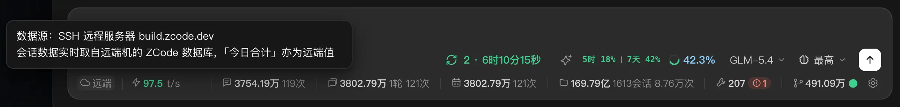</a><br><sub>演示</sub> |
| **Web 远控状态条**         | 通过浏览器油猴脚本，在远控页面复用这套桌面状态条、悬停卡和设置面板（见[手机远控指南](docs/user-guide.md#手机远控页面)）                       | <a href="docs/promo/features/live/web-remote.webp">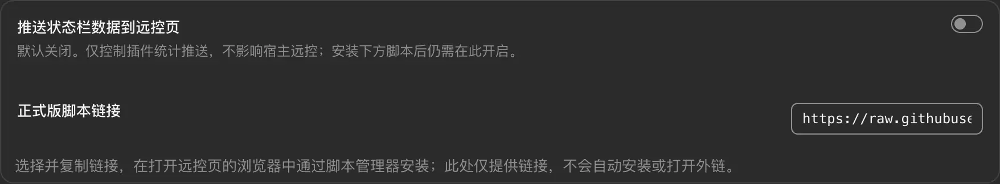</a><br><sub>桌面设置入口</sub> |
| **子智能体与工作流明细**   | 独立统计后台子智能体与动态工作流卡片的消耗；展开面板查看各子任务的模型、状态、速度和费用，会话流 Agent 行内也会显示对应子任务速率             | <a href="docs/promo/features/live/subagents.webp">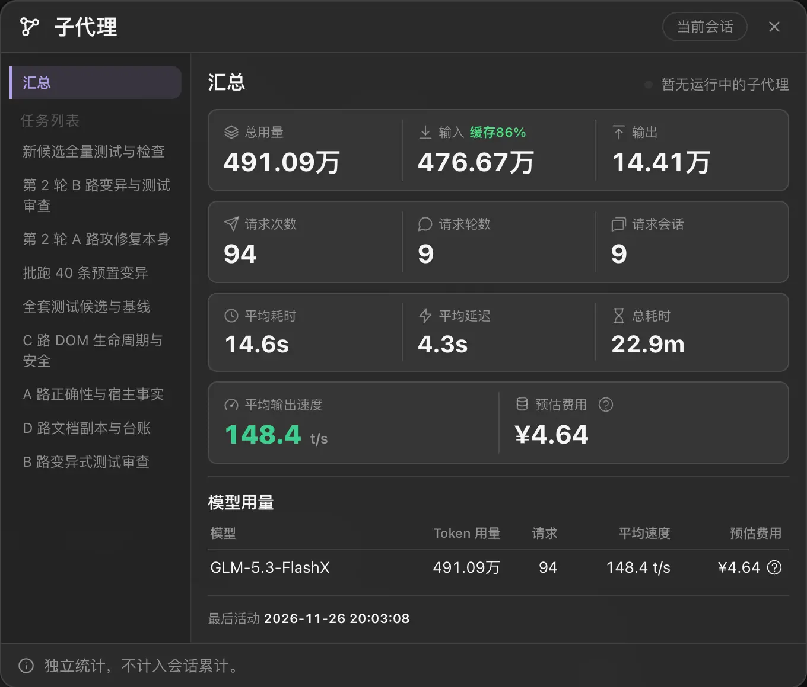</a> |
| **自动更新、日志与体检**   | 支持 GitHub / GitCode 双渠道更新、在线查看版本更新日志、本地热修保护、待重启红点提醒与一键重启 ZCode；输入 `/zusage-doctor` 可做只读环境体检   | <a href="docs/promo/features/live/update-notes.webp">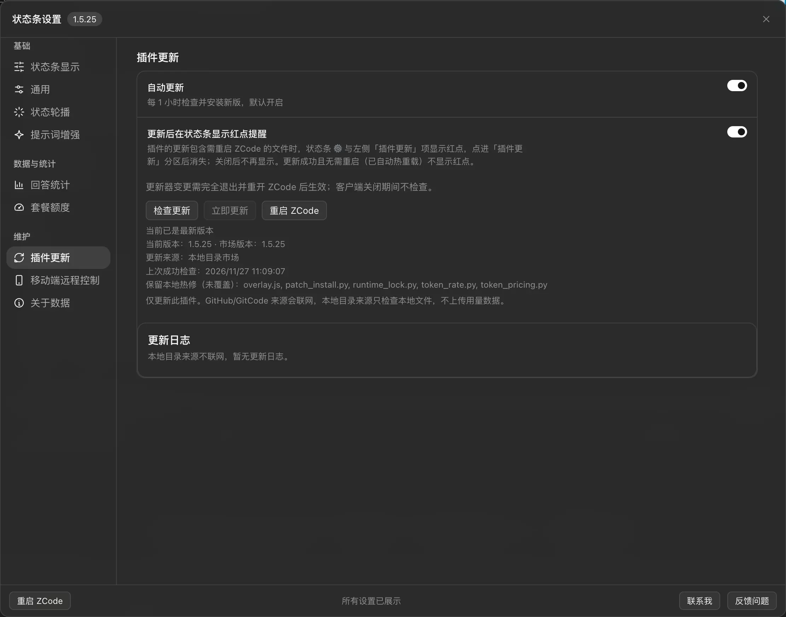</a> |
| **用量查询**               | 除了看状态条，还能在对话里发 `/usage today`、在终端跑 `python3 zusage.py days 7`，或让 AI 调用 MCP 工具 `token_usage` 查历史用量             | <a href="docs/promo/features/usage-query.webp">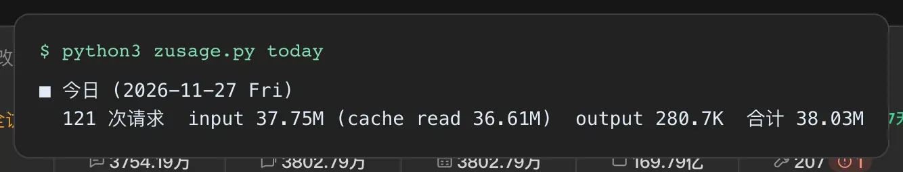</a><br><sub>演示</sub> |

点击状态条右侧的 **⚙ 齿轮图标**，可以切换「默认 / 药丸 / 精简」[状态条样式](docs/user-guide.md#状态条样式)、调整显示哪些格子、切换中英文、切换「万/亿」或「K/M/B」单位，以及设置悬浮卡是「悬停弹出」还是「点击打开」。

## 这些数据是怎么来的

- **用量与费用**：主要从 ZCode 本地的历史记录数据库（SQLite，只读不改）读取；每次回答完成后刷新，不是逐字滚动。
- **生成速度**：回答生成中按字数变化估算，回答结束后切换为实际测算速度；更细的算法见[数据口径](docs/user-guide.md#数据如何计算)。
- **上下文与额度**：上下文占比优先跟随 ZCode 原生显示；套餐额度直接向对应服务商接口查询，不会用本地 Token 数量去反推。

## 顺带支持 WorkBuddy（可选）

同一套查询工具也能读取 **WorkBuddy** 的本地用量，并自动在它的输入框底部注入状态条（只连客户端自带调试端口，不改任何程序文件，也不会影响原 ZCode）：

```bash
python zusage.py host                 # 检查当前宿主和数据库位置
python zusage.py --host workbuddy now # 临时查一次 WorkBuddy 用量
```

想固定用 WorkBuddy 或在客户端里直接用 `/usage`，看[宿主适配文档](docs/hosts.md#7-在-workbuddy-客户端里安装可选)。

## 隐私与安全

- **非官方插件**：本工具通过修改 ZCode 程序文件（`app.asar`）显示界面增强，卸载时只清理自己添加的部分。
- **哪些操作会联网**：本地用量查询完全在本地完成，不上传任何数据；只有查询套餐额度/重置卡、每 12 小时同步一次公开价表与汇率、检查插件更新、使用提示词增强/模型探测，以及你手动开启的远程会话或手机远控才会联网。各功能开关独立，可随时关闭。
- **手机远控安全边界**：只有你在 ⚙ 手动打开开关后，才会把当前会话的数值统计（不含对话正文、文件路径或密钥）经 ZCode 官方中继推给远控页；该通道无端到端加密。
- **本地调试端口**：为方便排查问题和自动测试，插件默认尝试开启本地调试端口 `9229`（仅限本机，请勿转发到公网）。如不需要，启动前设置环境变量 `ZCODE_DISABLE_FIXED_REMOTE_DEBUGGING_PORT=1` 并完全重启即可关闭。
- **凭据与密钥**：你在 ⚙ 填写的额度密钥仅保存在本地运行目录的 `quota-secrets.json`（0600 权限），不会写入日志；内置账号凭据只在内存解密使用，SSH 密码和私钥口令不会被插件读取。
- **用量 ≠ 账单**：估算费用和额度展示仅供参考，不代表实际扣费账单。

## 常见问题

**更新 ZCode 之后，状态条怎么没了？**

- 官方更新会覆盖程序文件。保持插件启用，**新开或恢复一个会话**触发自动修复，确认成功后再**完全退出重开一次 ZCode** 即可。[详细步骤 →](docs/user-guide.md#zcode-升级后状态条消失)

**数字怎么不一直跳？**

- 用量数字在每次回答完成后入库刷新，不是逐字跳动；生成过程中只有速度会按字数估算变化。

**能显示花了多少钱吗？**

- 不能当真实账单，但鼠标悬停在用量数字上可以看到按官方公开价估算的 API 费用；支持的服务商也能直接在「套餐额度」看剩余比例或余额。

[更多排查 →](docs/user-guide.md#排查)

## 💬 交流与反馈

- QQ 群：**129554306**（[点击加入](https://qm.qq.com/q/WXuISJK3ug)）
- 微信群：添加微信 **ByteRax** 邀请进群

<p>
  
  &nbsp;&nbsp;
  
</p>

## 一起把 ZCodeBox 做得更好

欢迎修复问题、完善文档、开发扩展，或分享使用建议。感谢每一位贡献者，也感谢帮助定位问题、测试版本和支持项目的人。

<p align="center">
  <a href="https://github.com/ByteRax/zcode-token-usage-statusbar">
    
  </a>
</p>

## Star History

如果 ZCodeBox 对你有帮助，欢迎 [点一颗 Star](https://github.com/ByteRax/zcode-token-usage-statusbar)。

[](https://www.star-history.com/#ByteRax/zcode-token-usage-statusbar&Date)

## 许可证与免责声明

### 开源许可

本项目已加入并致谢 [LINUX DO](https://linux.do/) 开源社区。

本项目以 [MIT License](LICENSE) 开源。

部分界面图标改编自 [Lucide](https://lucide.dev)（ISC License）。

### 免责声明

- 本项目为**社区维护的非官方增强插件**，未获得 ZCode 官方授权或认可。ZCode 的名称、商标及官方资源归各自权利人所有。
- 本项目通过修改 `app.asar` 加载增强代码，并依赖客户端内部接口、页面 DOM 与部分引擎补丁，**不承诺兼容未来所有 ZCode 版本**；客户端更新可能使功能失效或需要适配，用于生产环境前请评估风险。
- 软件按「现状」提供，不附带明示或默示担保；完整许可与责任限制见 [MIT License](LICENSE)。
