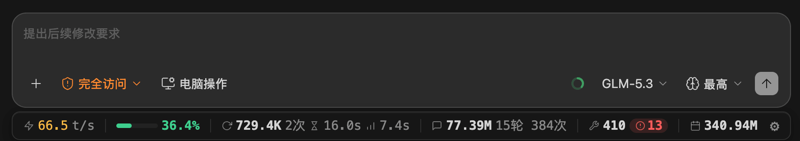

<div align="center">

# ZCode Token 用量状态栏

**用了多少 token，模型有多快，上下文还剩多少——一眼看清。**

给 [ZCode](https://zcode.z.ai) 对话窗口加一条实时用量状态栏。

简体中文 · [English](README.en.md)

Windows / macOS · Python 3.8+ · [MIT](LICENSE)



</div>

## 能做什么

- **看消耗**：本轮、当前会话和今日总用量，不用来回切设置页。
- **看速度**：生成速度、首字等待时间，模型快不快一眼可读。
- **防超限**：显示上下文占比，接近上限时变色提醒。
- **查明细**：悬停看缓存与思考 token，点击查看子智能体消耗，工具出错也有提示。
- **按需显示**：点 ⚙ 调整显示项、语言和插件更新设置。
- **对话内查询**：输入 `/usage` 查看报表；插件还支持在符合条件的回答末尾显示速率。

[查看功能截图与说明 →](docs/features.md)

## 快速开始

> ⚠️ **首次安装悬浮状态条后不会立即显示，必须完全退出 ZCode 并重新启动，状态条才会加载。只关闭窗口不算退出。**

**用桌面客户端？** 推荐通过插件安装，也可以选择下方的一键安装，无需重复安装。
**用自托管网页？** 请直接看 [Web 版安装](web/README.zh-CN.md)。

### 通过 ZCode 插件安装

插件提供**用量查询、回答速率和插件更新**。先安装 [Python 3.8+](https://www.python.org/downloads/)，然后任选一种方式添加插件。

#### 方式一：远程安装（无需下载源码）

在 **ZCode 对话输入框**依次执行：

```text
/plugin marketplace add ByteRax/zcode-token-usage-statusbar#plugin-releases
/plugin install zcode-token-usage-statusbar@zusage-marketplace
```

也可以打开 **设置 → 插件 → 添加插件市场**，输入 `https://github.com/ByteRax/zcode-token-usage-statusbar#plugin-releases`，添加后找到 **ZCode Token Usage Statusbar** 并安装。此渠道安装经过校验的正式 Release，不跟随开发分支。

#### 方式二：本地目录安装

下载或克隆本仓库后：

1. 打开 **设置 → 插件 → 添加插件市场**，点击 **选择目录**。
2. 选择包含 `marketplace.json` 的仓库根目录（不是 `plugins/` 子目录），添加市场。
3. 找到 **ZCode Token Usage Statusbar**，点击安装。

也可在 ZCode 中执行，路径替换为实际仓库目录：

```text
/plugin marketplace add /绝对路径/到/zcode-token-usage-statusbar
/plugin install zcode-token-usage-statusbar@zusage-marketplace
```

<details>
<summary>查看添加插件市场截图</summary>


</details>

#### 安装窗口底部的状态条

> **适用范围：** 本文关于状态条默认自动安装/修复的说明仅适用于当前 `main` / 本地新版源码，尚未发布到正式渠道。`#plugin-releases` 的正式版 `v1.4.1` 仍默认关闭自动安装；请执行 `/install-overlay`，或在下述配置文件中合并 `"plugin_auto_install_overlay": true` 后新建或恢复会话。

安装当前 `main` 的本地新版源码插件后，保持插件启用，新建或重新打开会话，插件默认自动安装/修复状态条。**这会修改客户端的 `app.asar`，请确认信任此项目。安装成功后，必须完全退出并重新打开 ZCode**，只关闭窗口不算退出。

自动安装失败时，再手动执行以下兜底命令，按实际输出排查；成功后仍需完全退出并重开：

```text
/install-overlay
```

**只需要查询和回答速率？** 在 `~/.zcode/zcode-token-usage-statusbar/config.json` 中合并 `"plugin_auto_install_overlay": false`（保留其它设置），或运行 `/uninstall-overlay` 移除状态条并保留卸载豁免，阻止自动重注入与安装提醒。

配置文件不存在或缺少该字段时默认开启；已有的显式 `false` 会保留。环境变量 `ZUSAGE_PLUGIN_AUTO_INSTALL=1` / `0` 优先于配置，但不能绕过卸载豁免。未设置环境变量时，损坏配置或非布尔字段不会启用自动安装。

**以后如何更新？**

- **远程安装**：在 ZCode 输入 `/plugin marketplace update zusage-marketplace`，再到 **设置 → 插件 → 已安装** 更新本插件。
- **本地安装**：先自行更新本地源码，再执行同样的刷新和更新步骤；本地市场不会替你 `git pull`。
- 更新后新建或重新打开会话；若提示主进程文件变化，完全退出并重开 ZCode。

远程推荐使用 `#plugin-releases` 正式渠道，配套清单与发布包的地址、版本和 SHA256 一致。已从默认分支或本地目录添加市场的用户，来源不会自动切换；迁移步骤见 [用户指南](docs/user-guide.md#切换已有市场到正式渠道)。
[更多安装、更新与排查说明 →](docs/user-guide.md#插件安装)

### 一键安装（不通过插件）

先安装 [Python](https://www.python.org/downloads/) 和 [Git](https://git-scm.com/downloads)，在终端执行：

```bash
git clone https://github.com/ByteRax/zcode-token-usage-statusbar.git
cd zcode-token-usage-statusbar
python install.py
```

macOS 上若找不到 `python`，改用 `python3 install.py`。

**安装成功后，完全退出 ZCode，再重新打开。** 状态条会出现在对话窗口底部。

## 日常使用

- **悬停**：查看某项的详细数据。
- **点击子智能体**：展开各个任务的用量。
- **点击 ⚙**：隐藏不关心的项目、切换语言，或检查插件更新。
- **输入 `/usage today`**：查看今天的用量；`/usage week` 查看近一周。

插件命令的完整名称是 `/zcode-token-usage-statusbar:usage`。

## 安全与注意事项

- **用量数据不上传**：本地查询不联网；配置远程会话后会通过指定通道读取远端数据库。插件更新会联网下载代码。
- **状态条会修改客户端文件**：它不是 ZCode 原生功能。卸载时只移除本项目的注入，不回滚客户端版本。
- **ZCode 升级后可能需要重装状态条**：插件默认自动修复，修复后仍需完全退出并重开；失败时再运行安装命令兜底。
- **只卸载插件，状态条可能还在**：请按下方步骤一并清理。

## 常见问题

**安装了插件，为什么没有状态条？**

保持插件启用，新建或重新打开会话以触发默认自动安装/修复；成功后完全退出并重开 ZCode。若自动安装失败，再运行 `install-overlay` 命令兜底，并检查权限、配置与卸载豁免。仅重启不会修复尚未成功安装的状态条。

**数字怎么没有一直变化？**

主要在一次模型请求完成后刷新，不是逐字计数。新会话还没有请求时，显示零值是正常的。

**回答末尾为什么有时没有速率行？**

纯问答或当前提问尚无已入库数据时不会显示，避免误用上一轮数据。可在 ⚙ 中关闭「逐问速率行」。

**能显示套餐费用或剩余额度吗？**

这里显示 token 用量，不是账单。套餐费用与额度仍以 ZCode 官方页面为准。

[更多排查、自动更新和远程配置 →](docs/user-guide.md)

## 卸载

**一键安装的用户**，在仓库目录执行，然后完全退出并重开 ZCode：

```bash
python install.py --remove
```

**插件用户**，按顺序操作，避免只删插件却留下状态条：

1. 在 ⚙ 中关闭自动更新；若更新正在进行，等它结束。
2. 运行 `/uninstall-overlay`，确认成功。
3. 打开 **设置 → 插件 → 已安装 → ZCode Token Usage Statusbar → ⋯ → 卸载**。
4. 完全退出并重开 ZCode，确认状态条消失。

<details>
<summary>查看卸载截图</summary>


</details>

需要删除设置、缓存和插件市场？请看 [彻底清理步骤](docs/user-guide.md#彻底卸载)。

## 更多文档

- [功能截图](docs/features.md) · [安装、配置与排查](docs/user-guide.md)
- [Web 版](web/README.zh-CN.md) · [实现原理与数据口径](docs/design-notes.md)
- [开发与发布](docs/maintaining.md) · [测试说明](tests/README.md)

[MIT License](LICENSE)
