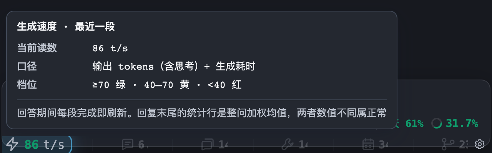
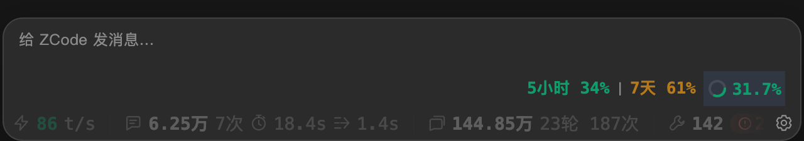
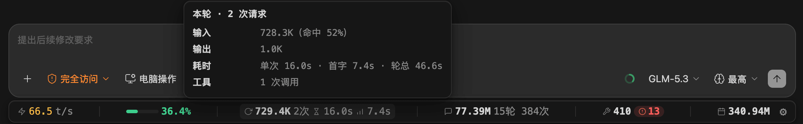
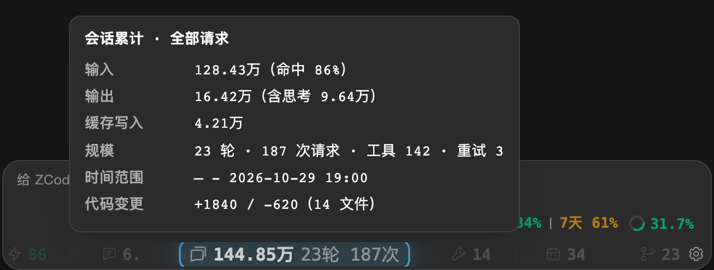
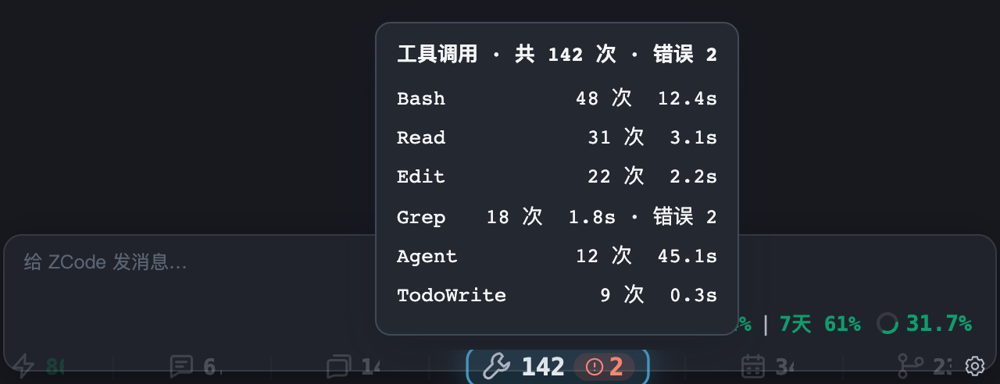
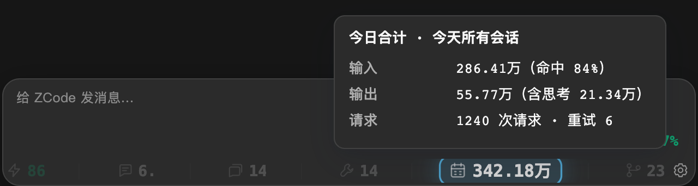
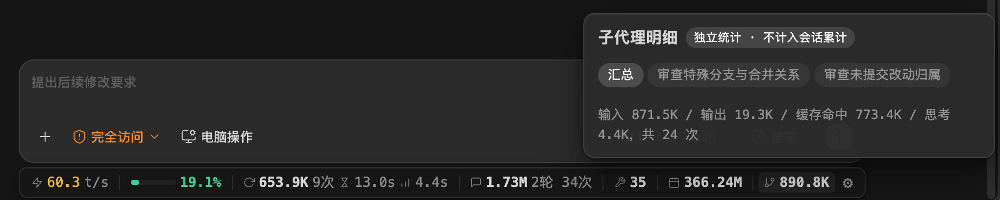
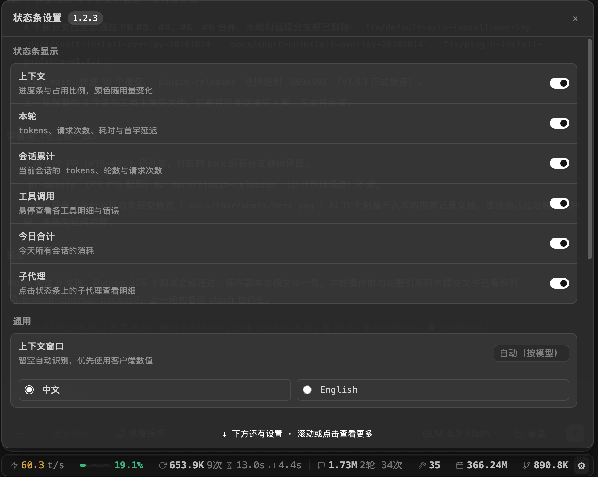

# 功能截图

[返回首页](../README.zh-CN.md) · [安装与配置](user-guide.md)

状态条跟随当前对话窗口；各项都可以在 ⚙ 中独立显示或隐藏。

## 生成速度

最近一次完成请求的生成速度。颜色用于快速比较模型快慢；悬停可查看计算方式。

## 上下文容量

显示当前上下文占比，接近上限时变色提醒。窗口大小自动识别，也可以在 ⚙ 中手动指定；请求被拒绝时会给出处置建议。

## 本轮用量

本次提问用了多少 token、缓存命中率多少、等了多久才出首字。悬停看输入、输出、缓存与思考明细。

## 会话累计

查看整个对话的用量、轮次和请求次数，以及代码增删统计。不同窗口跟随各自会话，不混用数据。

## 工具调用

显示调用次数，出错时亮起错误标记。悬停查看各个工具的耗时与错误。

## 今日合计

汇总今天各个会话的 token 消耗，随请求完成刷新。

## 子智能体

主会话与子智能体分别统计。点击展开面板，查看每个派发任务的用量与运行状态。

## 设置

调整显示项、上下文窗口大小和语言。插件安装还可管理自动更新与回答末尾的速率行；截图仅展示部分选项，以当前版本界面为准。

## 回答末尾的速率行（插件）

有当前提问的已入库数据时，符合条件的回答末尾会附上生成速度、首字延迟、输出量和耗时。可在 ⚙ 关闭「逐问速率行」，下一问生效。

它和状态条上的速度可能不同：状态条看**最近一段请求**，速率行看**本问已完成的多段请求**；回答收尾正文尚未入库，所以不在这次采样中。纯问答或无当前数据时不显示，避免显示上一轮的统计。

装了状态条后，悬停速率行也能查看解释。更详细的计算方式见 [数据口径](user-guide.md#数据如何计算)。

## 远程会话

桌面客户端连接远端 ZCode 时，需要单独配置远程数据库读取；支持 SSH，也能通过 Docker、WSL 等通道执行查询。

[远程配置步骤 →](user-guide.md#远程会话)
