# 功能截图

[返回首页](../README.zh-CN.md) · [安装与配置](user-guide.md)

点击图片可查看原图。未标注「演示」的截图均来自 ZCode 桌面 CDP 实拍（使用本仓库 `zcode-token-usage-statusbar` 的真实开发数据，个人路径已遮挡）；标注「演示」的截图由当前版本 `overlay.js` 配合同源数据渲染。状态条跟随当前对话窗口或分栏；各显示项可在 ⚙ 中独立设置。

## 生成速度与历史趋势 V3

生成中在渲染桥可用时显示字符增量估算与工作状态（思考、执行工具、运行子智能体等）；回答完成后切换为本会话加权平均输出速度。悬停显示（默认停留 500 毫秒弹出，⚙ 可调，也可改为点击打开）可按 4 种范围（最近 / 会话 / 项目 / 全部）× 5 种时间（最近 / 今天 / 近 7 天 / 本月 / 全部）筛选各模型均速、分布占比与日历热力图/柱状趋势图（选「本月」时支持前后翻月与月历选月）。

[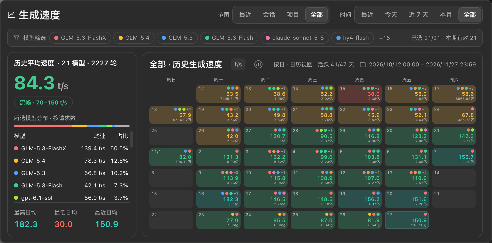](promo/features/live/status-bar.png)

## 三套状态栏样式与回答末尾速率行

- **默认样式（输入框内嵌）**：状态栏平铺在输入框工具行下方，与工具行增强（Git 分支改动、重置卡徽标、套餐额度、上下文进度圆环、✦ 提示词增强按钮）融为一体；支持「均分 / 居左 / 居右」对齐、拖拽排序与低优先级折叠进 `···` 菜单。

  [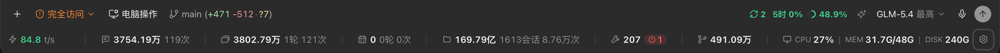](promo/features/live/bar.png)

- **药丸样式（悬浮胶囊）**：居中悬浮在输入框下方，宽度随内容自适应，圆角、边框与背景随输入框聚焦及速度档位变化。

  [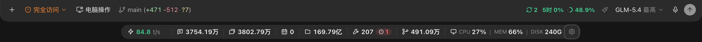](promo/features/live/pill-bar.png)

- **精简样式（工具行前导区）**：隐藏底部状态条，将生成速度移入输入框工具行前导区（Git 状态 chip 左侧），悬停照常查看速度趋势卡，右键或点卡内齿轮打开设置。

  

- **回答末尾的速率行**：每轮回答结束后，符合条件的回答末尾（含子智能体窗格与划词辅助对话，远端会话除外）会附上一行统计：模型名称、本轮输出速度、首字延迟、输出 Token 数、生成耗时、分段数与峰值速度、会话均速、累计输出以及预估费用。可在 ⚙ →「回答统计」随时开关，悬停该行也能查看计算口径说明。更详细的计算方式见 [数据口径](user-guide.md#数据如何计算)。

  

## 本轮用量

查看最近一轮提问的 Token 总量、输入与缓存命中率、输出、请求次数、平均耗时/延迟、平均输出速度、预估费用及按模型拆分的明细。

[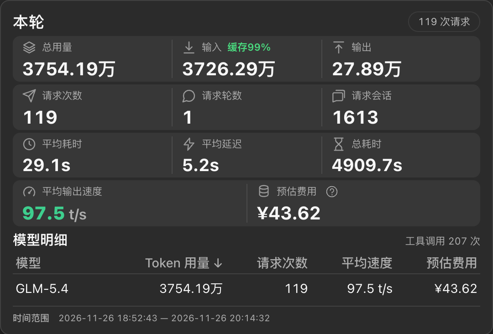](promo/features/live/turn.png)

## 会话累计与预估费用

查看当前对话窗口全部请求的累计用量、轮次、耗时、平均输出速度、预估费用及各模型占比；多窗口、多分栏与划词辅助对话各自独立统计，互不串用。预估费用按公开官方单价估算，支持美元（`$`）与人民币（`¥`）切换，仅供参考，不代表真实账单。

[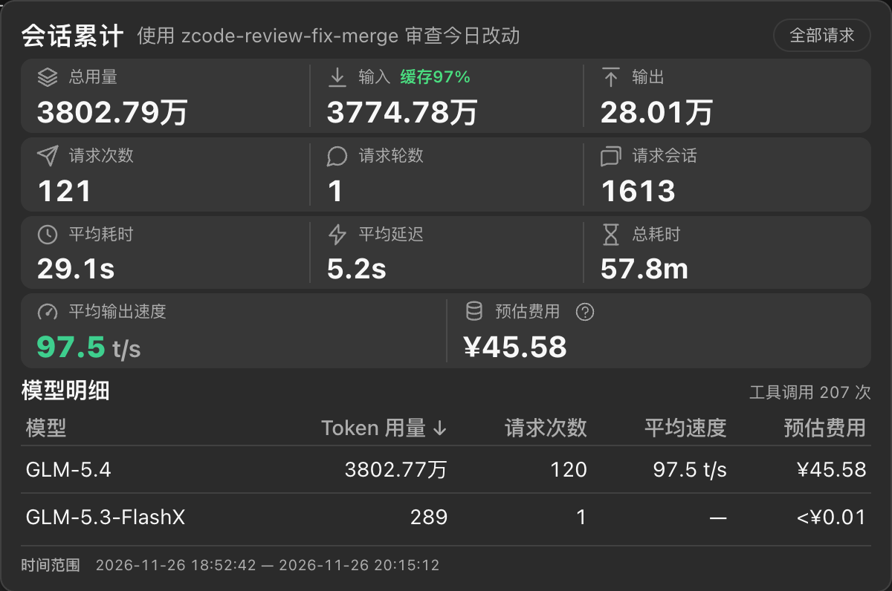](promo/features/live/session.png)

## 项目累计与跨项目对比

按工作区目录汇总整个项目跨会话的 Token 消耗、请求次数、累计耗时、平均输出速度、预估费用与模型明细，右上角也可一键切换到「全部项目」对比不同项目的历史消耗。

[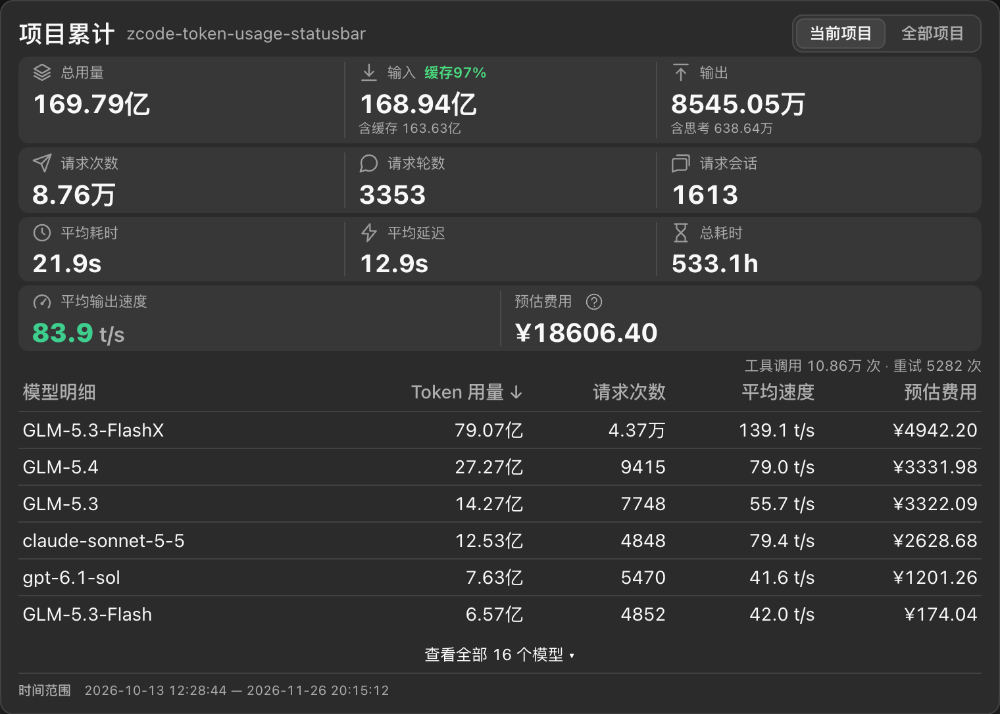](promo/features/live/project.png)

## 今日合计

跨会话汇总今天所有对话的 Token 消耗、缓存命中率、请求次数、平均速度、预估费用与模型分布，随每次请求完成刷新。

[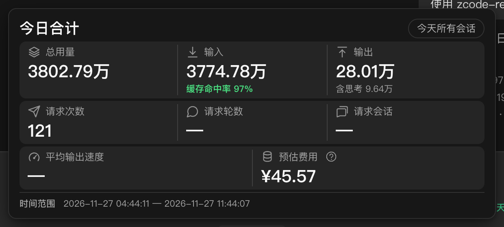](promo/features/today.png)

演示

## 工具调用与错误监控

显示当前会话的工具调用总次数，出错时亮起红色错误徽标；悬停可查看每个工具的调用次数、累计耗时与错误数。

[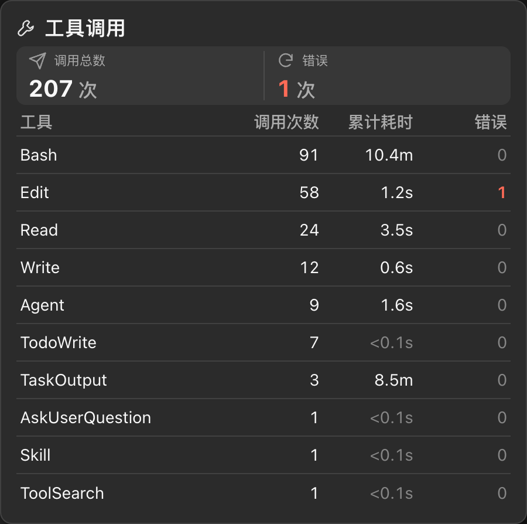](promo/features/live/tools.png)

## 子智能体与工作流明细

主会话与后台派发的子智能体、动态工作流卡片分别独立统计（不重复计入会话累计）。悬停或点击展开面板，可查看汇总数据、模型用量以及每个子任务的运行状态、Token 消耗、速度和预估费用；会话流中的 Agent 工具行与工作流卡片内也会显示对应速率与消耗汇总。

[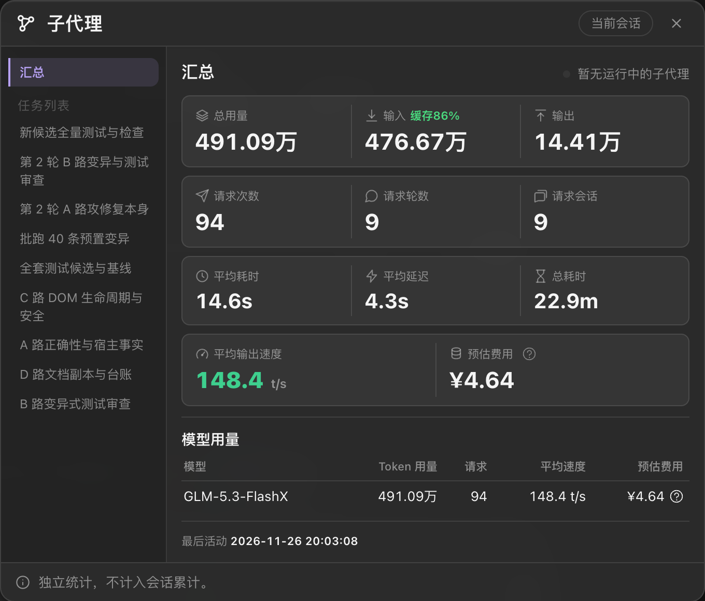](promo/features/live/subagents.png)

## 上下文按钮增强、构成明细与压缩

在原生上下文按钮上叠加进度圆环、百分比与变色预警，不额外占用状态条格子：

[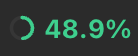](promo/features/live/context-ring.png)

悬停原生「上下文容量」弹层时，自动在消息、系统工具、技能、系统提示词等分项旁补上估算 Token 数（悬停单行可看说明、关联文件路径与省空间建议），并展示平均缓存命中率、当前自动压缩阈值线与「压缩上下文」快捷按钮：

[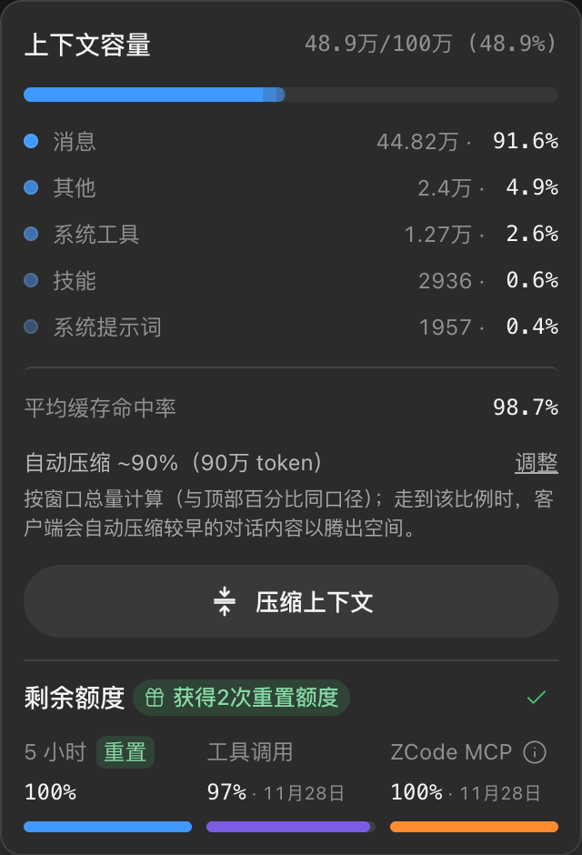](promo/features/live/context-breakdown.png)

点击「压缩上下文」并确认后，直接向当前会话发送 `/compact` 总结压缩历史，不会改动输入框里正在编写的草稿；时间线上的「上下文已压缩」分隔线下方也会自动标注第几次压缩、压缩前后上下文水位变化、压缩消耗、耗时与执行模型（可在 ⚙ →「回答统计」开关）：

[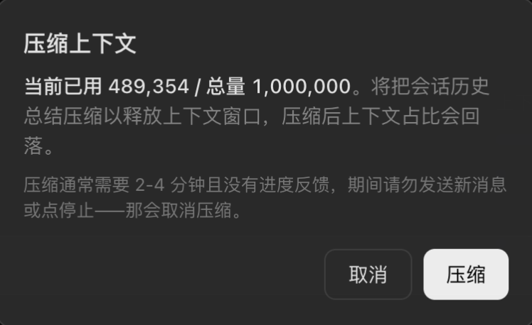](promo/features/live/compact.png)

在 **⚙ → 通用** 中还可自定义自动压缩触发阈值（支持 `30%–99%` 百分比或 `100k` 等 Token 数模式，留空跟随引擎默认；仅支持受支持的客户端内置引擎）：

[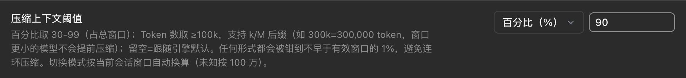](promo/features/live/auto-compact.png)

## 套餐额度、多源凭据、重置卡与峰谷倍率

在上下文按钮左侧显示当前账号套餐的已用比例（可在 ⚙ 切换为剩余比例）、重置时间或账户余额，支持 GLM Coding Plan、ZCode Start Plan、千问 Coding Plan、DeepSeek、OpenCode Go、R4 Coder、StepFun、MiniMax、Kimi、Cline、Anthropic、MiMo、火山方舟、SCNet、Ollama Cloud 等多种数据源（详见 [额度支持矩阵](quota-support-audit.md)）：

[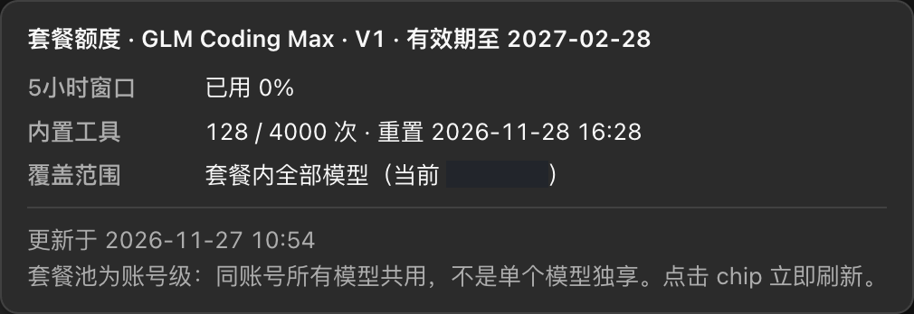](promo/features/live/quota.png)

在 **⚙ → 套餐额度** 中可统一管理各家套餐与余额数据源的独立开关和凭据（仅保存在本地 `quota-secrets.json`，0600 权限）：

[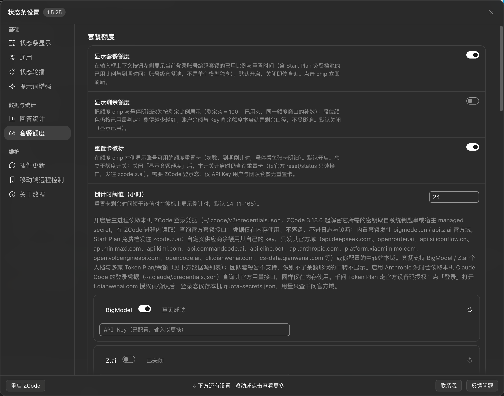](promo/features/live/quota-settings.png)

登录 ZCode 账号有可用额度重置卡时，在额度 chip 左侧显示「重置 · N」徽标与最快到期倒计时，悬停可看每张卡的到期时间、近 7 天过期记录与上次重置时间：

[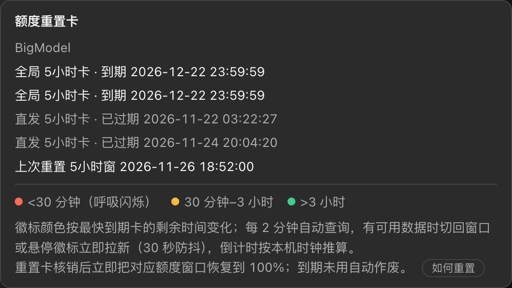](promo/features/live/reset-card.png)

在 GLM Coding Plan 模型选择器列表右侧，还会直接标出当前时段的额度消耗倍率（如 `0.67×` / `1.00×`），悬停可查看工作日高峰（14:00–18:00）与非高峰双档倍率：

[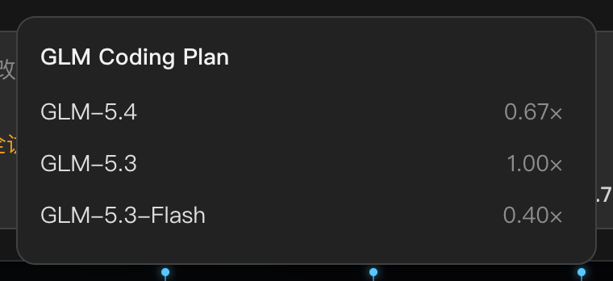](promo/features/peak-factor.png)

演示

## Git 状态与系统状态

工具行前导区的 Git 状态 chip 显示当前分支、领先/落后提交数、暂存/未暂存/未跟踪文件数以及增删行数；支持多仓库子目录汇总与受管 Worktree 会话（只读本地仓库，不改代码）：

[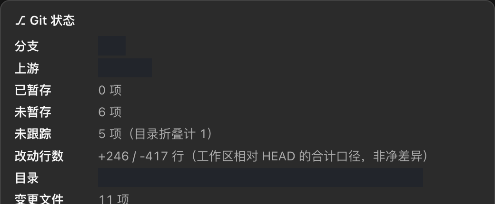](promo/features/live/git.png)

状态条第 8 格「系统状态」（默认关闭，可在 ⚙ 开启）展示本机 CPU、内存（含 Wired / Swap）与磁盘剩余空间（支持 APFS 共享容器识别），接近阈值时变色提醒：

[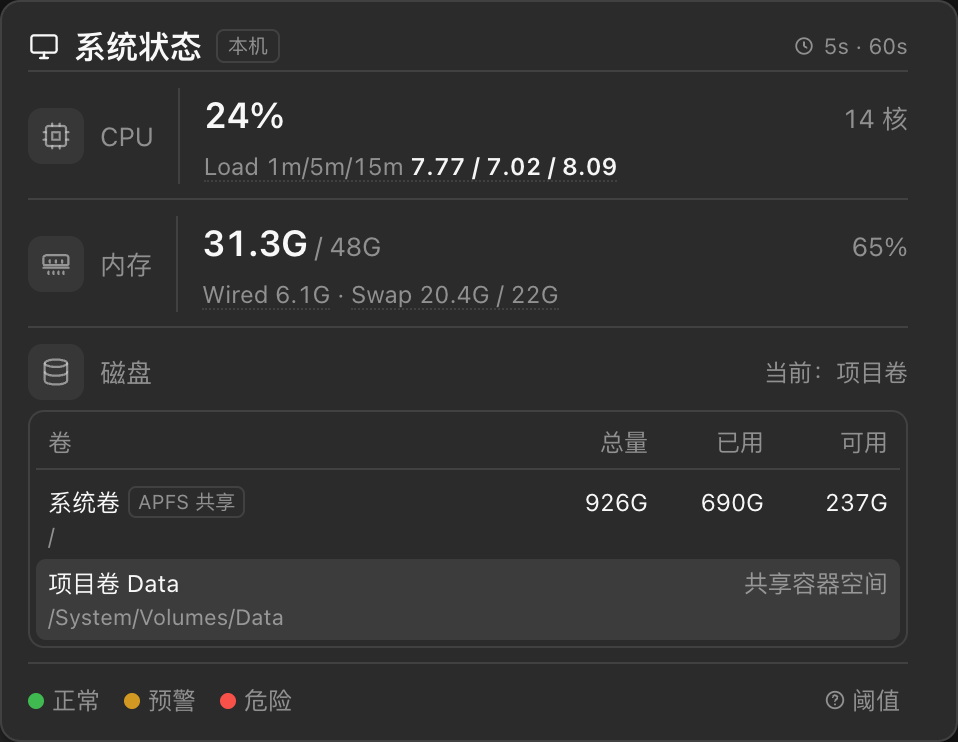](promo/features/live/system.png)

## 模型拉取探测、提示词增强与界面小工具

- **拉取模型列表与探测**：在自定义供应商和套餐源页面一键拉取模型列表，勾选后可自动发送最小请求检测连通性与思考档位，并补齐缺失的上下文窗口与输出上限（检测可能消耗少量额度）。

  [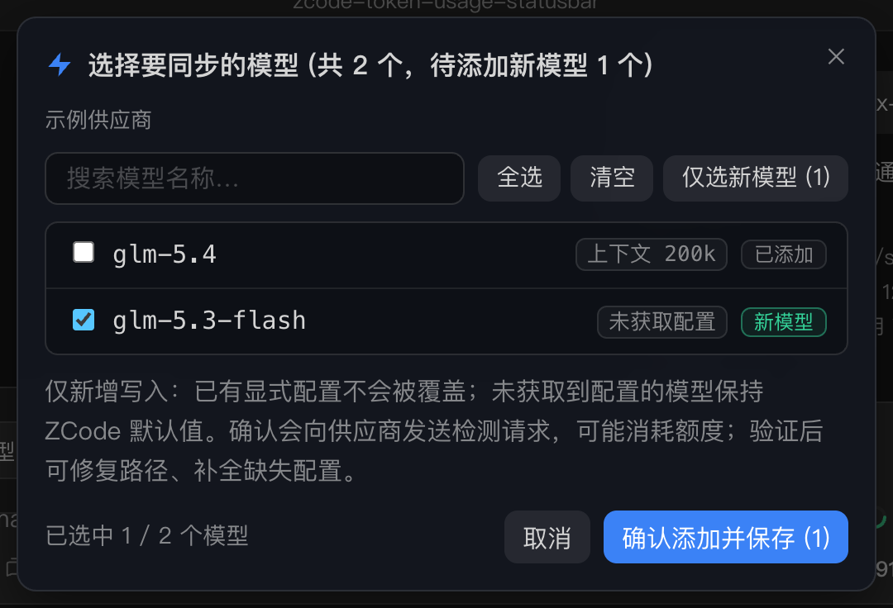](promo/features/model-pull.png)

  演示

- **增强提示词与历史记录**：模型选择按钮左侧的 ✦ 按钮可一键润色输入框草稿；悬停 ✦ 按钮可查看最近增强历史（含供应商、模型、原始文本与增强文本对照、Token 消耗与耗时），也可在 ⚙ →「提示词增强」指定专用润色模型。

  [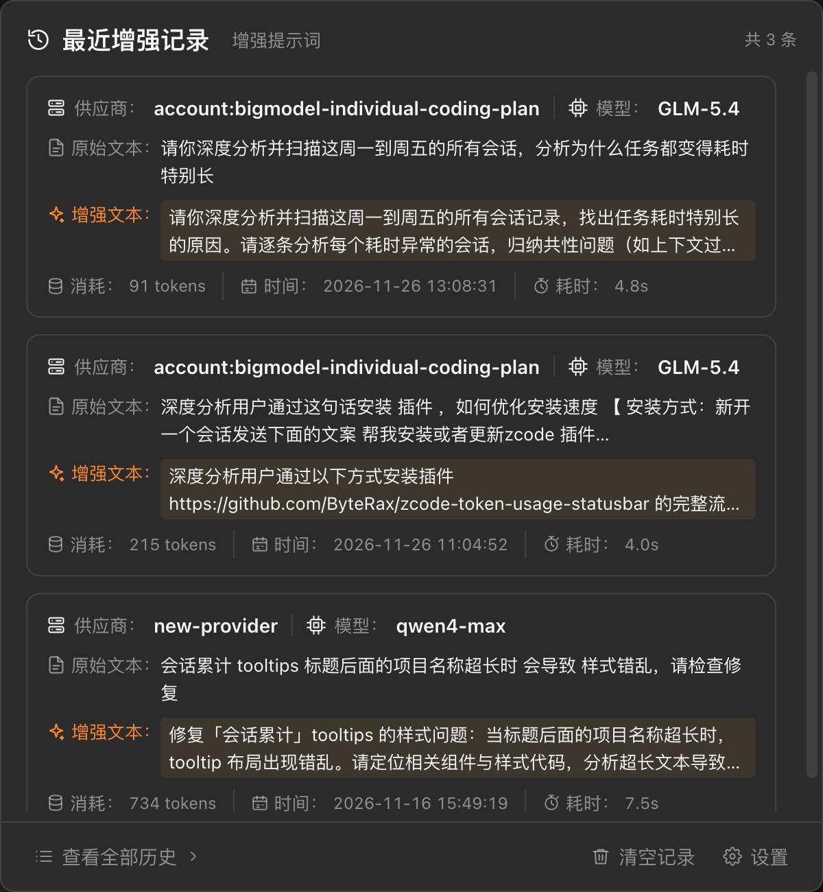](promo/features/live/prompt-enhance.png)

- **项目快捷打开与完整路径**：在本地项目右键或「⋯」菜单中加入「在 Finder / 文件资源管理器中打开」，并在「编辑项目」弹窗里显示可点击的完整路径。

  [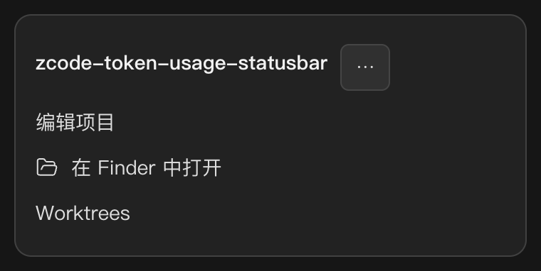](promo/features/project-folder.png)

  演示

- **搜索弹框加宽**：自动放宽加高命令中心等搜索弹窗，长文件名和长路径无需左右滚动。

  [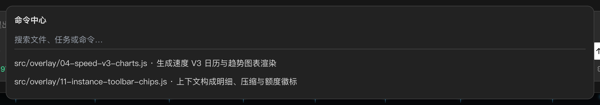](promo/features/search.png)

  演示

- **状态轮播**：默认关闭；开启后在 AI 思考与生成时轮播趣味短语（内置 16 个词包与日程排程，支持自定义词包、附加工作耗时与估算速率）。

  

## 远程会话、Web 远控与命令行查询

- **SSH / WSL 远端会话**：连接远程服务器或 WSL 时独立查询并展示远端数据库用量（状态条左侧显示「远端」标记；配置步骤见 [远程会话指南](user-guide.md#远程会话)）。

  [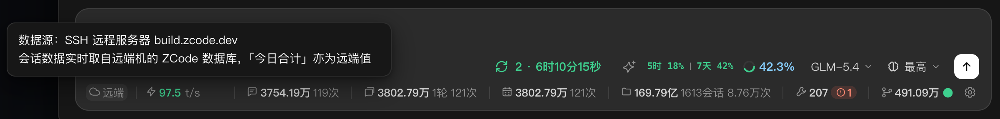](promo/features/ssh.png)

  演示

- **Web 远控状态条**：在浏览器安装油猴脚本并在 **⚙ → 维护 → 移动端远程控制** 开启推送后，可在 `zcode.z.ai/remote` 页面直接复用桌面状态条、悬停卡与设置面板（详见 [手机远控指南](user-guide.md#手机远控页面)）。

  [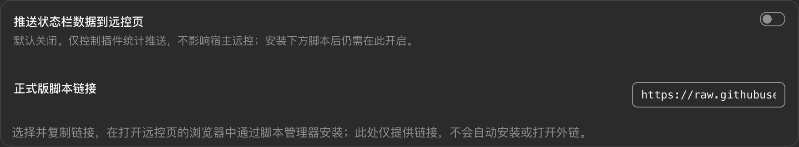](promo/features/live/web-remote.png)

- **命令行、`/usage` 与 MCP 查询**：除状态条外，可在对话中发送 `/usage today`、在终端运行 `python3 zusage.py today` / `days 7`，或由 AI 调用 `token_usage` MCP 工具查询历史报表。

  [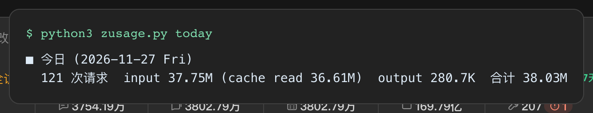](promo/features/usage-query.png)

  演示

## 设置面板、自动更新与版本日志

点击状态条右侧的 **⚙ 齿轮图标**（精简样式下点击速度卡标题旁的设置图标或右键点击速率图标）打开设置面板：可切换中英文、切换「默认 / 药丸 / 精简」样式与水平对齐、拖拽调整各显示项顺序与折叠优先级、开关中文单位（万/亿）或强制 K/M/B 单位、配置各家套餐额度凭据、设置提示词增强与状态轮播。

[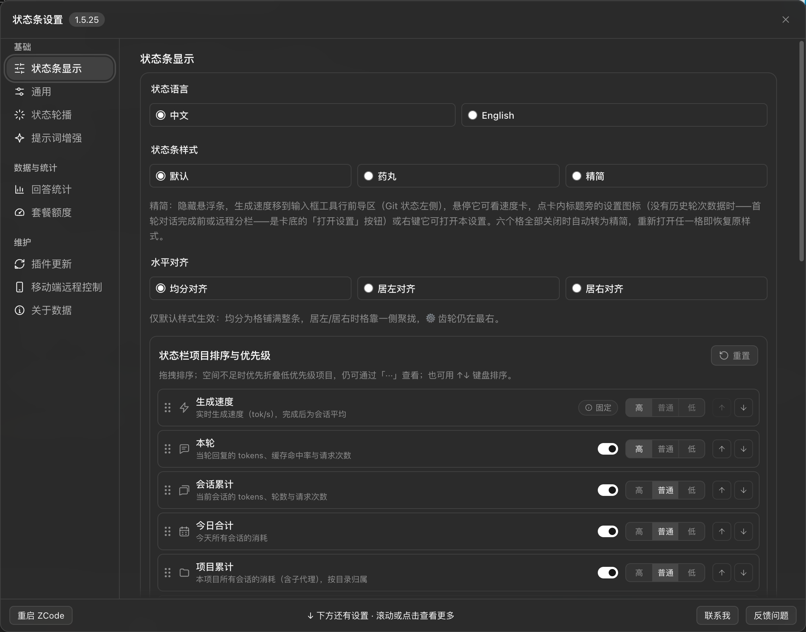](promo/features/live/settings.png)

在 **⚙ → 维护 → 插件更新** 中，支持 GitHub / GitCode 双渠道更新、渠道落后检测、本地热修文件保留提示、在线查看版本更新日志（待重启红点亮起时悬停 ⚙ 齿轮也可直接预览更新日志）以及一键重启 ZCode；遇到环境问题时可在新会话运行 `/zusage-doctor` 做只读体检：

[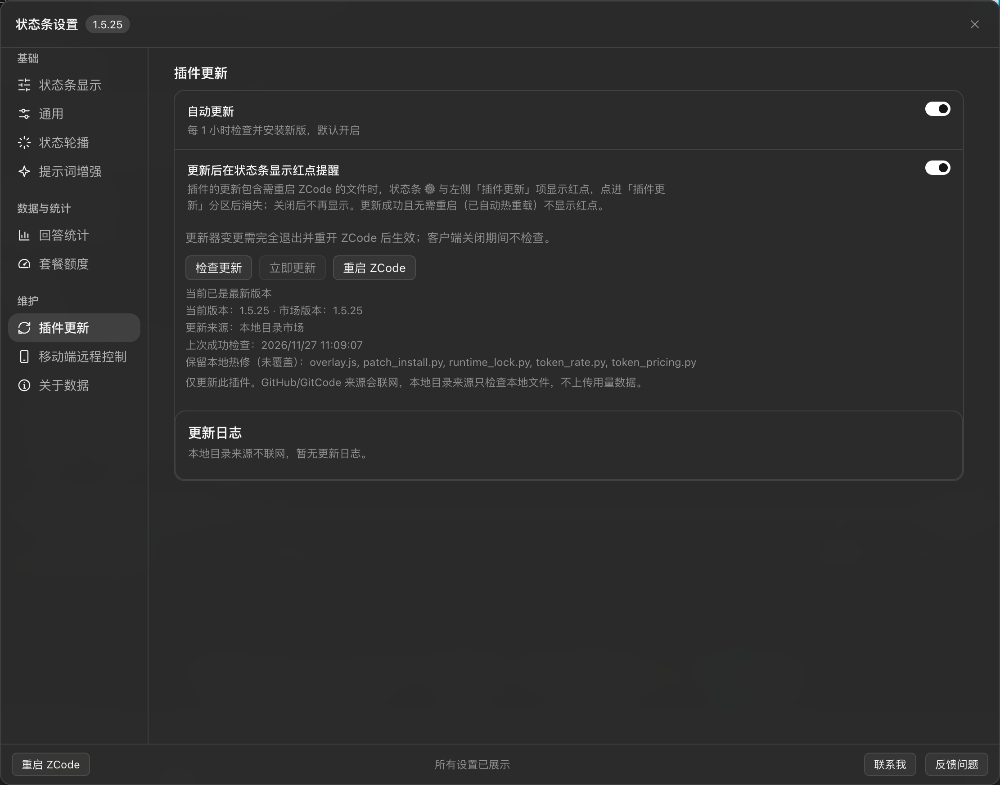](promo/features/live/update-notes.png)
