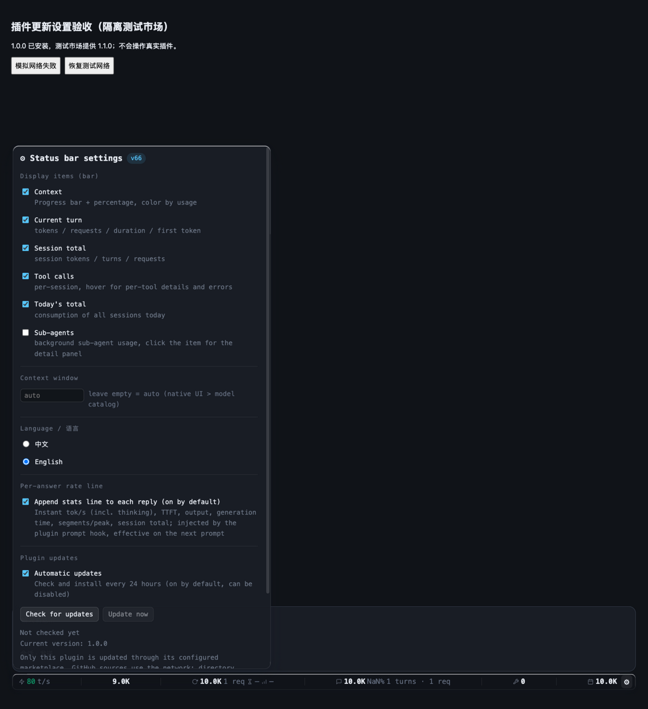
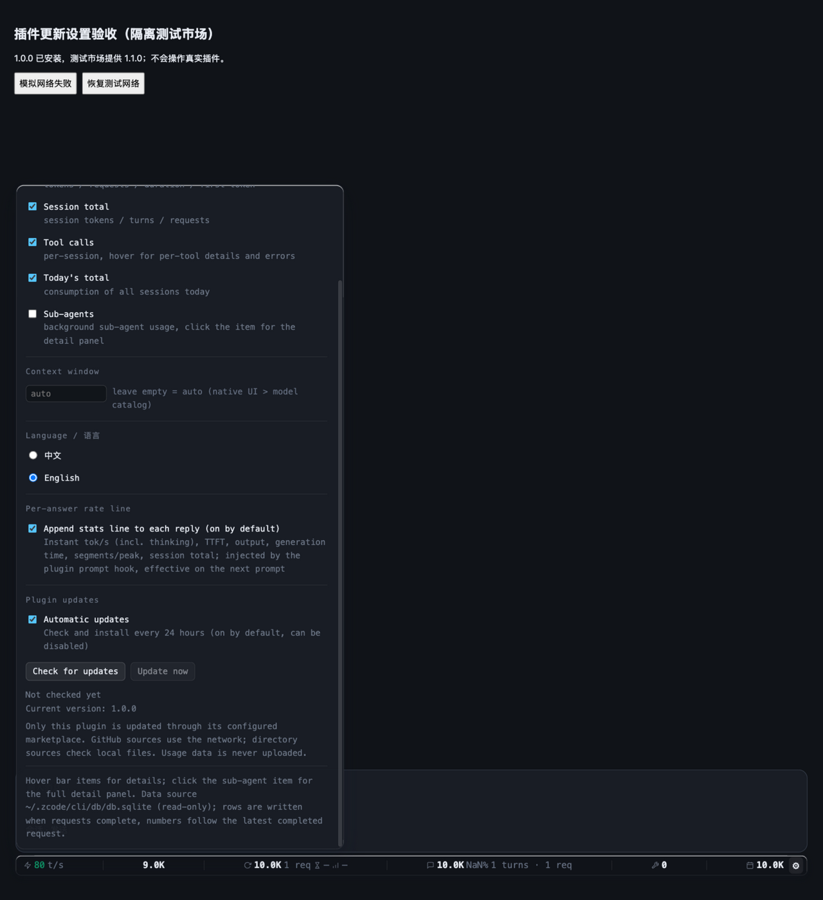

# 批量修复验收（1.3.1，2026-10-14）

## 结果与范围

按照 [上轮审查](plugin-default-update-review.md) 的 8 项问题及安装授权类型收紧点完成源码修复，插件源码版本 **1.3.1**。原有自动更新默认开启、显式关闭保持、自动重注入授权分离不变；保留并行会话加入的逐问速率行开关。

源码：`/Users/smzdm/Projects/AI/zcode-token-usage-statusbar/plugins/zcode-token-usage-statusbar`。
市场根：`/Users/smzdm/Projects/AI/zcode-token-usage-statusbar`，清单为根 `marketplace.json`。
插件 ID：`zcode-token-usage-statusbar@zusage-marketplace`。

**本轮没有人工安装新版、覆盖真实缓存、修改真实 app.asar、提交、推送或重启客户端。** 本机官方安装记录仍为 **1.2.3**，自动更新与自动恢复开关仍为 true。源码完成不等于已安装版本已更新。

## 修复到证据映射

| 原审查项 | 修复实现 | 具体回归证据 |
|---|---|---|
| P1 SessionStart 并发同步回滚 | `sync_runtime` 基线读取、规划、文件写入和记录提交全程持永久 `plugin-runtime.lock`，与更新锁分离 | `test_actual_process_transaction_blocks_old_hook_until_new_baseline_commits`：真实旧进程不能读取未提交基线，新版提交后旧包无 changed，版本与文件保持新版 |
| P1 陈旧更新锁删除竞争 | `runtime_lock.py` POSIX flock / Windows byte locking；Node 异步 helper 持有永久 `plugin-update-v2.lock`，stdin EOF 释放，不按路径删锁 | `multiple real holder processes have exactly one winner and no unlink race`：12 真进程唯一赢家；SIGKILL、父退出、EOF、永久 inode 回归 |
| P1 同版同步覆盖热修 | 可信 SHA256 基线持续保护同版本；无基线才使用迁移 mtime；损坏 hash 写前失败关闭 | `test_same_version_preserves_manual_edit_with_older_mtime`；`test_upgrade_preserves_recorded_manual_edit_with_older_mtime` 连续同步；损坏基线不覆盖 |
| P2 CLI 提交后错误丢同步 | 安装前保存 pendingSync/pendingVersion；默认子进程同步保存 pendingPid；失败/重启后依据官方 inventory 协调 | `pending intent exists before installer commits and failed committed CLI recovers offline`；真实 `orphaned official installer keeps recovery waiting until actual child exit`，存活时不 CLI/不 sync，退出后离线恢复 |
| P2 后台冷更新丢重启提醒 | 同步写文件之前合并目标 hash 标记；报告 restartRecorded 防后置重复；已有 marker、无 changed 的后续 hook 仍提醒；loader 按启动时间与指纹确认 | 后台实例持久 marker、`test_loader_ack_during_sync_is_not_overwritten_by_hook_postwrite`、真实 helper+loader boot 3 项、marker failure 拦截写入、重复 SessionStart 不重打包且确认后静默 |
| P2 检查期间关闭仍安装 | 安装副作用前重读配置；busy 期间接受保存 false；loader 不 await 长更新请求而停止后续 poll；checkbox busy 时仍可操作 | 跨实例检查中关闭、busy 关闭、安装已启动后关闭继续善后；`loader keeps polling controls while an update action is still awaiting the CLI` |
| P2 quiet 来源时间窗及占用不重试 | repack 前来源指纹、原子 TMP sidecar、来源/TMP hash+stat+self_check；quiet/可见 monitor/--finalize 统一安全收尾；仅 OSError 在一天内重试 | `test_upgrade_before_monitor_starts_does_not_roll_back`、生成中升级、相同 mtime 篡改、短暂占用重试/校验缓存、deadline、remove/cancelled/未知 TMP 保留；33 项待替换模块回归 |
| P2 内容变但源 mtime 相同不热生效 | 已有目标内容改变时生成不同 mtime_ns，至少旧值+1ms；不扩大 loader 高频内容扫描 | `test_same_source_mtime_sync_reloads_actual_loader_overlay_and_python`：真实 Python 同步后真实 loader VM 注入新 overlay、kill 常驻 Python |
| 非布尔 autoInstall 误授权 | 运行时配置只接受字面 true，显式环境授权既有行为保留 | `test_auto_install_config_requires_literal_true_and_environment_remains_explicit`：false/null/数字/字符串/数组/对象不授权 |

额外收紧：损坏/null 更新状态不崩溃，未来时间不会永久阻止检查；Python bootstrap 与 Node 都忽略未来尝试时间。未提交安装失败不冒充成功，关闭后不启动新的自动安装，但已提交安装的本地同步善后可恢复。

## 协议与分发

- 新运行时文件 `runtime_lock.py` 同步进入插件包、稳定 runtime 与传统安装文件清单，不依赖插件缓存目录固定版本。
- `file_lock(path, timeout=10.0)`：永久文件 OS advisory lock；锁文件存在不等于被占用，不手动删除锁文件。
- Node 更新锁 `plugin-update-v2.lock`，Python 同步锁 `plugin-runtime.lock`，重启标记锁 `plugin-restart.lock`，不同职责不交叉等待。
- marker：`{createdAt: 秒, hashes: {文件名: 目标SHA256}, changed, version}`。同步预写目标 hash；loader 捕获文件指纹，传 `_loadedAt` 进程启动毫秒值给 helper。新于进程启动的 marker 保守保留；逐项确认匹配 hash，不匹配继续保留。
- 当前包同步报告 `restartRecorded:true`，Node 不重复创建已经处理的标记；旧包按 changed 兼容补标记。
- 待替换 sidecar：目标目录 `app.asar.zusage.tmp.json`，包含来源/TMP sha256、size、mtime_ns、ctime_ns、dev、ino、目标路径、runtime 和 operation=install/remove/cancelled。未知或无来源证明的历史 TMP 不自动消费、删除或覆盖。
- `install --finalize` 只消费可信 install TMP，不重新 repack；monitor 根据 sidecar 操作收尾。卸载先原子取消本目标旧 install sidecar，防 optout 后旧包重新注入。

## 自动验证

最终完整回归：
- **56 项 Node**：updater、OS lock、loader 请求桥接、重启启动确认。
- **131 项 Python**：安装与升级、同步事务、通知、SessionStart bootstrap、待替换安全收尾、包资源。
- **14 项逐问速率**：含并行会话新增的速率开关回归，未回退并行修改。
- Node 语法检查、修改的 Python 文件按 Python 3.8 grammar 检查、`sync_plugin.py --check`、`git diff --check` 通过。
- 官方插件源码校验：`ok=true, diagnostics=[]`。
- macOS 官方 CLI 隔离 smoke：`ok=true`，临时目录删除；缺省自动更新在临时库存真正从 1.0 升到 1.1，pendingSync=false/pendingPid=0，OS 锁可重新取得，24 小时限频保持。

第一次集成中 2 个旧测试期望“再次 hook 静默”，与本轮要求“未重启持续提醒”冲突；改为确认提醒继续、没有再次 repack、helper 确认后静默，再跑通过。新增缺陷用例先失败、修复后通过，不是仅接受原绿测试。

## GUI 观察（不冒充完整通过）

准备：启动 `tests/plugin-update-demo.cjs`，真实 overlay/updater，临时配置与模拟市场；创建独立 IAB 页面、1280×1400 视口。沿用该站点已有语言选择，显示 English。没有预触发更新，不操作真实插件库存。

默认开启 checkbox 与说明经 DOM、截图双验证，按钮初始状态正确。其后正常点击 Check for updates 时工具 locator 超时，重新观察仍为 Not checked yet；**检查中关闭自动更新的完整 GUI 动作链未完成，不宣称通过**。没有强制点击、执行页面脚本、改 URL/窗口绕过。功能逻辑由跨实例 updater 回归和真实 loader 请求桥接回归覆盖。临时测试页已关闭、服务已停止。

已观察截图（从宿主真实原始截图复制到仓库证据目录）：

夹具旧 payload 未提供缓存字段，状态条 session NaN% 与本次更新交互无关，未扩大任务修改旧显示逻辑；不把夹具数据异常当生产统计故障。

## 保留边界

1. 旧 wx updater 不遵守新 OS 锁。新版会尊重存活旧锁、不删除旧锁，但无法让已经运行的旧代码自动遵守新协议；升级到此版后必须完全退出 ZCode 再启动，停止旧 updater。
2. Windows 文件锁、quiet/可见收尾有隔离及参数分支测试，**没有 Windows 实机升级验收**。
3. 外部官方客户端升级不共用本工具的锁。替换前紧贴核对来源与 TMP 身份，显著收紧回滚窗口，但仍有极短 check/rename TOCTOU 边界，不承诺绝对零竞争。
4. partial 文件/record 失败后同包重试能恢复正确基线；若不重试该包而直接切到更高版，尚未提交基线的已写文件会保守视作本地修改，可能少更新，提示保留而非覆盖。
5. pendingPid 避免父退出后 installer 尚存活的重复安装；PID 复用可能导致保守等待，不自动杀死疑似进程或清除用户文件。
6. 重启提醒仍通过 hook 上下文要求模型展示，不是客户端原生即时弹窗。cold 文件部署与真正加载必须区分。

## 本机启用说明

本机开关已经开启，但当前官方安装仍 1.2.3，1.3.1 仅源码与市场清单就绪。请在 **设置→插件/市场源** 刷新 `zusage-marketplace`，更新 `zcode-token-usage-statusbar` 到 **1.3.1**，然后完全退出 ZCode 所有窗口并重新启动一次；新任务/恢复会话后可用状态条设置的检查更新和实际 SessionStart 诊断验收。无需重新添加或改绑市场；现有自动更新也会在周期到达时检测，本地目录来源不自动 git pull。
