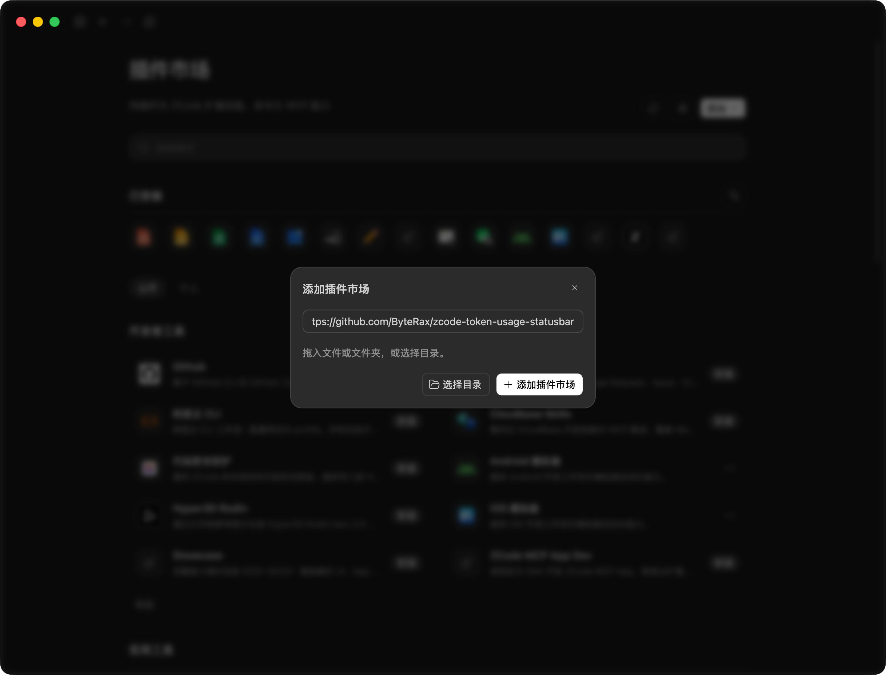
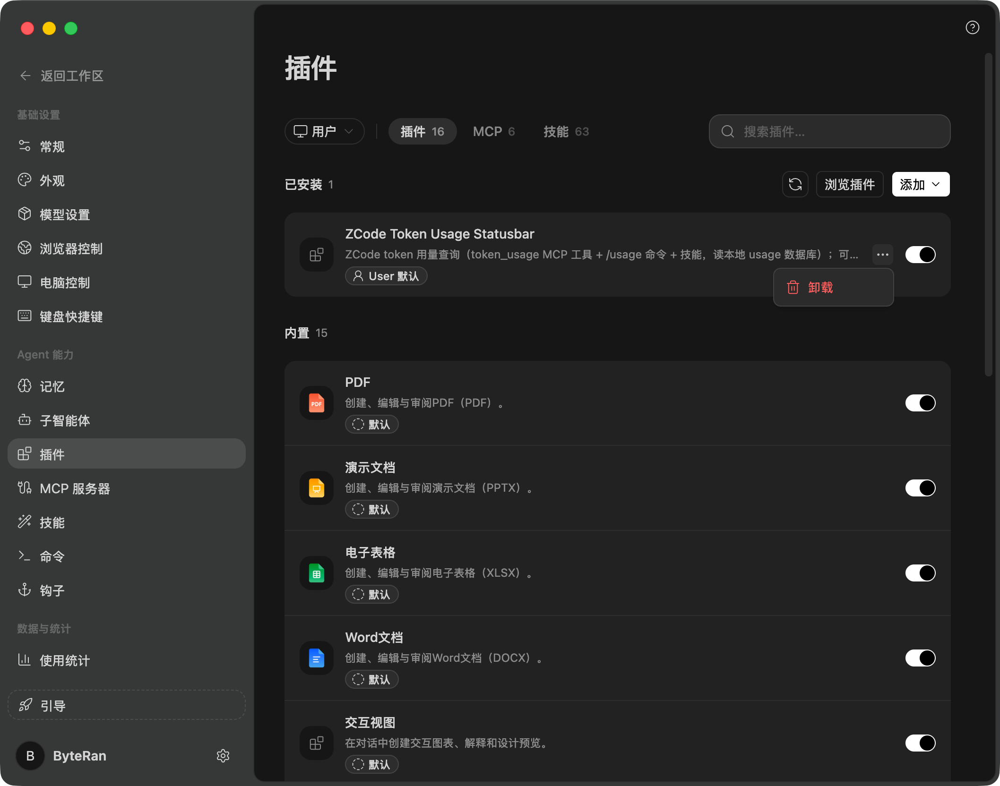

# 安装、配置与排查

[返回首页](../README.zh-CN.md) · [功能截图](features.md) · [开发与发布](maintaining.md)

这份文档面向需要自定义安装、远程查询或彻底清理的用户。日常使用通常不需要改配置文件。

> **当前正式版：** `#plugin-releases` 正式渠道（核对 2026-10-20：v1.5.2）默认自动安装/修复状态条；配置文件不存在或缺少字段时开启，已有显式 `false` 会保留。安装/修复会修改客户端 `app.asar`，请确认信任此项目；成功后需完全退出并重开。

## 选择安装方式

- **桌面客户端**：推荐通过 ZCode 插件安装，可选择远程市场或本地目录。插件管理查询、回答速率与更新，默认自动安装/修复状态条，成功后需完全退出并重开。也可以使用下方的一键安装器；两者共用运行目录与注入行，无需重复安装。
- **自托管网页**：按 [Web 版文档](../web/README.zh-CN.md) 部署，不能用桌面安装器给浏览器页面添加状态条。
- **官方云端网页**：本仓库的 Web 方案需要你控制服务器与 nginx，不适用于官方托管页面。

桌面版需要 Python 3.8+，不需要额外 Python 包。支持 Windows、macOS；Linux 系统级路径可能需要管理员权限，界面与发行版兼容性需自行验证。

## 插件安装

### 方式一：远程安装（无需下载源码）

通过客户端界面操作，无需系统 PATH 中有 `zcode`：

1. 打开 **设置 → 插件 → 添加插件市场**；某些版本入口在「发现」页的 **+**。
2. 输入 `https://github.com/ByteRax/zcode-token-usage-statusbar#plugin-releases`，添加市场。
3. 找到 **ZCode Token Usage Statusbar**，安装到用户范围并启用。

GitHub 访问受限时，第 2 步改用 GitCode 渠道地址（结尾 `.git` 不能省，本机需装有 Git）：

```text
https://gitcode.com/tanranran/zcode-token-usage-statusbar.git#plugin-releases-gitcode
```

两条渠道提供同一份经过校验的正式 Release；注册哪个地址，之后的版本检查和下载就在哪个渠道进行，⚙ 面板的「更新来源」会显示当前渠道。

此渠道从经过校验的正式 Release ZIP 安装插件，不跟随开发分支，也不需要自己下载源码。当前正式版默认自动安装/修复状态条；成功后完全退出并重开，已有显式关闭配置不会被改为开启。

### 方式二：本地目录安装

从 [ByteRax 仓库](https://github.com/ByteRax/zcode-token-usage-statusbar) 下载或克隆源码后：

1. 打开 **设置 → 插件 → 添加插件市场**，点击 **选择目录**。
2. 选择包含 `marketplace.json` 的仓库根目录（不是 `plugins/` 子目录），添加市场。
3. 找到 **ZCode Token Usage Statusbar**，安装到用户范围并启用。



### 安装状态条

安装插件后，按宿主提示加载插件，新建或恢复会话；已有会话不会补触发启动钩子。插件默认自动安装/修复状态条，**会修改客户端的 `app.asar`，请确认信任此项目。成功后必须完全退出并重新打开 ZCode**；只关闭窗口不一定退出主进程。

自动安装失败时，再手动执行以下兜底命令，按实际输出排查；成功后仍需完全退出并重开：

```text
/install-overlay
```

只需要查询工具与回答速率时，在 `~/.zcode/zcode-token-usage-statusbar/config.json` 中合并 `"plugin_auto_install_overlay": false`（保留其它设置），或运行 `/uninstall-overlay` 移除状态条并保留卸载豁免，阻止自动重注入与安装提醒。

配置文件不存在或缺少该字段时默认开启；已有的显式 `false` 会保留。环境变量 `ZUSAGE_PLUGIN_AUTO_INSTALL=1` / `0` 优先于配置，但不能绕过卸载豁免。未设置环境变量时，损坏配置或非布尔字段不会启用自动安装。

Windows 找不到 `python3` 时插件 hook 会自动回退：hook 命令按 `python3` → `python` → `py -3` 依次尝试，无需改文件。插件的 `.mcp.json` 仍固定 `python3`——宿主对 stdio MCP 是直接 spawn，没有 shell 回退通道，而 macOS 自带命令只有 `python3`，不能整体换成 `python`；需要在 Windows 会话里使用 `token_usage` MCP 工具的用户，可手工把安装副本 `.mcp.json` 的 `command` 改成本机可用的 Python 命令，注意插件每 24 小时自动更新可能覆盖此修改，只用状态条与 `/usage` 时无需处理；只改仓库不会改变已安装副本。

### 正式 Release 渠道

[`plugin-releases` 分支](https://github.com/ByteRax/zcode-token-usage-statusbar/tree/plugin-releases) 的市场清单指向当前正式 Release。新用户请在添加市场界面使用 `https://github.com/ByteRax/zcode-token-usage-statusbar#plugin-releases`，具体版本以该清单为准。

GitHub 访问受限时可注册 GitCode 镜像渠道 `https://gitcode.com/tanranran/zcode-token-usage-statusbar.git#plugin-releases-gitcode`：清单由同一份发布产物生成，ZIP 与 SHA256 和 GitHub Release 完全一致，版本检查、下载与安装全部在 GitCode 完成。该渠道要求本机装有 Git（宿主通过 git 拉取渠道清单）。

清单指向正式 ZIP，包含 SHA256 与插件子目录；下载时核对 Release manifest、版本与包内容，安装后再复核宿主安装记录与所选 Release 一致。后续正式版本仍需维护者同步发布渠道清单：Release 已发布而渠道清单尚未更新的几分钟内，宿主按旧清单安装不会前进到新版本，更新会报「插件管理器未提交新版安装记录」，稍后再点即可。

默认 `main` 的市场清单仍用于源码安装，本地目录也保持原用法；不要把正式渠道清单复制到自己的源码根目录。私有仓库认证下载和 GitHub/GitCode 之外的远端自动更新不支持。发布操作见 [维护文档](maintaining.md#发布插件)。

### 切换已有市场到正式渠道

市场名仍是 `zusage-marketplace`，但来源从默认分支/本地目录变为 `#plugin-releases`。**已安装用户不会自动切换，也不必为了添加分支卸载浮层。** 想迁移时：

1. 先关闭插件自动更新，等待正在进行的更新结束，记下现有市场来源。
2. 打开 **设置 → 插件 → 发现 → +（添加插件市场）**，填写 `https://github.com/ByteRax/zcode-token-usage-statusbar#plugin-releases`。通过市场管理确认并切换同名市场来源；不支持同名来源替换时，先移除旧市场注册再添加正式地址，**无需卸载插件或浮层**。
3. 在市场管理中确认 `zusage-marketplace` 指向新地址，来源的 `ref` 为 `plugin-releases`，再刷新市场并在插件页按需更新。不要只看到插件已安装就假定来源已切换。
4. 确认正式包可读取后，按自己的偏好开启自动更新。更新涉及主进程文件时，完全退出并重开 ZCode。

如果客户端版本不支持同名来源替换，可先移除旧市场注册再添加正式地址；**移除市场与卸载插件是不同操作**。不要执行卸载命令来替代来源迁移。

要从 GitHub 渠道迁到 GitCode 镜像渠道（或反向），用同样步骤把来源地址换成目标渠道即可；迁移前后插件版本相同，无需重装，迁移后 ⚙ 的「更新来源」显示新渠道即成功。

迁移操作须由你明确选择；本项目不会静默修改个人市场注册、删除设置或移动本地源码。

## 一键安装

不通过插件时，先安装 Python 和 Git，在系统终端执行：

```bash
git clone https://github.com/ByteRax/zcode-token-usage-statusbar.git
cd zcode-token-usage-statusbar
python install.py
```

macOS 可改用 `python3`。成功后完全退出并重开 ZCode；只关闭窗口不一定退出主进程。

安装器会定位客户端、复制运行文件、保留或生成设置、安装状态条、注册查询工具和 `/usage`。安装监控会提示重启并确认是否加载；Windows 文件被占用时，可能要退出后才完成替换。

### 找不到安装位置

推荐指定安装目录：

```bash
# Windows 示例
python install.py --root "D:\Apps\ZCode"

# macOS 示例
python3 install.py --root /Applications/ZCode.app
```

也可传 `--asar <app.asar 完整路径>` 或设置环境变量 `ZCODE_ASAR`。自动探测只采用确认属于 ZCode 的目标，首次安装后会保存位置；Windows 会依次探测用户目录、`%ProgramFiles%` 与各本地固定盘的 `Program Files\ZCode`、`<盘>:\ZCode` 等常见布局（如 `D:\Program Files\ZCode` 也能自动找到；网络盘和可移动盘不扫描，装在那里请用 `ZCODE_ASAR`）。

### 其它选项

| 选项 | 用途 |
|---|---|
| `--lang en` | 安装器、CLI 和查询报表使用英文 |
| `--no-mcp` | 只安装状态条，不再注册查询工具和 `/usage`；适合查询已由插件提供的情况 |
| `--dry-run` | 预览安装动作，不实际安装 |
| `--dev` | 开发模式，直接引用仓库文件；此时不能删除或移动仓库 |
| `--remove` | 移除注入、独立注册的查询工具、`/usage` 和运行目录；不等于卸载 ZCode 插件 |

## 更新与客户端升级

### 插件更新

正式渠道可在 ⚙ 检查或安装更新，也可以按以下步骤手动更新：

1. 远程安装无需更新本地源码；本地目录安装需先自行获取最新源码。
2. 打开 **设置 → 插件**，在市场管理中刷新 `zusage-marketplace`。
3. 到 **已安装** 更新 **ZCode Token Usage Statusbar**。
4. 新建或恢复会话；若提示主进程文件变化，再完全退出并重开 ZCode。

本地目录市场**不会执行 `git pull`**。ZCode 使用的是独立安装副本，修改仓库不等于完成插件更新。

状态条 **⚙ → 插件更新** 还提供「检查更新」「立即更新」和「自动更新」：

- **检查更新**不会安装；发现新版后可点「立即更新」。
- **自动更新默认开启**，首次运行检查，之后按 24 小时间隔检测与安装；你显式关闭的设置会保留。
- GitHub/GitCode 来源按市场清单分两条链：清单指向正式 Release ZIP（`#plugin-releases` / `#plugin-releases-gitcode`）时走 Release 校验链；清单指向仓库源码（默认分支）或本地目录时没有可校验的 Release，更新交给宿主插件管理器按市场清单直接完成（`marketplace update` → 插件更新），不经过发布包 SHA256 校验，⚙ 的「更新来源」会写明「仓库源码」或「本地目录市场」。新远程安装仍建议使用 `#plugin-releases`。
- GitCode 渠道的版本检查读宿主从注册 ref 拉取的渠道清单，ZIP 从 GitCode Release 资产下载并按 Release manifest 核对 SHA256，安装后复核安装记录与所选 Release 一致。
- 更新代码会访问已注册来源，不上传用量数据；来源错误或网络失败会显示原因。
- 只支持本插件的用户级安装；不会替你启用已禁用的插件。

自动或手动更新成功后，都需按提示重开会话或重启客户端。

### ZCode 升级后状态条消失

客户端升级可能覆盖 `app.asar`。插件默认在新建或恢复会话时自动修复，成功后仍需完全退出并重开 ZCode；自动修复失败时，再运行 `install-overlay` 或 `python install.py` 兜底。

只需要查询、不希望自动修改客户端时，在已有运行配置中设置：

```json
{
  "plugin_auto_install_overlay": false
}
```

只合并这一项，不要覆盖其它设置。它**默认开启**，缺配置文件或缺字段时启用，已有的显式 `false` 会保留；损坏或非布尔配置不会启用自动安装（环境变量另有设置时以其为准）。`ZUSAGE_PLUGIN_AUTO_INSTALL=1` / `0` 优先于配置，但不能绕过卸载豁免。它与 `plugin_auto_update` 是两个独立开关：关闭插件更新并不会关闭客户端自动安装/修复。

自动修复不会直接调用斜杠命令，而是在启动钩子中执行同一个安装器；`SessionStart` 覆盖新建和恢复会话（`startup|resume`），清空后新会话走 `startup`，不依赖独立 `clear` 事件。宿主 schema 接受 `clear`，但当前没有独立事件派发。

自动修复后仍需完全退出并再次启动 ZCode。插件会请求助手给出重启提醒，不会自行重启。插件未启用、启动钩子没触发、无写入权限或客户端结构不兼容时，自动修复不能保证成功。

卸载产生的 `.plugin-overlay-optout` 会阻止重注入；删除它表示恢复参与自动安装/提示，而不是立即执行安装。

### 源码安装的更新

```bash
git pull
python install.py
```

状态条脚本和查询库通常可热更新；主进程文件、首次注入或安装目录改变时需重启。已安装文件的本地手改会受到插件同步保护，未覆盖内容会提示，不应为了升级直接删除个人配置。

## 配置

优先用状态条的 **⚙** 调整。需要直接编辑时，默认位置是：

```text
~/.zcode/zcode-token-usage-statusbar/config.json
```

Windows 对应用户目录下的 `.zcode\zcode-token-usage-statusbar\config.json`。下面是常用设置示例，**只修改需要的字段，保留现有配置**：

```json
{
  "lang": "zh",
  "hot_reload": true,
  "answer_rate_line": true,
  "quota_enabled": false,
  "plugin_auto_update": true,
  "plugin_auto_install_overlay": true,
  "context_window": 1000000
}
```

| 字段 | 说明 |
|---|---|
| `lang` | `zh` / `en`，查询报表语言 |
| `python_path` | Python 可执行文件；安装器会设置，无法启动 Python 时检查 |
| `hot_reload` | 状态条脚本是否热更新 |
| `answer_rate_line` | 插件回答末尾的速率行，默认开，下一问生效 |
| `quota_enabled` | 套餐额度 chip（BigModel / Z.ai 个人编码套餐），默认关。建议用 ⚙ 面板开关而不是手改：开启后主进程读取凭据查询套餐/余额接口（仅内存使用、不落盘、不进日志与诊断）：内置套餐走 ZCode 登录凭据（bigmodel.cn / api.z.ai）；自定义供应商余额用其自己的 key，只发官方域（api.deepseek.com、openrouter.ai、api.siliconflow.cn、api.minimaxi.com、api.kimi.com、api.commandcode.ai、api.cline.bot、api.anthropic.com、platform.xiaomimimo.com、open.volcengineapi.com、opencode.ai 等）或你配置的中转站本域；⚙ 面板可为各数据源（MiniMax/Kimi/Cline/Anthropic/MiMo/火山/SCNet/OpenCode 等）单独配置凭据与开关（保存在运行目录 quota-secrets.json，0600）。套餐额度是账号级套餐池口径，不是单模型额度；BigModel 悬停还显示套餐名/版本与周期（自动续费显示"下次续费"，非自动续费显示"有效期至"；无法确认当前周期时不显示日期）；团队套餐暂不支持，识别不了余额形状的中转不显示 |
| `plugin_auto_update` | 插件自动更新，默认开；损坏或非布尔配置不会启动更新 |
| `plugin_auto_install_overlay` | 自动安装/修复客户端注入，默认开（缺配置或缺字段）；显式 false 保留，环境变量优先，卸载豁免仍阻止；无环境变量覆盖时损坏或非布尔配置不开启 |
| `context_window` | 自动识别失败时的上下文窗口大小兜底 |
| `resident` | 使用常驻 Python 查询进程，默认开 |
| `activity_min_ms` | 活跃期最小查询间隔，默认 1500ms |
| `heartbeat_ms` | 文件事件丢失时的兜底检查间隔，默认 30000ms |

配置是 JSON，不能直接粘贴带注释的示例。

## 远程会话

> 本节远端适配与恢复功能已随正式 Release 发布。本机必须加载当前安装副本与运行文件，完成状态条安装或修复后**完全退出并重启 ZCode**；只修改仓库不会更新已安装副本，只关闭窗口不算退出。

桌面连接 SSH 远端 ZCode 时，数据在远端。支持的是**桌面状态条的 JSON 查询链**，不是把所有命令都变成远端命令：MCP、`/usage` 和回答末尾速率不自动跨机，纯 CLI 没有状态条 UI，自托管 Web 仍按独立文档部署。

### 功能清单与身份边界

- **自动连接适配**：读取客户端保存的 SSH 工作区连接设置（默认 `~/.zcode/v2/setting.json` 的 `lastWorkspaceSession`），生成可用通道；结合宿主合法工作区 IPC 与本窗口会话证据取得 `workspaceIdentity`。
- **多服务器路由**：以会话 ID 和工作区身份共同选目标，不仅凭 ID、主机标签或远端最近活跃会话猜测。自动模式只查询已确认远端 scope，不对历史服务器试探本地未知会话 ID。手动目标用 `identity` 或 `identities` 绑定工作区，可覆盖同身份的自动目标。
- **独立 today/error**：各目标独立返回今日总量与错误，不能把某服务器的今日量混入本地或另一服务器；一台不可达不应中断其它来源查询。相同会话 ID 仍需按工作区/目标隔离。
- **失败与未知持续重试**：查询失败、远端暂未找到会话或尚无可信身份时不会永久放弃；已知远端 scope 保持退避重试，身份未知则等待合法身份重新出现，不盲发到其它服务器。
- **恢复与重连**：恢复历史会话、切换工作区或宿主 SSH 重连后，取得可靠身份才继续远端查询。这里的自恢复是**统计查询链恢复**，不是插件替宿主自动重连 SSH。身份广播依赖宿主功能与事件；晚加载且没有可信工作区证据时默认不猜测；归属歧义（如同 SID 多归属）时也不猜测。

**主面板归属**：主标签页（`workspace-main`）与各分栏按本窗口实际会话节点的 SID 和工作区身份路由，不从共享的 last-session、pane-layout 或工作台分组历史推断归属，因此其它窗口切换会话或清除记录不会改变本窗绑定。身份由版本、资产 SHA256 和唯一节点锚点校验的 renderer 补丁随宿主渲染更新；本窗可信 workspace IPC 与任务列表继续校验身份。节点身份缺失、协议不匹配或 SID 不一致时不借其它分栏或历史远端数据：无桥且本窗没有任何远端证据时按同 SID 的本地记录显示，否则显示零值。当前身份补丁已登记的客户端为 3.15.3、3.16.1、3.16.2；表外版本先经严格结构校验（唯一锚点、混淆名绑定与 store 形状）自动推导后补丁，校验不过则跳过并降级为数据库轮询。升级安装后需完全退出并重启客户端，旧补丁或未知构建不会启用共享记录回退。

明确分栏的工作区身份与 SID 组合仍可生成远端 scope；空 scope 则 fail-closed，不借同 SID 的远端快照。配置 `targets.identity` 只绑定查询目标，并不凭空证明主 pane 属于该工作区。

### 前置准备：远端脚本需手工部署

每台 SSH 远端需部署与本机匹配的 `zusage.py`，默认路径 `~/.zcode/zcode-token-usage-statusbar/zusage.py`。远端需要 Python 3.8+（含标准库 `sqlite3`），并让执行脚本的用户能读取其 ZCode 数据库。示例在**本机仓库目录**执行；请替换连接地址：

```bash
ssh user@server 'mkdir -p ~/.zcode/zcode-token-usage-statusbar'
scp zusage.py user@server:.zcode/zcode-token-usage-statusbar/zusage.py
ssh -o BatchMode=yes user@server 'python3 ~/.zcode/zcode-token-usage-statusbar/zusage.py today'
```

最后一条只验证远端脚本/数据库可读，不证明桌面身份路由或所有服务器已实机验收。自定义远端安装位置时设置 `remote.script`。远端查询带递归防护，无需在远端安装桌面状态条或再次启用远端转发。

本机查询通道必须免交互可用。插件**不能解密复用宿主保存的密码、加密私钥或口令**，不会自动登录或应答认证提示；请自行配置 SSH key/agent。自动生成的 SSH 通道使用 `BatchMode=yes`，不支持的凭据不会变成可用登录。自动适配不等于自动部署，不能承诺完全零配置。

### 自动模式与手动关闭

将需要的字段合并到运行配置，保留其它设置：

```json
{
  "remote": {
    "auto": true,
    "enabled": false,
    "script": "~/.zcode/zcode-token-usage-statusbar/zusage.py",
    "python": "python3",
    "timeout_s": 6,
    "poll_ms": 3000
  }
}
```

- `remote.auto` 缺省为 `true`，独立控制自动发现/身份路由。
- `remote.enabled: false` 保留为旧单通道/无身份 fallback 的手动关闭，不关闭已确认身份的自动路由。
- `remote.auto: false` 关闭自动发现；手动使用带身份的 `targets` 时需显式 `enabled: true`。
- 不再查询任何远端时，设置 `auto: false`、`enabled: false`；已有 `targets` 可保留而不会执行：

```json
{
  "remote": {
    "auto": false,
    "enabled": false
  }
}
```

### 多服务器：必须绑定工作区身份

下面示例中的身份字符串仅是格式示例。请从客户端连接工作区记录的 `workspaceIdentity` 复制实际值，必须与当前工作区完全匹配；不要只依据标签、主机名或目录自行猜值。

```json
{
  "remote": {
    "auto": true,
    "enabled": false,
    "script": "~/.zcode/zcode-token-usage-statusbar/zusage.py",
    "python": "python3",
    "timeout_s": 6,
    "poll_ms": 3000,
    "targets": [
      {
        "identity": "remote:ssh:build.example.com:22:alice:/srv/build",
        "ssh": "ssh alice@build.example.com",
        "host_label": "构建机"
      },
      {
        "identities": ["remote:ssh:gpu.example.com:2222:bob:/srv/gpu"],
        "ssh": ["ssh", "-i", "~/.ssh/id_ed25519", "-p", "2222", "bob@gpu.example.com"],
        "host_label": "GPU 机",
        "timeout_s": 6
      }
    ]
  }
}
```

`targets` 在自动模式或显式 `enabled: true` 时接收；`auto: false` 且 `enabled` 非 true 为总关闭。用 `identity` 绑定一个工作区，或用 `identities` 绑定同一目标的多个工作区。目标的 `script`、`python`、`timeout_s` 未设置时继承 `remote` 顶层值。多个目标不应争抢同一身份；不带身份的多机配置不能实现精准 route。

### 旧 CLI 单通道 fallback（显式开启，非桌面空 scope 兜底）

```json
{
  "remote": {
    "auto": false,
    "enabled": true,
    "ssh": "ssh user@server",
    "script": "~/.zcode/zcode-token-usage-statusbar/zusage.py",
    "python": "python3",
    "timeout_s": 6,
    "poll_ms": 3000,
    "host_label": "我的服务器"
  }
}
```

仅旧 CLI `python3 zusage.py json <SID>` 的 SID/逗号列表协议，在 `enabled: true` 时可使用 `remote.ssh` 或首个手动目标作为默认单通道 fallback。桌面始终发送 JSON 请求；显式 `scopes: []` 禁止 legacy fallback，即使 `enabled: true` 也不会把未知 main 借通道查成远端。桌面远端仍必须有可靠 scope，不猜历史身份。多服务器推荐上方带身份的配置。`ssh` 也可用 argv 数组指定其它免交互通道，例如 Docker `['docker', 'exec', '-i', '容器名']`、WSL `['wsl', '-d', '发行版']` 或 Kubernetes `['kubectl', 'exec', '-i', 'pod名', '--']`（写入 JSON 时改用双引号）。

### 刷新、恢复与排查

远端按 `poll_ms` 刷新，默认 3000ms、最少 1000ms，首次查询即建立续查定时器；本地仍以数据库写入事件触发。单目标 `timeout_s` 限制 1–6 秒，最多 4 个并行查询、整轮总预算 6 秒；配置更大值不能突破预算。失败或暂未找到会话持续退避重试，包括已确认远端 scope 尚未配置目标的情况；总关闭则停止远端轮询。

有效失败条目保留最近成功的同工作区快照并标为 stale/error；首次无缓存显示零值，不借本地今日量。null/error 响应不清空最近成功的显示，不代表取得成功新数据。不需要为了短暂断线反复安装状态条；宿主自身断线需先由宿主/用户恢复连接。配置或客户端连接设置变化、关闭后重新开启由心跳检测（默认 30000ms、最少 10000ms），不是修改文件后立即生效。

1. 确认本机确实加载新版安装副本且完全重启过。
2. 确认远端脚本、Python、数据库读取权限和免交互 SSH 命令可用；认证失败先修认证，不是重装插件。
3. 确认客户端当前会话 `workspaceIdentity` 与目标 `identity`/`identities` 匹配，并安装当前节点身份补丁后完全重启。主标签页与分栏按本窗实际会话节点绑定；未知版本/节点字段、SID 不一致、身份不可信或与任务列表矛盾时不借其它来源。partial 远端 IPC、共享 last-session 或历史分组不证明当前主 pane 归属，默认不猜测服务器。
4. 恢复连接后等待轮询与退避重试，再查看各目标独立的今日量和错误；暂未找到会话时先确认远端请求已入库。

协议使用 JSON 请求 `{sids, scopes: [{sid, workspaceIdentity}]}`，响应 `recent` 携带 `workspace_identity`；本机与远端脚本应同步更新，不能把旧版的无身份结果当作多服务器验证。自动化回归说明见 [测试文档](../tests/README.md#远端路由与恢复回归)。

## 查询与数据口径

### 对话内查询

一键安装和插件都使用裸名 `/usage`（不加插件名前缀）：

```text
/usage
/usage today
/usage week
/usage sessions
/usage workspace:项目目录关键词
```

MCP 工具 `token_usage(scope)` 还支持 `days:N`、`sessions:N`、`models:days` 和 `session:会话ID前缀`。

### 终端查询

在仓库根目录运行：

```bash
python zusage.py today
python zusage.py days 7
python zusage.py sessions 10
python zusage.py models 7
python zusage.py workspace 项目目录关键词
python zusage.py session 会话ID前缀
python zusage.py watch
```

`json` 子命令供自动化工具使用。

### 数据如何计算

- 数据来自 ZCode 本地 SQLite，主要随请求完成入库刷新，不是逐字速度或账单。
- 总用量为输入 + 输出；缓存读取已在输入内，不再重复相加。思考明细取决于供应商是否上报。
- 当前实现将思考视为已包含在输出中；有思考的请求从请求开始计算生成耗时，其它请求从首字开始计算，段间工具等待不计入。Claude 系列不单独上报思考 token，但思考同样在首字之前完成，因此也从请求开始计算；这样 Claude 的速度会包含首字前的等待，略低于纯生成速度，属于正常现象。
- 状态条速度看最近一段请求；回答速率行看当前提问已入库请求的加权速度，尚未入库的最终正文不在此次采样内。
- 上下文占比是最近请求输入量 ÷ 窗口容量，不是会话累计量 ÷ 容量；压缩后可能回落。
- 子智能体单独展示；工作区查询按父子关系合并，避免重复计算。会话移动到另一个工作区后，历史消耗归属可能随之变化。
- 状态条跟随各窗口的焦点会话；CLI/MCP 的 `current` 是查询库识别的近期活跃会话，不保证等同屏幕上当前窗口。
- 输入框工具行「电脑操作」按钮右侧的 Git 状态 chip（⚙「Git 状态」开关，默认开）是独立数据链：主进程每 10 秒、每轮回答后及点击时对本窗各 pane 的本地工作区目录运行 `git status --porcelain --branch` 与 `git diff HEAD --shortstat`（无提交仓库退回 `diff` + `diff --cached` 求和），+N/-N 为工作区相对 HEAD 的插入/删除行数合计（非净差异），?N 为未跟踪条目数。只读不写 index、不联网、不自动 fetch；远端 SSH 会话、非 git 目录、找不到 `git` 时不显示；查询失败保留最近成功结果并以「过期」文字徽章标注。与本地 token 统计互不推导。
- 工作区目录自身不是仓库（`git status` 判定非仓库，即祖先链上也无仓库）时，枚举**直接子目录**中的独立仓库（`.git` 目录或 worktree 链接文件均认，只扫一层、不递归）：0 个维持 chip 不显示；恰好 1 个对该子仓走完整单仓管线，tooltip「目录」行显示真实仓库路径；≥2 个进入多仓聚合，每仓只并行跑一条 `git status --porcelain --branch`（有界并发 6），不查行数。聚合 chip 形如 `▣ 24仓 · 6改`：「改」= 有未提交改动的**仓库数**（确认冲突的仓库包含在内）；确认冲突追加 `· !2冲突`（冲突**仓库数**）；部分仓库查询失败追加 `· 2失败` 且「改」带「已知」前缀；整体过期显示 `· 上次6改 · 过期`；全部干净只显示份数；窄屏紧凑模式隐藏份数、保留语义段。多仓 tooltip 分三段：概览（有改动仓库数、非零冲突/操作中/查询失败、条目汇总「已跟踪变更 X 项 · 未跟踪 Y 项」、数据不完整时的「已确认 22/24 个仓库」覆盖率行）；逐仓全量列表（行=仓库名+分支+状态标签：`!N 冲突`、操作名（变基/合并/拣选/还原/二分/补丁）、`过期`、`改 X 项`、`新 Y 项`、↑领先 ↓落后，按冲突 → 失败/过期 → 操作中 → 有改动 → 上游差异 → 干净排序，干净组前插「其余 N 个仓库，无本地改动」分隔行，悬停仓库名可见完整路径，超出屏幕滚动）；元信息（工作目录、更新时间 yyyy-MM-dd HH:mm:ss、口径）。失败仓保留最近成功快照并标「过期」，其冲突不汇总为已确认；刷新失败的时间不算更新时间。「改」的口径=已跟踪变更条目（新增/修改/删除/改名/冲突各算 1，部分暂存计 1 条），「新」=未跟踪条目（目录折叠计 1，文件与目录混合计数），与单仓 `+N/-N` 行数口径不同；单仓 tooltip 的已暂存/未暂存/未跟踪同为条目数。子仓库超过 32 个按仓库名排序（码点序、大小写敏感）只统计前 32 个，tooltip 注明「另有 N 个未统计」；远端 SSH 会话不显示与 ⚙ 开关同时管单仓/多仓两种形态的规则与原单仓一致。

更深入的数据库和性能说明见 [设计笔记](design-notes.md)。

## 排查

| 现象 | 先做什么 |
|---|---|
| 装插件后没有状态条 | 新建或恢复会话触发默认自动安装，成功后完全退出并重开；失败时用 `install-overlay` 兜底 |
| ZCode 升级后消失 | 新建或恢复会话触发默认自动修复，成功后完全退出并重开；检查配置与卸载豁免，失败时手动安装 |
| 新会话都是零 | 完成一次模型请求后再查看 |
| 远端会话没有数据 | 确认远程配置、远端脚本和非交互通道可用 |
| Python 启动失败 | 检查 Python 命令与 `python_path`；Windows 的命令可能叫 `python` |
| 说已更新但没有变化 | 确认安装的是缓存副本而非仅改了仓库；按提示重开会话或重启 |
| 卸载后又有目录 | 确认插件、自动更新和旧主进程已停止，再删除目录 |

在仓库目录可运行状态检查（不修改注入；已注入时可能生成临时语法检查文件并调用客户端可执行文件）：

```bash
python3 plugins/zcode-token-usage-statusbar/overlay_install.py check
python3 patch_install.py check
```

`patch_install.py` standalone 运行（不经 install.py/overlay_install.py 拉起）不会自动探测安装位置；非默认位置须传 `--asar <app.asar 完整路径>` 或设置环境变量 `ZCODE_ASAR`（命令行参数优先），否则会按平台默认位置猜测，猜错时报 `FileNotFoundError`。`install --finalize` 还须额外传 `--runtime <运行时目录>` 或设 `ZCODE_RUNTIME`：pending TMP 的 sidecar 记录了生成时的运行时目录，standalone 默认用脚本自身所在目录，插件安装的运行时数据目录通常不是同一个，不传会被来源授权校验拒绝；`remove`/`check` 不需要这个参数。收尾/卸载失败后的提示会给出带正确路径的完整命令，照着复制执行即可。

运行目录中的 `plugin-session-start.json` 是启动钩子诊断，`plugin-update.json` 是更新状态，`diag-*.json` 是窗口诊断。没有自然启动事件记录时，手动脚本成功不能证明钩子自动执行过；空闲时窗口诊断不持续更新并不等于故障。

## 彻底卸载

**先停用，再清理文件。不要只删除运行目录。** 自动更新或仍在运行的主进程可能重建文件。

1. 如果使用插件，在 ⚙ 关闭自动更新；没有状态条时在现有配置中设置 `plugin_auto_update: false`。等待已经开始的更新结束。
2. 在插件仍启用时执行 `/uninstall-overlay`，确认成功。这会移除注入并留下阻止重注入的标记。
3. 在 **设置 → 插件 → 已安装 → ZCode Token Usage Statusbar → ⋯ → 卸载**。这是卸载插件组件，不负责移除外部状态条与个人配置。
4. 完全退出并重开 ZCode，确认状态条消失。若此前也用一键安装器注册过 `/usage`，在插件卸载后运行 `python install.py --remove` 清理独立注册与运行目录，再重启确认。
5. 不再需要插件市场时，在设置里移除 `zusage-marketplace`。保留供其它插件使用的市场和目录，不要删除整个 `.zcode`。
6. 备份想保留的 `config.json`，检查并删除本项目残留。



插件已卸载才想起移除状态条？从仍保留的仓库执行：

```bash
python3 plugins/zcode-token-usage-statusbar/overlay_install.py remove
```

仅一键安装的用户直接执行 `python install.py --remove`，无需操作插件页。

### 需要检查哪些残留

以下为**默认位置**。ZCode 支持自定义 `storage.dir` / `ZCODE_STORAGE_DIR`，不要把默认路径当作全部安装的固定位置；按自己的设置查找。

- 客户端 `app.asar`：用 `patch_install.py check` 确认未注入，而不是删除该文件。
- 运行目录 `~/.zcode/zcode-token-usage-statusbar/`：脚本、个人设置、诊断与卸载标记。
- 插件缓存 `~/.zcode/cli/plugins/cache/zusage-marketplace/zcode-token-usage-statusbar/`：GUI 操作后检查是否残留，不要假定所有宿主版本都会清理同样的目录层级。
- 市场缓存 `~/.zcode/cli/plugins/marketplaces/zusage-marketplace/`：与市场注册分开检查，本地目录市场可能保留源码副本。
- 插件数据目录：按宿主显示的 `dataPath` 检查，不猜测固定子路径。
- 回答速率状态 `~/.zcode/zusage-rate.last-session.json` 及其 `.lock`：不在运行目录中，若保留过其它安装或多个会话，先确认没有继续使用它。
- 一键安装器的配置备份 `~/.zcode/cli/config.json.zusage.bak`：可能含完整客户端设置。只处理备份，**不要删除原 `config.json`**。
- `app.asar` 同目录的 `app.asar.zusage.tmp`、`.tmp.json`、`.lock` 和异常遗留的暂存文件：注入移除、所有相关进程退出后检查。成功卸载会清掉历史 `.bak`，但未知 TMP 可能保留用于排查；**不要手动把 TMP 覆盖回 app.asar**。
- 自行创建的卸载备份：保留与否由你决定。

文件清理请通过文件管理器逐项检查后删除。删除个人配置前先备份；运行目录只能在注入已移除、插件已卸载、旧进程已退出后删除。`installed_plugins.json`、`known_marketplaces.json` 是多插件共享库存，不应整文件删除。

### 卸载后确认

在仍保留的仓库运行：

```bash
python3 patch_install.py check
```

应显示未注入；然后确认：

- 插件页没有本插件的已安装条目。
- 状态条在完全重启后不再出现。
- 插件缓存和运行目录没有本项目残留（其它插件的市场父目录可能正常保留）。
- 不再使用该市场时，市场页已移除它，对应缓存也已清理。

不必为了卸载删除 `db.sqlite`；它是 ZCode 自己的用量与会话数据。

## sub2api 与余额查询支持范围

自定义供应商使用 sub2api 时，插件使用该配置的 key 在同源 `/v1/usage` 查询，无需后台管理密钥。订阅型数据展示日／周／月的用量、限额、剩余与已用比例；remaining 可能等于每日剩余，不能当充值余额。仅余额型响应才显示余额；重置时间只展示接口明确返回的字段。

OpenRouter 账户余额需设置 Management Key 或 `OPENROUTER_MANAGEMENT_KEY`；普通推理 key 不代表管理权限。SiliconFlow 返回 410 时表示接口已停用，不代表余额为零。其他厂商的发现条件、凭据依赖与实测程度见[额度支持审计矩阵](quota-support-audit.md)。

### 非默认 ZCode 数据目录

额度查询跟随宿主的 `ZCODE_DATA_BASE_DIR`，优先采用 `ZCODE_PERSONAL_PROVIDER_CONFIG_FILE` 与 `ZCODE_BUILTIN_PROVIDER_CONFIG_FILE` 指向的实际配置；凭据读取与文件监听使用同一实际目录。迁移数据后无需复制 key 回旧 HOME。个人配置只保存 key 而继承内置 baseUrl 的 MiniMax 规则同样可识别；不会按任意模型名称猜测查询地域。主进程文件改动需完全退出并重启客户端才生效。
